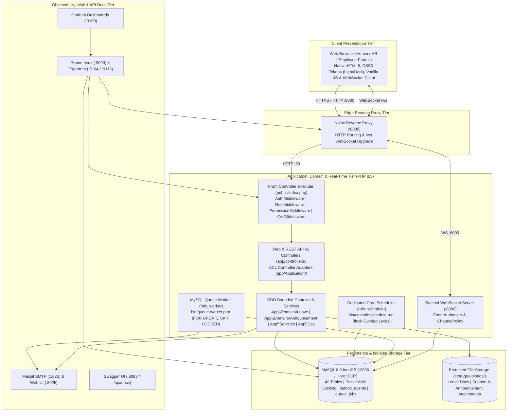
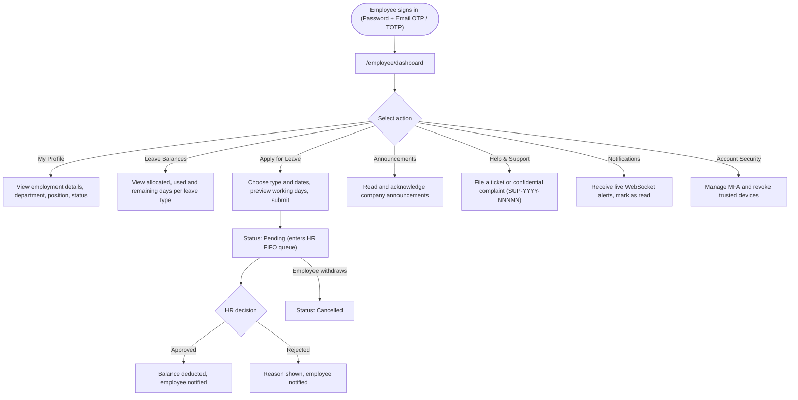
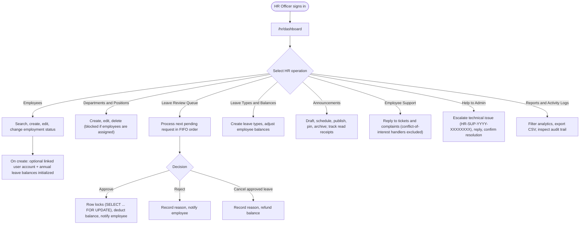
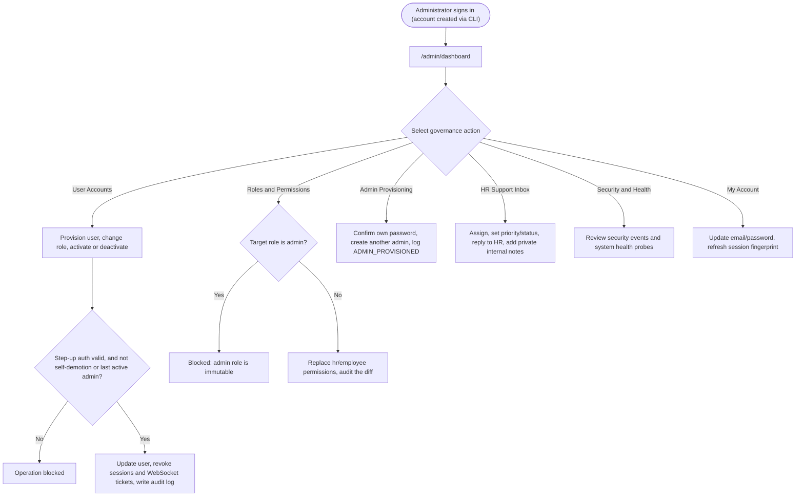
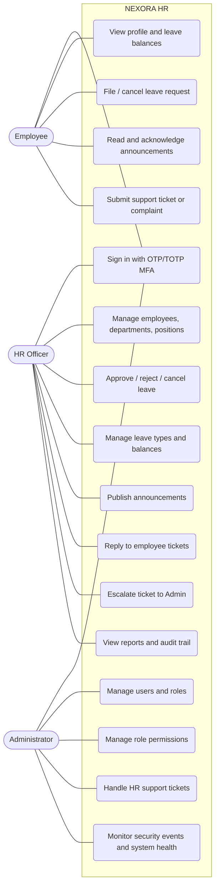
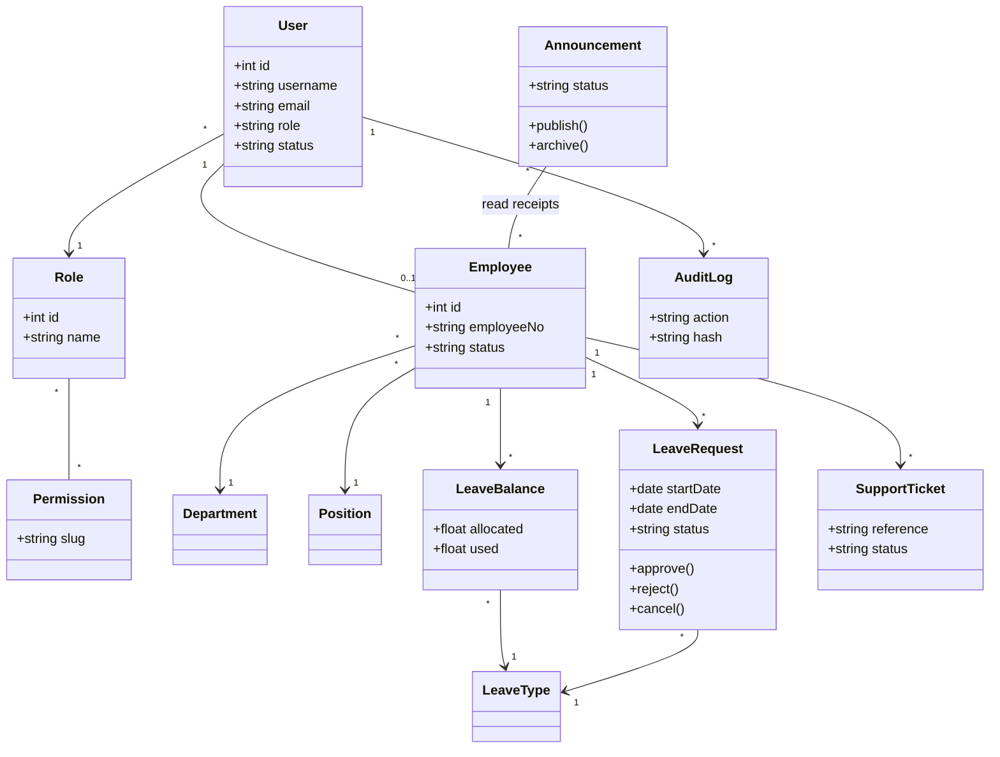
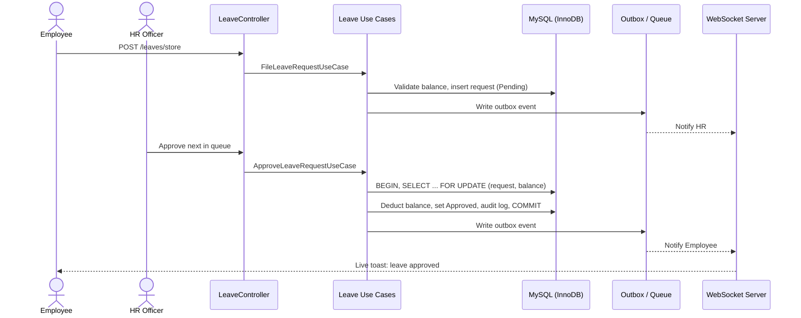
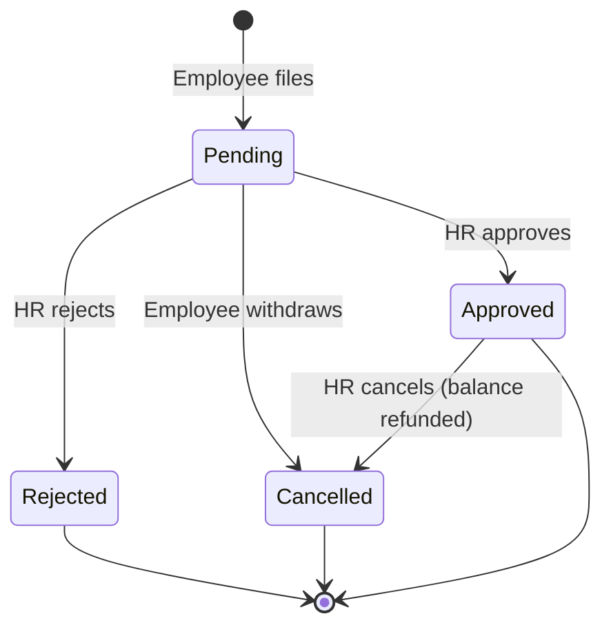

<div align="center">


# NEXORA HR — People. Processes. Progress.

**Enterprise Human Resource Information System (HRIS), Statutory Leave Engine &amp; DSA Workbench**

[](https://www.php.net/)
[-F59E0B.svg?style=flat-square&logo=mysql&logoColor=white)](https://www.mysql.com/)
[](docs/01-core/ARCHITECTURE.md)
[-16A34A.svg?style=flat-square)](docs/04-quality-assurance/testing-strategy.md)
[](docs/04-quality-assurance/testing-strategy.md)
[-16A34A.svg?style=flat-square)](e2e-tests/README.md)

[**Documentation Hub**](docs/README.md) &middot;
[**Architecture & Structure**](#-architecture--repository-structure) &middot;
[**User Manual**](docs/01-core/USER-MANUAL.md) &middot;
[**Quick-Start & CLI Commands**](#-quick-start-guide--essential-cli-commands) &middot;
[**Automated Tests**](#-running-automated-tests--quality-gates) &middot;
[**Defense Guide**](docs/06-defense/project-defense-guide.md)

</div>

<blockquote>
  <p align="justify">
    <strong>NEXORA HR</strong> (<em>People. Processes. Progress.</em>) is a production-grade Enterprise Human Resource Information System (HRIS), Statutory Leave Management Platform, and Data Structures &amp; Algorithms (DSA) Workbench engineered with native PHP 8.5, MySQL 8.0 (InnoDB), and Domain-Driven Design (DDD). Designed to unify organizational workforce operations with rigorous computer science fundamentals, the platform enforces a fail-closed, database-driven three-role access model (<code>admin</code>, <code>hr</code>, and <code>employee</code>) backed by 44 granular permissions, continuous session-state verification, and a SHA-256 hash-chained tamper-evident audit trail.
  </p>
  <p align="justify">
    Across its role-scoped workspaces, NEXORA HR delivers end-to-end employee lifecycle management, a Philippine statutory and company leave ledger protected by pessimistic row-level locking (<code>SELECT ... FOR UPDATE</code>), Smart Email OTP and RFC 6238 TOTP Multi-Factor Authentication with cryptographic trusted-device rotation, anti-enumeration password recovery, tokenized pre-login assistance (<code>AUTH-YYYY-NNNNN</code>), Employee-to-HR Help &amp; Support with conflict-of-interest-isolated confidential workplace complaints (<code>SUP-YYYY-NNNNN</code>), HR-to-Admin technical escalation ticketing (<code>HR-SUP-YYYY-XXXXXXXX</code>), and scheduled/targeted Company Announcements with employee read and acknowledgment receipts (<code>ANN-YYYY-XXXXXXXX</code>). Real-time notifications are broadcast in under 100ms via a Ratchet WebSocket server (:8090), Transactional Outbox, and MySQL-backed Queue Worker, orchestrated inside a multi-container Docker Compose stack with Nginx, Prometheus, Grafana, and OpenAPI 3.0 documentation.
  </p>
</blockquote>

---

<h2 align="center">📚 Authoritative Documentation Architecture</h2>

<p align="justify">
  <strong>NEXORA HR</strong> maintains a single-source-of-truth documentation suite organized into six numbered pillars inside <a href="docs/README.md"><code>docs/</code></a> (<code>01-core</code> through <code>06-defense</code>, plus machine-readable OpenAPI specifications and verified visual evidence):
</p>

<div align="center">
<table>
  <thead>
    <tr>
      <th align="center">Document</th>
      <th align="center">Purpose &amp; Description</th>
    </tr>
  </thead>
  <tbody>
    <tr>
      <td align="center"><strong><a href="docs/01-core/PRD.md">PRD.md</a></strong></td>
      <td align="justify">
        <strong>Product Requirements Document:</strong> Defines the executive product vision, three-role operational scope (<code>Admin</code>, <code>HR</code>, <code>Employee</code>), functional requirements (<code>FR-001</code>–<code>FR-016</code>), Philippine statutory and company leave rules, non-functional security/performance SLAs, and the verified Requirements Traceability Matrix (RTM).
      </td>
    </tr>
    <tr>
      <td align="center"><strong><a href="docs/01-core/ARCHITECTURE.md">ARCHITECTURE.md</a></strong></td>
      <td align="justify">
        <strong>System Architecture Specification:</strong> Documents the custom 4-tier MVC and Domain-Driven Design (DDD) bounded contexts, 49-table MySQL 8.0 InnoDB schema, pessimistic row-level concurrency locking (<code>SELECT ... FOR UPDATE</code>), Transactional Outbox WebSocket pipeline (:8090), Dedicated Cron Scheduler container, and MySQL Queue Worker.
      </td>
    </tr>
    <tr>
      <td align="center"><strong><a href="docs/01-core/USER-MANUAL.md">USER-MANUAL.md</a></strong></td>
      <td align="justify">
        <strong>Three-Role User Manual:</strong> Provides step-by-step operational guides for Administrators (<code>/admin/*</code>), HR Officers (<code>/hr/*</code>), and Employees (<code>/employee/*</code>) covering account provisioning, RBAC governance, leave filing and FIFO adjudication, multi-tier support ticketing, company announcements, and validation messages.
      </td>
    </tr>
    <tr>
      <td align="center"><strong><a href="docs/01-core/RULES.md">RULES.md</a></strong></td>
      <td align="justify">
        <strong>Engineering, Security &amp; AI Agent Rules:</strong> Enforces mandatory least-privilege boundaries under <code>ADR-012</code> and <code>ADR-013</code>, server-side ownership guards, CSRF and session-fingerprint protections, PSR-12 coding standards, database migration parity rules, and non-destructive operational guardrails.
      </td>
    </tr>
    <tr>
      <td align="center"><strong><a href="docs/01-core/DESIGN.md">DESIGN.md</a></strong></td>
      <td align="justify">
        <strong>UI/UX Design System:</strong> Establishes the Cobalt Blue and Deep Slate enterprise visual language, typography scale, 8px spatial grid, responsive App Shell, native <code>&lt;dialog&gt;</code> and semantic table patterns, Light/Dark Mode token parity, and WCAG 2.2 AA accessibility compliance.
      </td>
    </tr>
    <tr>
      <td align="center"><strong><a href="docs/01-core/TASK.md">TASK.md</a></strong></td>
      <td align="justify">
        <strong>Development Roadmap &amp; Milestone Tracker:</strong> Tracks engineering execution across Phases 1–16 and scope addenda (<code>v3.1</code>–<code>v3.3</code>), live quality gate metrics (<code>764</code> PHPUnit tests, <code>45</code> Selenium E2E tests, <code>0</code> PHPStan/PSR-12 regressions), and production release readiness.
      </td>
    </tr>
    <tr>
      <td align="center"><strong><a href="docs/01-core/MEMORY.md">MEMORY.md</a></strong></td>
      <td align="justify">
        <strong>AI Agent Context Primer:</strong> Supplies a high-density architectural reference map, core domain invariants, canonical file locations across MVC and DDD layers, database isolation rules (<code>hris_db</code> vs. <code>hris_test</code>), and essential CLI verification commands.
      </td>
    </tr>
    <tr>
      <td align="center"><strong><a href="docs/01-core/modules/">01-core/modules/</a></strong></td>
      <td align="justify">
        <strong>Feature &amp; Module Specifications:</strong> Contains dedicated specifications for <a href="docs/01-core/modules/announcements-management.md">Announcements Management</a>, <a href="docs/01-core/modules/employee-help-and-support.md">Employee Support &amp; Confidential Complaints</a>, <a href="docs/01-core/modules/hr-admin-help-and-support.md">HR-to-Admin Support</a>, <a href="docs/01-core/modules/smart-otp-trusted-devices.md">Smart OTP &amp; Trusted Devices</a>, and <a href="docs/01-core/modules/public-help-and-password-recovery.md">Public Help &amp; Password Recovery</a>.
      </td>
    </tr>
    <tr>
      <td align="center"><strong><a href="docs/README.md">docs/README.md</a></strong></td>
      <td align="justify">
        <strong>Unified Technical Documentation Hub:</strong> Serves as the master directory indexing all specialized architecture, database/ERD, UML, workflow flowcharts, custom DSA, security, REST API/OpenAPI, DevOps/Terraform, Prometheus/Grafana monitoring, QA benchmark, RBAC reference, and academic defense packages.
      </td>
    </tr>
  </tbody>
</table>
</div>

<h3 align="center">Priority Technical, QA &amp; Defense Guides</h3>

<ul>
  <li>
    <p align="justify">
      🏛️ <strong><a href="docs/02-technical/system-architecture.md">System Architecture &amp; Components</a></strong> (<code>docs/02-technical/system-architecture.md</code>): Details the verified multi-container Docker topology, 4-tier MVC and Clean/DDD bounded contexts (<code>Leave</code>, <code>Announcement</code>), Anti-Corruption Layer (ACL) controller adapters, and end-to-end HTTP and WebSocket request/data flows.
    </p>
  </li>
  <li>
    <p align="justify">
      📐 <strong><a href="docs/02-technical/uml-diagrams.md">UML Diagrams Catalog</a></strong> (<code>docs/02-technical/uml-diagrams.md</code>): Provides reconciled System Context, UML Use Case, Domain Class, Sequence, Activity, Lifecycle State Machine (Leave, Support, and Announcements), Component, and Container Deployment diagrams.
    </p>
  </li>
  <li>
    <p align="justify">
      🔄 <strong><a href="docs/02-technical/system-workflows.md">System Workflows &amp; Flowcharts</a></strong> (<code>docs/02-technical/system-workflows.md</code>): Traces step-by-step execution flowcharts for Smart OTP Authentication, Dynamic RBAC Governance, HR Workforce Operations, Statutory Leave Adjudication, DDD Announcements Distribution, Transactional Outbox &amp; Queue Worker, and the SHA-256 Tamper-Evident Audit Trail.
    </p>
  </li>
  <li>
    <p align="justify">
      🧮 <strong><a href="docs/02-technical/dsa-documentation.md">DSA Documentation &amp; Flowcharts</a></strong> (<code>docs/02-technical/dsa-documentation.md</code>): Documents the custom PHP Data Structures &amp; Algorithms implementations (Singly Linked List, FIFO Queue, LIFO Stack, Hash Table, Binary Search Tree, Merge/Quick/Insertion/Selection/Bubble Sort, and Binary/Linear Search) with pseudocode, Big-O time/space complexity matrices, and empirical benchmark charts.
    </p>
  </li>
  <li>
    <p align="justify">
      🔒 <strong><a href="docs/02-technical/security/security-architecture.md">Security &amp; Authentication Architecture</a></strong> (<code>docs/02-technical/security/</code>): Covers primary Bcrypt authentication, <a href="docs/02-technical/security/authentication-and-mfa-security.md">Email OTP &amp; RFC 6238 TOTP MFA</a>, HMAC-SHA256 rotating trusted-device cookies, anti-enumeration password recovery, session security fingerprinting, CSRF synchronization, and statutory confidentiality masking (RA 9262 VAWC &amp; RA 9710 SLW).
    </p>
  </li>
  <li>
    <p align="justify">
      🗄️ <strong><a href="docs/02-technical/database/database-schema.md">Database Architecture &amp; ERD</a></strong> (<code>docs/02-technical/database/database-schema.md</code>): Catalogs all 49 MySQL 8.0 InnoDB tables, the editable <a href="docs/02-technical/database/erd.mmd">Mermaid Entity-Relationship Diagram (<code>erd.mmd</code>)</a>, foreign key referential integrity, composite indexes, idempotent SQL migrations, and pessimistic row-level locking (<code>SELECT ... FOR UPDATE</code>).
    </p>
  </li>
  <li>
    <p align="justify">
      🔌 <strong><a href="docs/02-technical/api-reference.md">REST API v1 &amp; OpenAPI 3.0 Reference</a></strong> (<code>docs/02-technical/api-reference.md</code>): Documents the programmatic REST API v1 endpoints, standardized JSON envelopes, role/permission guards, and machine-readable OpenAPI 3.0 specifications (<a href="docs/api/openapi.yaml"><code>openapi.yaml</code></a> and <a href="docs/api/openapi.json"><code>openapi.json</code></a>).
    </p>
  </li>
  <li>
    <p align="justify">
      🧪 <strong><a href="docs/04-quality-assurance/test-plan-and-results.md">Quality Assurance, Testing Strategy &amp; Audit Reports</a></strong> (<code>docs/04-quality-assurance/</code>): Presents verified execution results across <code>764</code> PHPUnit tests (<code>4,078</code> assertions), <code>45</code> Selenium E2E browser tests, PHPStan static analysis, PSR-12 coding standard enforcement, the <a href="docs/04-quality-assurance/testing-strategy.md">Testing Strategy Guide</a>, and the <a href="docs/04-quality-assurance/functional-audit-report.md">Full-System Functional Audit Report</a>.
    </p>
  </li>
  <li>
    <p align="justify">
      ⚡ <strong><a href="docs/04-quality-assurance/performance-test-plan-and-results.md">Performance Test Plan &amp; Empirical Benchmarks</a></strong> (<code>docs/04-quality-assurance/performance-test-plan-and-results.md</code>): Reports reproducible latency percentiles (<code>avg</code>, <code>p50</code>, <code>p95</code>, <code>ops/sec</code>), algorithmic scaling comparisons across dataset sizes, and InnoDB query execution plan analysis.
    </p>
  </li>
  <li>
    <p align="justify">
      🚀 <strong><a href="docs/03-operations/deployment/installation-and-configuration-guide.md">Installation, Deployment, DevOps &amp; Monitoring</a></strong> (<code>docs/03-operations/</code>): Combines the complete setup guide, <a href="docs/03-operations/deployment/deployment-guide.md">Production Deployment Runbook</a>, <a href="docs/03-operations/deployment/production-readiness-checklist.md">18-Point Production Readiness Checklist</a>, <a href="docs/03-operations/devops/cron-scheduler-and-queue-worker.md">Cron Scheduler &amp; Queue Worker Guide</a>, and <a href="docs/03-operations/monitoring/README.md">Prometheus &amp; Grafana Observability Stack</a>.
    </p>
  </li>
  <li>
    <p align="justify">
      🎓 <strong><a href="docs/06-defense/project-defense-guide.md">Academic &amp; Technical Defense Package</a></strong> (<code>docs/06-defense/</code>): Equips presenters with the <a href="docs/06-defense/project-defense-guide.md">Project Defense Guide</a>, <a href="docs/06-defense/anticipated-questions.md">Anticipated Panel Q&amp;A Bank</a>, <a href="docs/06-defense/demonstration-script.md">15-Step Live Demonstration Script</a>, and <a href="docs/06-defense/presentation-outline.md">22-Slide Master Presentation Deck</a>.
    </p>
  </li>
</ul>

---

<h2 align="center">⚡ Core System Capabilities</h2>

<p align="justify">
  <strong>NEXORA HR</strong> unifies ten production-hardened engineering capabilities spanning identity security, organizational workforce management, statutory leave accounting, multi-tier support workflows, real-time event streaming, and algorithmic computation:
</p>

<ul>
  <li>
    <p align="justify">
      🛡️ <strong>Dynamic 3-Role RBAC &amp; Least-Privilege Governance (<code>ADR-012</code> / <code>ADR-013</code>):</strong> Enforces fail-closed, database-driven access control across three mutually exclusive roles—<strong>Administrator</strong> (<code>/admin/dashboard</code>, <code>/admin/users*</code>, <code>/admin/roles</code>, <code>/admin/support*</code>), <strong>HR Officer</strong> (<code>/hr/dashboard</code>, <code>/hr/employees*</code>, <code>/hr/announcements*</code>, <code>/hr/support*</code>, <code>/hr/help*</code>), and <strong>Employee</strong> (<code>/employee/dashboard</code>, <code>/employee/profile</code>, <code>/employee/announcements*</code>, <code>/support*</code>)—backed by 44 granular permissions in <code>Core\PermissionRegistry</code> and atomic role-permission auditing (<code>permission_audit_logs</code>).
    </p>
  </li>
  <li>
    <p align="justify">
      🔑 <strong>Controlled CLI Admin Bootstrapping &amp; Lockout Protection:</strong> Prohibits public Administrator registration; initial Admin accounts are provisioned exclusively via the hardened CLI utility (<code>bin/create_admin_user.php</code>) with Bcrypt cost-12 hashing, password complexity enforcement, and server-side guards that prevent self-demotion, self-deactivation, or deactivating the last active Administrator.
    </p>
  </li>
  <li>
    <p align="justify">
      🔐 <strong>Smart Email OTP, RFC 6238 TOTP MFA &amp; Trusted Devices:</strong> Combines 6-digit cryptographic Email OTP challenges and RFC 6238 TOTP authenticator support with single-use rotating HMAC-SHA256 trusted-browser cookies (<code>trusted_devices</code>), risk-based step-up verification (<code>AuthRiskService</code>), timing-equalized anti-enumeration password recovery, and self-service device revocation at <code>/account/security</code>.
    </p>
  </li>
  <li>
    <p align="justify">
      🔄 <strong>Continuous Live Session &amp; Account-State Verification:</strong> Executes <code>Session::verifyAuthenticatedAccountState()</code> on every authenticated HTTP request to verify that the user and linked employee record remain <code>Active</code>, validate cryptographic session fingerprints, synchronize department/position metadata in real time, and immediately terminate revoked or deactivated sessions.
    </p>
  </li>
  <li>
    <p align="justify">
      📅 <strong>Philippine Statutory &amp; Company Leave Engine:</strong> Supports Vacation Leave, Sick Leave, Emergency Leave, Service Incentive Leave (SIL), Expanded Maternity Leave (RA 11210), Paternity Leave (RA 8187), Solo Parent Leave (RA 8972), VAWC Leave (RA 9262), and Special Leave for Women (RA 9710) with versioned policy rules (<code>leave_policy_versions</code>), statutory qualification verification, confidential reason/document redaction, and automatic Monday–Friday business-day calculation.
    </p>
  </li>
  <li>
    <p align="justify">
      🔒 <strong>Pessimistic Concurrency Locking (<code>SELECT ... FOR UPDATE</code>):</strong> Processes leave adjudications through a FIFO approval queue inside atomic InnoDB transactions that acquire row-level locks on <code>leave_requests</code> and <code>leave_balances</code>, guaranteeing zero race conditions, double-deductions, or negative balance overdrafts under concurrent HR reviews.
    </p>
  </li>
  <li>
    <p align="justify">
      🎫 <strong>Multi-Tier Help, Support &amp; Confidential Complaints:</strong> Provides three isolated support channels—tokenized pre-login authentication assistance (<code>AUTH-YYYY-NNNNN</code>), Employee-to-HR Help &amp; Support and Confidential Workplace Complaints (<code>SUP-YYYY-NNNNN</code>) with automatic conflict-of-interest (COI) handler exclusions, and HR-to-Admin technical escalation ticketing (<code>HR-SUP-YYYY-XXXXXXXX</code>) with strict separation of private Admin internal notes.
    </p>
  </li>
  <li>
    <p align="justify">
      📢 <strong>DDD Company Announcements Management:</strong> Implements a dedicated Domain-Driven Design bounded context (<code>App\Domain\Announcement</code>) managing the complete announcement lifecycle (<code>Draft</code>, <code>Scheduled</code>, <code>Published</code>, <code>Expired</code>, <code>Archived</code>) with company-wide or department-targeted audiences, pinned notices, automated CRON publication and expiration (<code>process-announcements</code>), outside-web-root attachments, and idempotent employee read/acknowledgment receipts (<code>announcement_reads</code>).
    </p>
  </li>
  <li>
    <p align="justify">
      ⚡ <strong>Real-Time WebSockets, Outbox, Cron Scheduler &amp; Queue Worker:</strong> Delivers sub-100ms browser notifications over a Ratchet WebSocket server (<code>:8090</code>) authorized via single-use handshake tickets (<code>POST /realtime/ticket</code>), backed by a Transactional Outbox (<code>outbox_events</code>), a dedicated Docker Cron Scheduler (<code>hris_scheduler</code>), and a concurrency-safe <code>FOR UPDATE SKIP LOCKED</code> MySQL Queue Worker (<code>hris_worker</code>).
    </p>
  </li>
  <li>
    <p align="justify">
      🧮 <strong>Custom DSA Laboratory, SHA-256 Audit Chain &amp; OpenAPI Portal:</strong> Features native PHP implementations of Singly Linked Lists, FIFO Queues, LIFO Stacks, Hash Tables, Binary Search Trees, and Merge, Quick, Insertion, Selection, Bubble, Binary, and Linear Search algorithms alongside a SHA-256 hash-chained tamper-evident audit trail (<code>Core\AuditService</code>), Prometheus metrics (<code>/metrics</code>), and an interactive Swagger UI portal (<code>/docs</code>).
    </p>
  </li>
</ul>

---

<h2 id="-architecture--repository-structure" align="center">🏗️ Architecture &amp; Repository Structure</h2>

<p align="justify">
  <strong>NEXORA HR</strong> combines a custom native PHP 8.5 <strong>4-Tier MVC Architecture</strong> with <strong>Domain-Driven Design (DDD)</strong> bounded contexts (<code>Leave</code> and <code>Announcement</code>), an <strong>Anti-Corruption Layer (ACL)</strong> of controller adapters, and an asynchronous <strong>Transactional Outbox + MySQL Job Queue</strong> pipeline. Every HTTP and REST API v1 request passes through front-controller routing (<code>public/index.php</code>), fail-closed authentication and role/permission middleware (<code>core/</code>), and ACID-compliant MySQL 8.0 InnoDB persistence before emitting domain events to background workers and connected WebSocket clients.
</p>

<h3 align="center">System &amp; Container Architecture</h3>



<h3 align="center">Repository Directory Structure</h3>

```text
HRIS-SYSTEM/
├── app/                                        # Application, Domain, Infrastructure & MVC Layers
│   ├── Application/                            # DDD Application Layer (ACL Adapters, Commands, UseCases)
│   │   ├── Announcement/Adapters/              # AnnouncementControllerAdapter & OperationResult
│   │   └── Leave/                              # Leave Adapters, Commands & UseCases
│   ├── Console/                                # CLI Kernel, ScheduledTask & flock TaskLock
│   ├── controllers/                            # Web MVC Controllers & REST API v1 Controllers (Api/)
│   ├── Domain/                                 # Pure DDD Bounded Contexts (Entities, VOs, Events, Contracts)
│   │   ├── Announcement/                       # Announcement Aggregate Root, Value Objects & Domain Events
│   │   ├── Common/                             # Shared Domain Event Contracts & Dispatcher Interfaces
│   │   └── Leave/                              # Leave Aggregate Root, Value Objects & Domain Events
│   ├── dsa/                                    # Custom PHP Data Structures & Algorithms Engine
│   │   ├── algorithms/                         # Binary/Linear Search & Merge/Quick/Insertion/Selection/Bubble Sort
│   │   ├── arrays/                             # Array manipulation utilities
│   │   ├── benchmarks/                         # Instrumented algorithm runner, counter & dataset generator
│   │   └── structures/                         # LinkedList, Queue (FIFO), Stack (LIFO), HashTable, BST
│   ├── Infrastructure/                         # Concrete Persistence, Event Handlers & Transactional Outbox
│   │   ├── Database/                           # Transaction managers & database adapters
│   │   ├── Events/                             # EventBootstrap & post-commit domain event handlers
│   │   ├── Outbox/                             # MySqlOutboxRepository & OutboxEventSerializer
│   │   └── Persistence/                        # MySqlAnnouncementRepository & Leave repositories
│   ├── models/                                 # Active-Record / PDO Domain Models (User, Employee, Leave, Support)
│   ├── Queue/                                  # MySQL Job Queue Service, Worker, JobRegistry & Job Handlers
│   ├── realtime/                               # Ratchet WebSocket Server, EventAuthorizer & PdoRealtimeStore
│   ├── services/                               # Application Services (Auth, OTP, Leave, Support, Attachments)
│   └── views/                                  # Native PHP Views & Responsive Layouts (Admin, HR, Employee)
├── benchmarks/                                 # Empirical DSA Benchmark Runner & Generated SVG/CSV/JSON Reports
├── bin/                                        # CLI Binaries (migrate, console, queue-worker, create_admin_user)
├── config/                                     # Environment-backed Configuration (app, database, mail, auth, announcements)
├── core/                                       # Framework Core (Router, Database, Session, RBAC, AuditService, CSRF)
├── database/                                   # Canonical Schema (schema.sql), Seeds (seed.sql) & SQL Migrations
│   └── migrations/                             # Idempotent timestamped SQL migrations (2026_03 to 2026_11)
├── docker/                                     # Container Configs (Nginx, MySQL Init, Scheduler, Prometheus, Grafana)
├── docs/                                       # 6-Pillar Authoritative Documentation Hub & OpenAPI 3.0 Specs
│   ├── 01-core/                                # PRD, ARCHITECTURE, DESIGN, RULES, TASK, MEMORY, USER-MANUAL & modules/
│   ├── 02-technical/                           # Architecture, Database/ERD, Security, UML, Workflows, DSA & API
│   ├── 03-operations/                          # Deployment, DevOps, Cron/Queue, Prometheus/Grafana & Troubleshooting
│   ├── 04-quality-assurance/                   # Testing Strategy, QA Results, Performance Benchmarks & Functional Audit
│   ├── 05-reference/                           # Domain Glossary & 44-Permission RBAC Reference Matrices
│   ├── 06-defense/                             # Defense Guide, Q&A Bank, Demo Script & Presentation Outline
│   ├── api/                                    # Machine-readable OpenAPI 3.0 specs (openapi.yaml, openapi.json)
│   └── screenshots/                            # Verified Portal Captures & DSA Benchmark SVG Graphs
├── e2e-tests/                                  # Python Selenium WebDriver E2E Suite (Page Objects, Fixtures, 45 Tests)
├── public/                                     # Web Server Document Root (index.php Front Controller & Static Assets)
│   └── assets/                                 # Vanilla CSS3 Design System (css/), Progressive JS (js/) & Logos (img/)
├── scripts/                                    # Operational Scripts (DB Backup/Restore, Smoke Tests & Scheduled Cron Jobs)
├── storage/                                    # Protected Non-Public Storage (Uploads, Attachments, Logs & Task Locks)
├── terraform/                                  # Modular Infrastructure-as-Code (Network & Sandbox Modules, Dev/Prod Envs)
├── tests/                                      # PHPUnit Automated Test Suite (764 Unit, Integration & Feature Tests)
├── docker-compose.yml                          # Local 11-Container Development & Observability Orchestration
├── docker-compose.prod.yml                     # Hardened Production Container Orchestration
├── Dockerfile                                  # PHP 8.5 Apache Application & Worker Container Image Definition
├── Makefile                                    # Cross-Platform Developer Task Automation
├── phpcs.xml.dist                              # PSR-12 Coding Standard Ruleset
├── phpstan.neon.dist                           # PHPStan Static Analysis Configuration
└── phpunit.xml                                 # Isolated Test Suite Configuration (DB_DATABASE=hris_test)
```

<h3 align="center">Architectural Layer Breakdown</h3>

<div align="center">
<table>
  <thead>
    <tr>
      <th align="center">Directory / Layer</th>
      <th align="center">Architectural Responsibility &amp; Key Components</th>
    </tr>
  </thead>
  <tbody>
    <tr>
      <td align="center"><code>public/</code> &amp; <code>core/</code></td>
      <td align="justify">
        <strong>Front Controller, Routing &amp; Security Kernel:</strong> <code>public/index.php</code> dispatches every HTTP and REST API v1 request through <code>Core\Router</code>, enforcing <code>AuthMiddleware</code>, <code>RoleMiddleware</code>, <code>PermissionMiddleware</code>, <code>CsrfMiddleware</code>, continuous session verification (<code>Core\Session</code>), dynamic 44-permission evaluation (<code>Core\AuthorizationService</code>), and SHA-256 hash-chained audit logging (<code>Core\AuditService</code>).
      </td>
    </tr>
    <tr>
      <td align="center"><code>app/Domain/</code> &amp; <code>app/Application/</code></td>
      <td align="justify">
        <strong>DDD Bounded Contexts &amp; Anti-Corruption Layer (ACL):</strong> Encapsulates rich domain aggregates, value objects, domain exceptions, and domain events for <code>Leave</code> and <code>Announcement</code> workflows, bridged to web/API controllers through <code>LeaveControllerAdapter</code> and <code>AnnouncementControllerAdapter</code>.
      </td>
    </tr>
    <tr>
      <td align="center"><code>app/Infrastructure/</code> &amp; <code>app/models/</code></td>
      <td align="justify">
        <strong>Persistence, Transactional Outbox &amp; Domain Event Relay:</strong> Implements PDO/InnoDB repositories with prepared statements and pessimistic row locking (<code>SELECT ... FOR UPDATE</code>), persists domain events atomically into <code>outbox_events</code>, and dispatches post-commit handlers via <code>EventBootstrap</code>.
      </td>
    </tr>
    <tr>
      <td align="center"><code>app/Console/</code>, <code>app/Queue/</code> &amp; <code>app/realtime/</code></td>
      <td align="justify">
        <strong>Asynchronous Processing, Cron Scheduler &amp; WebSockets:</strong> Coordinates scheduled maintenance and lifecycle transitions via <code>App\Console\Kernel</code> (protected by non-blocking <code>flock</code> locks), processes background jobs via <code>App\Queue\QueueWorker</code> (<code>FOR UPDATE SKIP LOCKED</code>), and streams real-time events via the Ratchet WebSocket server (<code>:8090</code>).
      </td>
    </tr>
    <tr>
      <td align="center"><code>app/dsa/</code> &amp; <code>benchmarks/</code></td>
      <td align="justify">
        <strong>Custom Data Structures &amp; Algorithms Workbench:</strong> Houses from-scratch PHP implementations of <code>LinkedList</code>, <code>Queue</code>, <code>Stack</code>, <code>HashTable</code>, <code>BinarySearchTree</code>, and seven sorting/searching algorithms with operation counters and automated SVG/CSV/JSON benchmark generation.
      </td>
    </tr>
    <tr>
      <td align="center"><code>database/</code> &amp; <code>storage/</code></td>
      <td align="justify">
        <strong>Relational Schema, Migrations &amp; Isolated File Storage:</strong> Maintains strict schema parity between <code>database/schema.sql</code>, <code>docker/mysql/init/01-schema.sql</code>, and timestamped migrations in <code>database/migrations/</code>, while storing sensitive leave, support, and announcement attachments outside the public web root in <code>storage/uploads/</code>.
      </td>
    </tr>
    <tr>
      <td align="center"><code>tests/</code> &amp; <code>e2e-tests/</code></td>
      <td align="justify">
        <strong>Multi-Layer Automated Verification:</strong> Combines <code>764</code> PHPUnit unit, integration, and feature/security tests in <code>tests/</code> (isolated against <code>hris_test</code>) with <code>45</code> Python Selenium browser automation tests in <code>e2e-tests/</code> verifying desktop, mobile (<code>390x844</code>), and Light/Dark Mode workflows.
      </td>
    </tr>
  </tbody>
</table>
</div>

---

<h2 id="-role-workflows--uml-diagrams" align="center">🔄 Role Workflows &amp; UML Diagrams</h2>

<p align="justify">
  This section summarizes how each of the three roles (<strong>Employee</strong>, <strong>HR Officer</strong>, <strong>Administrator</strong>) uses the system, followed by UML diagrams of the shared model. Full catalogs are in <a href="docs/02-technical/system-workflows.md">System Workflows</a> and <a href="docs/02-technical/uml-diagrams.md">UML Diagrams</a>.
</p>

### Employee Workflow (`/employee/*`)



### HR Officer Workflow (`/hr/*`)



### Administrator Workflow (`/admin/*`)



### UML Use Case Diagram



### UML Class Diagram (Simplified)



### UML Sequence Diagram: Leave Filing and Approval



### UML State Diagram: Leave Request



---

<h2 id="-quick-start-guide--essential-cli-commands" align="center">🚀 Quick-Start Guide &amp; Essential CLI Commands</h2>

<p align="justify">
  The recommended way to run <strong>NEXORA HR</strong> with its complete 11-container infrastructure (Nginx reverse proxy, PHP 8.5/Apache runtime, MySQL 8.0 InnoDB, Ratchet WebSocket server, Dedicated Cron Scheduler, Queue Worker, Mailpit SMTP, Swagger UI, phpMyAdmin, Prometheus, and Grafana) is via Docker Compose:
</p>

```bash
# ==============================================================================
# 1. Clone Repository & Configure Environment
# ==============================================================================
git clone https://github.com/JeriStack/HRIS-SYSTEM.git
cd HRIS-SYSTEM
cp .env.docker.example .env

# ==============================================================================
# 2. Build & Start Full Multi-Container Stack
# ==============================================================================
docker compose up -d --build
docker compose ps

# Follow live logs across web app, cron scheduler, queue worker, and WebSockets
docker compose logs -f app scheduler worker realtime

# Stop containers safely (preserves persistent MySQL db_data volume)
docker compose down

# ==============================================================================
# 3. Database Migrations & Controlled Role Provisioning (CLI)
# ==============================================================================
# Apply all pending idempotent SQL migrations (database/migrations/*.sql)
docker compose exec app php bin/migrate.php

# Bootstrap or promote a System Administrator account (CLI-only guard)
docker compose exec app php bin/create_admin_user.php \
  --username=admin \
  --email=admin@company.local \
  --password="Admin@Password123!"

# Provision an additional HR Officer account via CLI
docker compose exec app php bin/create_hr_user.php \
  --username=hr02 \
  --email=hr02@company.local \
  --password="Hr@Password123!"

# ==============================================================================
# 4. Scheduled Tasks (Cron Kernel), Queue Worker & Outbox Daemons
# ==============================================================================
# List all registered cron tasks (cleanup-sessions, process-notifications,
# process-announcements, send-leave-reminders, cleanup-temp-files)
docker compose exec app php bin/console schedule:list

# Manually trigger all due scheduled tasks (with flock overlap protection)
docker compose exec app php bin/console schedule:run

# Inspect real-time MySQL job queue health (pending, reserved, failed_jobs)
docker compose exec app php bin/console queue:status

# Process pending background jobs once and exit (or run continuous daemon)
docker compose exec app php bin/console queue:work --once
docker compose exec app php bin/queue-worker.php --sleep=2 --lease=300 --max-runtime=3600

# Retry a failed dead-letter job by ID
docker compose exec app php bin/console queue:retry 1

# Relay pending transactional outbox events & verify WebSocket daemon health
docker compose exec app php bin/outbox-worker.php --once
docker compose exec app php bin/realtime-healthcheck.php

# ==============================================================================
# 5. Leave Accrual, OpenAPI Docs, DSA Benchmarks, SMTP & Database Backups
# ==============================================================================
# Preview or execute annual leave quota initialization / accrual
docker compose exec app php bin/accrue-leave.php --dry-run
docker compose exec app php bin/accrue-leave.php

# Regenerate OpenAPI 3.0 YAML & JSON specifications (docs/api/openapi.*)
docker compose exec app composer swagger:generate

# Verify SMTP / Mailpit email transport and OTP delivery
docker compose exec app php bin/test_smtp.php

# Run empirical Data Structures & Algorithms (DSA) benchmark suite
docker compose exec app php benchmarks/run.php

# Create or restore SHA-256 checksummed MySQL backups
powershell -ExecutionPolicy Bypass -File scripts/backup/backup-db.ps1
bash scripts/backup/backup-db.sh
bash scripts/restore/restore-db.sh backups/<backup_file>.sql.gz

# ==============================================================================
# 6. GNU Makefile Task Shortcuts
# ==============================================================================
make help       # Display all available automation targets
make up         # Start all Docker services in the background
make migrate    # Run pending database migrations inside the app container
make test       # Execute the full PHPUnit test suite
make lint       # Run PSR-12 baseline check and PHPStan static analysis
make e2e        # Execute headless Selenium E2E browser suite
make clean      # Safely purge disposable test caches and temporary reports
```

<h3 align="center">Accessing Local Services</h3>

<div align="center">
<table>
  <thead>
    <tr>
      <th align="center">Service / Interface</th>
      <th align="center">Local URL</th>
      <th align="center">Portal Routes &amp; Default Credentials</th>
    </tr>
  </thead>
  <tbody>
    <tr>
      <td align="center"><strong>NEXORA HR Web App</strong></td>
      <td align="center"><a href="http://localhost:8080"><code>http://localhost:8080</code></a></td>
      <td align="justify">Role Portals: <code>/admin/dashboard</code>, <code>/hr/dashboard</code>, <code>/employee/dashboard</code> (Prometheus metrics at <code>/metrics</code>)</td>
    </tr>
    <tr>
      <td align="center"><strong>Mailpit (Local SMTP / OTP)</strong></td>
      <td align="center"><a href="http://localhost:8025"><code>http://localhost:8025</code></a></td>
      <td align="justify">Captures all outgoing 6-digit Email OTP verification codes, password reset links, and support notifications</td>
    </tr>
    <tr>
      <td align="center"><strong>Swagger UI (OpenAPI 3.0)</strong></td>
      <td align="center"><a href="http://localhost:8083"><code>http://localhost:8083</code></a></td>
      <td align="justify">Interactive REST API v1 explorer (also served in-app at <a href="http://localhost:8080/api/docs"><code>http://localhost:8080/api/docs</code></a>)</td>
    </tr>
    <tr>
      <td align="center"><strong>phpMyAdmin</strong></td>
      <td align="center"><a href="http://localhost:8081"><code>http://localhost:8081</code></a></td>
      <td align="justify">Host: <code>db</code> &middot; User: <code>root</code> &middot; Password: <code>rootpassword</code> (Direct MySQL port: <code>127.0.0.1:3307</code>)</td>
    </tr>
    <tr>
      <td align="center"><strong>Prometheus Telemetry</strong></td>
      <td align="center"><a href="http://localhost:9090"><code>http://localhost:9090</code></a></td>
      <td align="justify">Scrapes application <code>/metrics</code>, <code>nginx-exporter (:9113)</code>, and <code>mysqld-exporter (:9104)</code></td>
    </tr>
    <tr>
      <td align="center"><strong>Grafana Dashboards</strong></td>
      <td align="center"><a href="http://localhost:3100"><code>http://localhost:3100</code></a></td>
      <td align="justify">Pre-provisioned HRIS observability dashboards &middot; Default login: <code>admin</code> / <code>admin</code></td>
    </tr>
  </tbody>
</table>
</div>

<h3 align="center">Pre-Seeded &amp; Bootstrapped Accounts</h3>

<div align="center">
<table>
  <thead>
    <tr>
      <th align="center">Account Email / Username</th>
      <th align="center">Role</th>
      <th align="center">Default Password</th>
      <th align="center">Target Workspace</th>
    </tr>
  </thead>
  <tbody>
    <tr>
      <td align="center"><code>admin@company.local</code> (<code>admin</code>)</td>
      <td align="center">Administrator (<code>admin</code>)</td>
      <td align="center"><em>Provisioned via <code>bin/create_admin_user.php</code></em></td>
      <td align="center"><code>/admin/dashboard</code></td>
    </tr>
    <tr>
      <td align="center"><code>marcus.tan@company.local</code> (<code>hr01</code>)</td>
      <td align="center">Human Resources (<code>hr</code>)</td>
      <td align="center"><code>Admin@123</code></td>
      <td align="center"><code>/hr/dashboard</code></td>
    </tr>
    <tr>
      <td align="center"><code>sofia.reyes@company.local</code> (<code>emp003</code>)</td>
      <td align="center">Human Resources (<code>hr</code>)</td>
      <td align="center"><code>Admin@123</code></td>
      <td align="center"><code>/hr/dashboard</code></td>
    </tr>
    <tr>
      <td align="center"><code>david.cruz@company.local</code> (<code>emp004</code>)</td>
      <td align="center">Employee (<code>employee</code>)</td>
      <td align="center"><code>Employee@123</code></td>
      <td align="center"><code>/employee/dashboard</code></td>
    </tr>
    <tr>
      <td align="center"><code>maria.santos@company.local</code> (<code>emp002</code>)</td>
      <td align="center">Employee (<code>employee</code>)</td>
      <td align="center"><code>Employee@123</code></td>
      <td align="center"><code>/employee/dashboard</code></td>
    </tr>
  </tbody>
</table>
</div>

<p align="center">
  <em><strong>Note:</strong> During sign-in, retrieve your 6-digit Email OTP verification code from the local Mailpit inbox at <a href="http://localhost:8025"><code>http://localhost:8025</code></a>.</em>
</p>

---

<h2 id="-running-automated-tests--quality-gates" align="center">🧪 Running Automated Tests &amp; Quality Gates</h2>

### 1. PHPUnit Automated Test Suite (764 Tests)
```bash
# Execute the full unit, integration, and feature test suite (against hris_test)
php vendor/bin/phpunit

# Run specific test suites (Domain Unit, Integration, or Feature/RBAC)
php vendor/bin/phpunit tests/Unit
php vendor/bin/phpunit tests/Integration
php vendor/bin/phpunit tests/Feature

# Run with readable testdox output and display warnings
php vendor/bin/phpunit --testdox --display-warnings
```

<div align="center">
  <table>
    <tr>
      <td align="center">
        ✅ <kbd><strong>Current Verified Result: 764 tests, 4,078 assertions, 0 errors, 0 failures (100% pass rate).</strong></kbd>
      </td>
    </tr>
  </table>
</div>

### 2. PSR-12 Code Style &amp; PHPStan Static Analysis
```bash
# Run both PSR-12 baseline verification and PHPStan static analysis
composer lint

# Or run each quality gate individually
php bin/check-phpcs-baseline.php
php vendor/bin/phpstan analyse --memory-limit=512M --no-progress
```

<div align="center">
  <table>
    <tr>
      <td align="center">
        🛡️ <kbd><strong>Requirement: Must introduce 0 new PSR-12 violations against the project baseline and 0 PHPStan errors.</strong></kbd>
      </td>
    </tr>
  </table>
</div>

### 3. Selenium End-to-End Browser Automation (45 Tests)
```powershell
# Activate the E2E virtual environment and run the full browser suite
cd e2e-tests
python -m venv .venv
.\.venv\Scripts\Activate.ps1
pip install -r requirements.txt

# Run all 45 E2E tests in headless mode and generate self-contained HTML report
pytest tests/ -v --headless

# Filter E2E tests by registered pytest markers (smoke, auth, rbac, leave, support, announcements)
pytest tests/ -m "announcements" -v --headless
pytest tests/ -m "support" -v --headless
pytest tests/ -m "smoke" -v --headless
```

---

<h2 align="center">📄 License &amp; Attribution</h2>

<p align="justify">
  <strong>NEXORA HR</strong> is engineered and maintained as an enterprise Human Resource Information System (HRIS), statutory leave management platform, and Data Structures &amp; Algorithms (DSA) engineering workbench. Distributed under the terms of the <a href="LICENSE">MIT License</a>.
</p>
