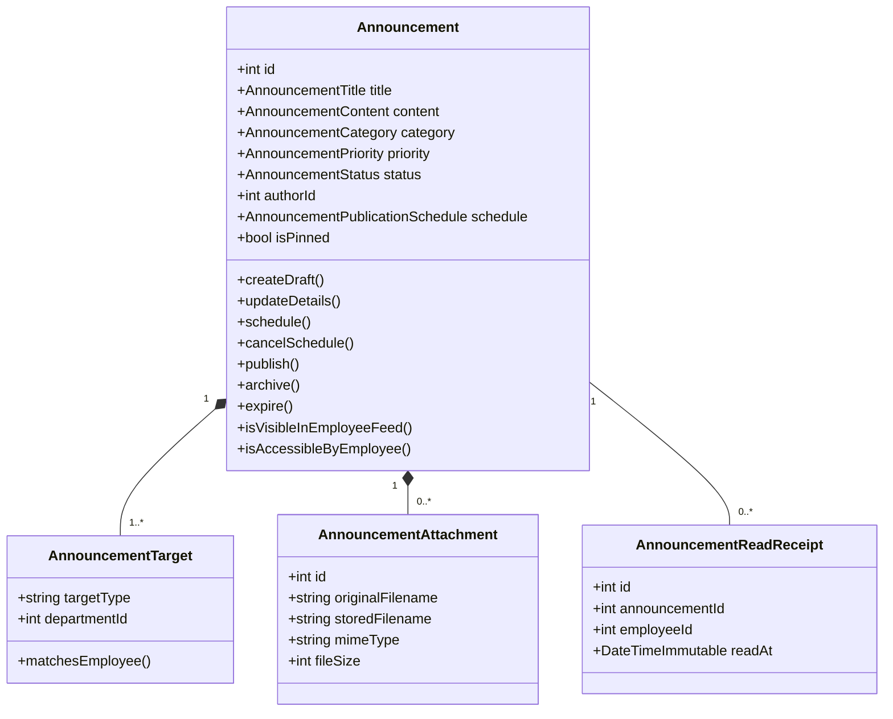
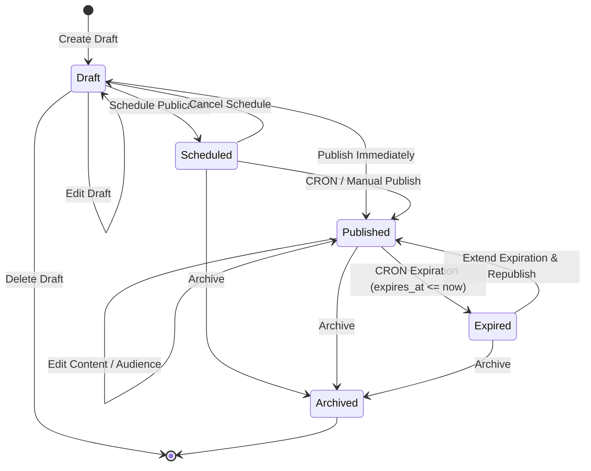
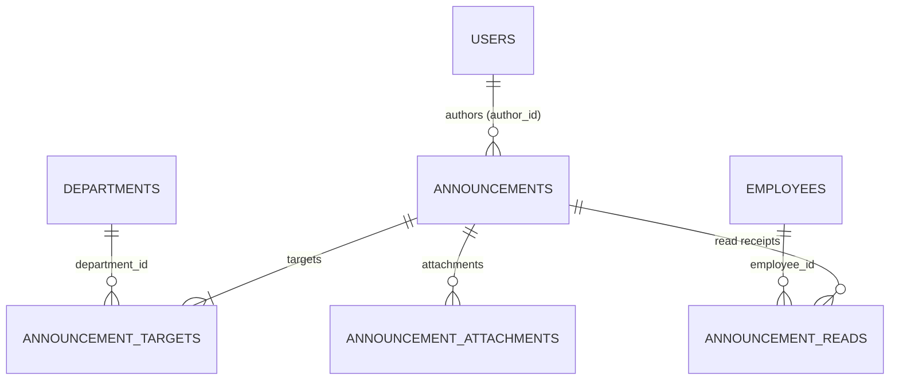
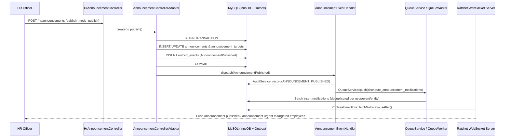

# HR Announcements Management System — Authoritative Specification

**Module:** Announcements Management  
**Primary Users:** HR and Employee  
**System Administrator:** Admin (Explicit Permission Governance)  
**Architecture:** Domain-Driven Design (DDD), Anti-Corruption Layer (ACL), Transactional Outbox, Queue Worker & Real-Time WebSockets

---

## 1. Functional Requirements & Bounded Context

The **Announcements Management** bounded context (`App\Domain\Announcement`, `App\Application\Announcement`, `App\Infrastructure\Persistence\Announcement`) provides centralized creation, scheduling, publication, audience targeting, employee distribution, read-receipt tracking, expiration, and archiving of official organizational communications.

### Core Capabilities
1. **HR Announcement Management (`/hr/announcements*`):**
   - Create announcements and save unpublished drafts (`Draft` status never triggers employee notifications or appears in employee feeds).
   - Classify announcements across 8 official categories: `General Announcement`, `Company Updates`, `HR Policy Updates`, `Leave and Benefits`, `Events and Activities`, `Office Operations`, `Emergency Advisory`, and `Other`.
   - Assign priority levels: `Normal`, `Important`, and `Urgent`, plus optional pinning (`is_pinned`).
   - Target audiences: `all` active employees or selected verified `department` records.
   - Publish immediately or schedule future publication (`scheduled_at`) with optional expiration (`expires_at`).
   - Cancel scheduled publication (reverting to `Draft`), archive announcements (`Archived`), or delete unpublished drafts.
   - View audience engagement and read statistics (`total_targeted`, `total_read`, `total_unread`, `read_percentage`) and paginated individual employee read receipts.
2. **Employee Announcement Experience (`/employee/announcements*` & Dashboard Preview):**
   - View up to 3 recent targeted announcements on the Employee Dashboard (prioritizing pinned and `Urgent`/`Important` items) **without** marking them as read on preview.
   - Browse the full Employee Announcement Feed with unread indicators, pinned & priority badges, category filter, search, and attachment indicators.
   - Open full announcement details (`GET /employee/announcements/{id}`), which idempotently records the employee's first read receipt (`UNIQUE (announcement_id, employee_id)`).
   - Download authorized supporting attachments stored in non-public storage (`storage/uploads/announcement_attachments/`).

---

## 2. Domain Model & Invariants

---

## 3. Announcement Lifecycle Diagram

---

## 4. Database Entity-Relationship Diagram (ERD)

---

## 5. Use Case & Activity Workflows

### 5.1 Event-Driven Publication & Queue Notification Flow

---

## 6. Role & Permission Matrix (Announcements Module)

| Permission Slug | Capability | Admin (Default) | HR (Default) | Employee (Default) |
|---|---|---|---|---|
| `announcements.view` | View HR Announcements Management | Explicit only | Granted | Denied |
| `announcements.create` | Create Announcements & Save Drafts | Explicit only | Granted | Denied |
| `announcements.edit_own` | Edit Own Authored Announcements | Explicit only | Granted | Denied |
| `announcements.publish` | Publish Own Announcements | Explicit only | Granted | Denied |
| `announcements.schedule` | Schedule / Cancel Schedule (Own) | Explicit only | Granted | Denied |
| `announcements.archive` | Archive Own Announcements | Explicit only | Granted | Denied |
| `announcements.delete_draft` | Delete Own Unpublished Drafts | Explicit only | Granted | Denied |
| `announcements.stats_own` | View Read Statistics & Receipts (Own) | Explicit only | Granted | Denied |
| `announcements.manage_all` | Modify Announcements of Other HR Authors | Explicit only | Explicit only | Denied |
| `announcements.stats_all` | View Read Statistics of All HR Authors | Explicit only | Explicit only | Denied |
| `announcements.feed` | View Targeted Employee Feed & Record Read Receipts | Denied | Denied | Granted |

---

## 7. REST API v1 Endpoints

### HR Endpoints
- `GET /api/v1/announcements` — Paginated, filterable HR announcement list and summary counts.
- `POST /api/v1/announcements` — Create a draft, scheduled, or immediately published announcement.
- `GET /api/v1/announcements/{id}` — Retrieve full announcement details and attachments.
- `PUT /api/v1/announcements/{id}` — Update an authorized announcement.
- `POST /api/v1/announcements/{id}/publish` — Immediately publish an announcement.
- `POST /api/v1/announcements/{id}/schedule` — Schedule an announcement for future publication.
- `POST /api/v1/announcements/{id}/archive` — Archive an announcement.
- `GET /api/v1/announcements/{id}/statistics` — Retrieve read statistics (`total_targeted`, `total_read`, `total_unread`, `read_percentage`).
- `GET /api/v1/announcements/{id}/reads` — Retrieve paginated individual read receipts for targeted employees.

### Employee Endpoints
- `GET /api/v1/employee/announcements` — Paginated targeted published announcements for the authenticated employee.
- `GET /api/v1/employee/announcements/unread-count` — Current unread targeted announcement count.
- `GET /api/v1/employee/announcements/{id}` — Retrieve full targeted announcement details and record read receipt.
- `POST /api/v1/employee/announcements/{id}/read` — Idempotently record a read receipt.
- `GET /api/v1/employee/announcements/{id}/attachments/{attachmentId}` — Stream authorized attachment download.

---

## 8. CRON Scheduler, Queue Worker & Observability

- **Scheduled Task (`process-announcements`):** Registered in `App\Console\Kernel` (`* * * * *`, `scripts/scheduled/process-announcements.php`). Uses `FOR UPDATE` row locking to idempotently transition due `Scheduled` announcements to `Published` and elapsed `Published` announcements to `Expired`.
- **Queue Handler (`distribute_announcement_notifications`):** Registered in `App\Queue\JobRegistry` (`DistributeAnnouncementNotificationsHandler`), processing targeted active employees in bounded batches (`100` per job) with `Notification::existsForEvent()` deduplication.
- **Prometheus Metrics (`/metrics`):** Exposes `hris_announcements_published_total`, `hris_announcements_scheduled_total`, `hris_queue_jobs_pending_total`, and `hris_queue_jobs_failed_total`.
