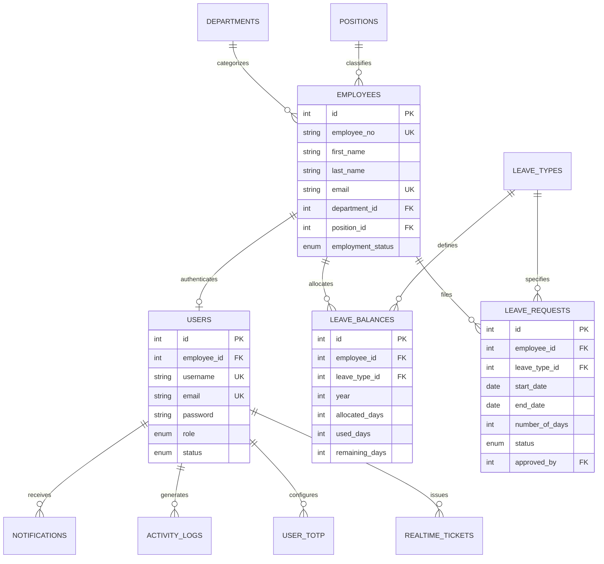
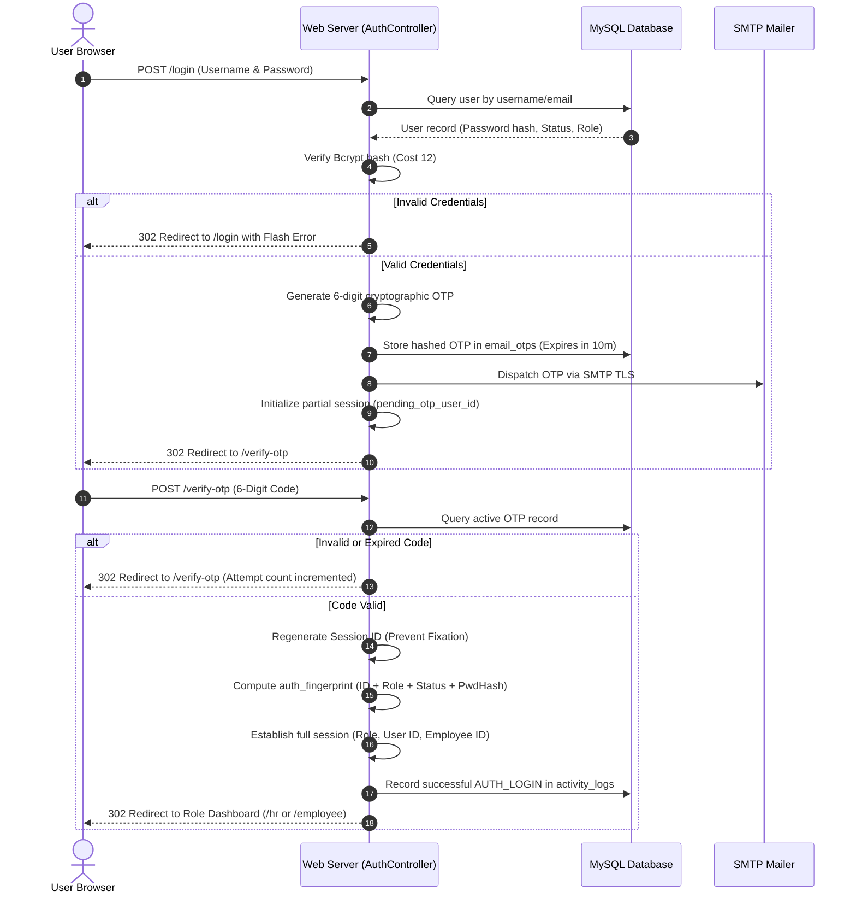

# NEXORA HR — System Architecture

**Project:** NEXORA HR  
**Tagline:** People. Processes. Progress.  
**Version:** 3.1  
**Status:** Authoritative Production Architecture  
**Date:** November 2026  
**Document Owner:** Repository Maintainer & Engineering Architecture Team  

---

## 1. Architectural Overview & Design Principles

NEXORA HR is engineered as a high-performance, modular, four-tier Model-View-Controller (**MVC**) web application built on native PHP 8.5 and MySQL 8.0 (InnoDB). The system avoids heavy full-stack framework overhead by utilizing an optimized, custom-crafted core framework with strict separation of concerns, fail-closed security middleware, pessimistic row-level locking, and an asynchronous Transactional Outbox for real-time WebSocket distribution.

```
       ┌────────────────────────────────────────────────────────┐
       │                Nginx Reverse Proxy (:8080)             │
       └───────────┬────────────────────────────────┬───────────┘
                   │ HTTP Traffic                   │ WS Traffic (/ws)
                   ▼                                ▼
       ┌────────────────────────┐       ┌───────────────────────┐
       │   PHP 8.5 / Apache     │       │  Ratchet WebSocket    │
       │   Application Server   │       │     Daemon (:8090)    │
       └───────────┬────────────┘       └───────────┬───────────┘
                   │                                │
                   │ PDO (Prepared Statements)      │ Outbox Poller / Loopback
                   ▼                                ▼
       ┌────────────────────────────────────────────────────────┐
       │            MySQL 8.0 InnoDB Database (:3306)           │
       │   [ACID Transactions | Row Locks | Transactional Outbox]│
       └────────────────────────────────────────────────────────┘
```

### Core Architectural Principles
1. **Strict 3-Role Separation:** Authorization is structured into `admin`, `hr`, and `employee`. `admin` owns system-wide governance, user account management, role assignment, and security audit inspection. `hr` handles operational workforce administration, leave review queue, and reporting (prohibited from administrative user role assignment). `employee` provides an isolated self-service environment with strict ownership enforcement.
2. **ACID Transaction Integrity:** All operations that modify leave balances or request statuses must execute within an isolated database transaction utilizing pessimistic row locks (`SELECT ... FOR UPDATE`).
3. **Fail-Closed Security Architecture:** Every incoming request defaults to unauthorized; access is granted only after passing through sequential middleware (`AuthMiddleware`, `RoleMiddleware`, `CsrfMiddleware`, `RateLimitMiddleware`).
4. **At-Least-Once Real-time Delivery:** Real-time state changes are committed to an `outbox_events` table synchronously with the business transaction. A decoupled worker dispatches events over WebSockets, guaranteeing that network transport failures do not compromise business logic.
5. **Continuous Session State Verification:** User sessions are verified against live database state on every HTTP request (`Session::verifyAuthenticatedAccountState()`), immediately invalidating deactivated accounts and synchronizing updated profile attributes without requiring re-authentication.

---

## 2. Technology Stack & Infrastructure

| Layer / Subsystem | Technology | Specification / Role |
|---|---|---|
| **Edge Proxy** | Nginx | Version 1.25+ Alpine. Reverse proxies HTTP traffic to Apache and upgrades `/ws` to the Ratchet WebSocket daemon. |
| **Application Server** | Apache / PHP | PHP 8.5.12 with OPcache, PDO MySQL, OpenSSL, and Apache `mod_rewrite`. |
| **Database Engine** | MySQL | Version 8.0 Community Server. InnoDB storage engine, `utf8mb4_unicode_ci` character encoding, ACID transactions, and composite indexes. |
| **Real-time Daemon** | Ratchet (PHP) | Event-driven WebSocket server running on port `:8090`, utilizing ReactPHP event loop and single-use ticket authentication. |
| **MFA Delivery** | PHPMailer / SMTP | RFC 821 SMTP transport with TLS encryption for delivering 6-digit cryptographic OTP tokens. |
| **Observability** | Prometheus & Grafana | Prometheus (:9090) scraping `nginx-exporter` (:9113) and `mysqld-exporter` (:9104); preconfigured Grafana (:3000) dashboards. |
| **Testing Harness** | PHPUnit & Selenium | PHPUnit 13.4 (600 automated unit/feature/integration tests) and Python/Selenium E2E suite targeting Chromium. |

---

## 3. Annotated Directory Structure

```
HRIS-SYSTEM/
├── app/                              # Application Domain Layer
│   ├── controllers/                  # HTTP Route Controllers
│   │   ├── Api/                      # REST API v1 Controllers (Employee, Department, Leave, etc.)
│   │   ├── AuthController.php        # Primary Login, Email OTP, TOTP, and Logout
│   │   ├── DashboardController.php   # HR and Employee Dashboard & Profile Controllers
│   │   ├── EmployeeController.php    # Workforce CRUD, Deactivation, and Search
│   │   ├── LeaveController.php       # Leave Filing, FIFO Queue, Approval, and Rejection
│   │   ├── DepartmentController.php  # Department Management
│   │   ├── PositionController.php    # Position Management
│   │   ├── NotificationController.php# User Notification Center
│   │   ├── ReportController.php      # CSV / JSON Analytics & Reports
│   │   └── DsaController.php         # Educational Algorithm Visualizers
│   ├── dsa/                          # Data Structures & Algorithms Library (MergeSort, BinarySearch, Queue)
│   ├── models/                       # Active Record / Data Access Models
│   │   ├── User.php                  # Authentication, Fingerprinting, and Identity
│   │   ├── Employee.php              # Workforce Profile Entity
│   │   ├── Leave.php                 # Transactional Leave Engine & Pessimistic Locking
│   │   ├── Department.php            # Department Entity
│   │   ├── Position.php              # Position Entity
│   │   └── Notification.php          # In-App Notification Store
│   ├── realtime/                     # Real-time WebSocket Subsystem
│   │   ├── RealtimeConfig.php        # Environment & Connection Configuration
│   │   ├── RealtimePolicy.php        # Role-based Event Authorization & PII Filtering
│   │   ├── NotificationPayload.php   # Role-Tailored Payload Formatter
│   │   ├── OutboxService.php         # Transactional Outbox Event Producer & Consumer
│   │   ├── TicketService.php         # Single-Use Connection Ticket Handshake
│   │   └── WebSocketServer.php       # Ratchet WebSocket Server Implementation
│   ├── services/                     # Reusable Domain & Security Services
│   │   ├── AccountRevocationService.php # Session Invalidation Coordinator
│   │   ├── EmailOtpService.php       # 6-Digit Cryptographic OTP Generator & Mailer
│   │   ├── LeaveApprovalService.php  # Pessimistic Locking Leave Transaction Coordinator
│   │   ├── StepUpAuthService.php     # High-Impact Action Re-authentication Guard
│   │   └── TotpService.php           # RFC 6238 Authenticator Verification Engine
│   └── views/                        # Server-Side Rendered PHP Templates
│       ├── auth/                     # Login, OTP Verification, TOTP Setup
│       ├── dashboard/                # HR and Employee Dashboard & Profile Views
│       ├── employees/                # Workforce Directory, Create, Edit, View Views
│       ├── leaves/                   # Leave Filing, HR Approval Queue, History Views
│       ├── layouts/                  # Base HTML Shells (hr.php, auth.php)
│       └── partials/                 # Reusable Components (navbar.php, sidebar.php, alerts.php)
├── bin/                              # Operational CLI Scripts & Daemons
│   ├── check-phpcs-baseline.php      # PSR-12 Baseline Enforcer
│   ├── migrate.php                   # Database Migration Runner
│   ├── realtime-server.php           # Ratchet WebSocket Server Startup Script
│   └── outbox-worker.php             # Transactional Outbox Polling Worker
├── config/                           # System Configuration Files
│   ├── app.php                       # Base URLs, Environment, Timezone
│   ├── database.php                  # PDO MySQL Connection Parameters
│   ├── mail.php                      # SMTP Server & Credential Configuration
│   └── realtime.php                  # WebSocket Ports, Host, and Reconnection Limits
├── core/                             # Custom High-Performance MVC Framework Core
│   ├── AuthMiddleware.php            # Session & Live Account State Guard
│   ├── Controller.php                # Base Controller (Views, JSON responses, CSRF)
│   ├── Database.php                  # Singleton PDO Wrapper with Connection Management
│   ├── Middleware.php                # Abstract Middleware Interface
│   ├── Model.php                     # Base Database Model with Prepared Statements
│   ├── PermissionMiddleware.php      # Action-Specific Permission Guard
│   ├── RoleMiddleware.php            # Strict Role Enforcement Middleware ('hr', 'employee')
│   ├── Router.php                    # Regex-Enabled URL Dispatcher
│   └── Session.php                   # Secure Session Handler, Auth Fingerprint, CSRF
├── database/                         # Database Assets
│   ├── migrations/                   # Versioned SQL Migration Scripts
│   ├── schema.sql                    # Authoritative Schema Definition (13 Tables)
│   └── seeds/                        # Test and Demo Data Seeders
├── docker/                           # Container Infrastructure Configuration
│   ├── apache/                       # Custom Apache Configuration
│   ├── grafana/                      # Provisioned Grafana Dashboards
│   ├── mysql/                        # Custom MySQL Engine Configuration
│   ├── nginx/                        # Edge Reverse Proxy & WebSocket Upstream Configuration
│   └── prometheus/                   # Metric Scraping & Alert Rules
├── docs/                             # Specialized Technical Documentation
├── public/                           # Web Document Root
│   ├── index.php                     # Front Controller & Route Registration
│   └── assets/                       # Static Frontend Assets (CSS, JS, Icons)
│       ├── css/                      # style.css, components.css, responsive.css, realtime.css
│       └── js/                       # app.js, navigation.js, forms.js, realtime.js
├── tests/                            # Automated Test Suites (592 Passing Tests)
│   ├── Feature/                      # HTTP Feature & Workflow Integration Tests
│   ├── Integration/                  # Database Concurrency & Locking Tests
│   └── Unit/                         # Core Logic, Routing, and Security Tests
├── docker-compose.yml                # Multi-Container Orchestration Specification
├── phpunit.xml                       # PHPUnit 13 Test Suite Configuration
└── composer.json                     # PSR-4 Autoloading & Dependency Definitions
```

---

## 4. Architectural Layers & Data Flow

### 4.1 Request Processing Pipeline
Every HTTP request follows a strict synchronous execution pipeline:

```
[HTTP Request] 
      │
      ▼
1. public/index.php (Front Controller)
      │
      ▼
2. Core\Router (Matches URI Pattern and HTTP Verb)
      │
      ▼
3. Middleware Pipeline (Sequential, Fail-Closed):
      ├── RateLimitMiddleware (DDoS & Brute Force Prevention)
      ├── AuthMiddleware (Active Session & Security Fingerprint Re-validation)
      ├── RoleMiddleware (Strict 'hr' vs 'employee' Role Authorization)
      ├── CsrfMiddleware (Synchronized Token Validation on POST/PUT/DELETE)
      └── OwnershipGuard (Ensures employees can only query their own data)
      │
      ▼
4. App\Controllers (Request Validation, Input Sanitization)
      │
      ▼
5. App\Services / App\Models (Domain Logic, Atomic PDO Transactions, Row Locks)
      │
      ▼
6. Database Layer (MySQL 8.0 InnoDB Execution)
      │
      ▼
7. Response Dispatch (View Template Rendering via Layout OR JSON API Response)
```

### 4.2 Middleware Execution Sequence
* **RateLimitMiddleware:** Inspects client IP and endpoint; returns `HTTP 429 Too Many Requests` if requests exceed configured thresholds.
* **AuthMiddleware:** Verifies `Session::has('user')`. Executes `Session::verifyAuthenticatedAccountState()`, re-checking account status, linked employee status, role, and password hash in MySQL. If invalid, the session is purged immediately and redirected to `/login`.
* **RoleMiddleware:** Evaluates `currentUserRole()`. Enforces strict two-role separation. Any unauthorized access returns `HTTP 403 Forbidden`.
* **CsrfMiddleware:** Inspects incoming `X-CSRF-TOKEN` header or `csrf_token` POST field; rejects state-modifying requests with `HTTP 419 Page Expired` if the token does not match the active session.

---

## 5. Database Architecture & Concurrency Control

The database consists of **13 InnoDB tables** optimized with foreign keys, cascaded updates, restricted deletions, and composite indexes.



### Concurrency & Pessimistic Locking Strategy
In multi-user enterprise environments, simultaneous leave processing risks double-deductions and negative balances. NEXORA HR eliminates this via **pessimistic row-level locking**:

```sql
-- 1. Begin atomic transaction
START TRANSACTION;

-- 2. Acquire exclusive lock on the leave request
SELECT * FROM leave_requests 
WHERE id = :request_id 
FOR UPDATE;

-- 3. Verify status is still 'Pending'
-- 4. Acquire exclusive lock on employee's balance record for the current year
SELECT * FROM leave_balances 
WHERE employee_id = :employee_id 
  AND leave_type_id = :leave_type_id 
  AND year = YEAR(CURDATE())
FOR UPDATE;

-- 5. Validate: remaining_days >= requested_days
-- 6. Atomically update leave request status
UPDATE leave_requests 
SET status = 'Approved', approved_by = :hr_id, approved_at = NOW() 
WHERE id = :request_id;

-- 7. Atomically deduct balance
UPDATE leave_balances 
SET used_days = used_days + :days, remaining_days = remaining_days - :days 
WHERE id = :balance_id;

-- 8. Record audit log & outbox event
INSERT INTO activity_logs (...) VALUES (...);
INSERT INTO outbox_events (...) VALUES (...);

-- 9. Commit transaction and release locks
COMMIT;
```

If another HR officer or process attempts to approve or reject the same request simultaneously, MySQL places the second transaction in a wait state until the first completes. Upon waking, the second transaction sees `status = 'Approved'` and exits safely without mutating balances.

---

## 6. Authentication, MFA & Session Security



---

## 7. Real-Time Notification & WebSocket Architecture

NEXORA HR utilizes the **Transactional Outbox Pattern** to ensure decoupled, reliable WebSocket delivery:

```
[Leave Action Committed]
        │
        ├─► [DB: leave_requests updated]
        ├─► [DB: leave_balances updated]
        └─► [DB: outbox_events inserted] (Atomic Commit)
                   │
                   ▼
       [Outbox Worker / Trigger]
                   │ Polls unhandled events
                   ▼
    [Ratchet WebSocket Server (:8090)]
                   │ Dispatches payload to authenticated channel
                   ▼
          [Connected Browsers]
     (Live badge update & auto-reload)
```

### Connection Handshake & Ticket Security
1. When an authenticated user loads a dashboard, `realtime.js` requests a single-use connection ticket via `POST /realtime/ticket`.
2. The server generates a cryptographically random, 32-byte token with a 60-second time-to-live and associates it with the user ID and role in `realtime_tickets`.
3. The client connects to `ws://host:8080/ws?ticket={token}`.
4. The Ratchet server validates and immediately consumes (deletes) the ticket from the database, binding the connection to the verified user ID and role.
5. `RealtimePolicy` filters every outgoing broadcast: HR users receive organizational event alerts, while employees receive only personal leave status updates. Sensitive PII is stripped prior to transmission.

---

## 8. Docker Infrastructure & Monitoring

The system is deployed as a coordinated set of Docker containers orchestrated by Docker Compose:

```
┌────────────────────────────────────────────────────────────────────────┐
│                        Docker Compose Network                          │
│                                                                        │
│   ┌────────────────────┐          ┌────────────────────┐               │
│   │   nginx:alpine     │◄────────►│     app (Apache)   │               │
│   │   (Edge Proxy)     │          │    (PHP 8.5 MVC)   │               │
│   │   Port: 8080       │          │    Port: 80 (int)  │               │
│   └─────────┬──────────┘          └─────────┬──────────┘               │
│             │                               │                          │
│             │ /ws                           │ PDO                      │
│             ▼                               ▼                          │
│   ┌────────────────────┐          ┌────────────────────┐               │
│   │  realtime-server   │          │   mysql:8.0-debian │               │
│   │  (Ratchet :8090)   │          │   (InnoDB Storage) │               │
│   └────────────────────┘          │   Port: 3306 (int) │               │
│                                   └─────────┬──────────┘               │
│                                             │                          │
│   ┌─────────────────────────────────────────┴──────────────────────┐   │
│   │ Telemetry: mysqld-exporter (:9104) | nginx-exporter (:9113)    │   │
│   │ Scraper:   Prometheus (:9090)      | Dashboard: Grafana (:3000)│   │
│   └────────────────────────────────────────────────────────────────┘   │
└────────────────────────────────────────────────────────────────────────┘
```

* **Health Checks:** Every service includes explicit health checks (e.g., `mysqladmin ping`, `curl http://localhost/health`, socket probes) preventing upstream proxies from dispatching traffic to unready containers.
* **Storage Volumes:** Persistent data is isolated in dedicated Docker volumes (`db_data`, `prometheus_data`, `grafana_data`), ensuring container restarts or rebuilds never destroy state.

---

## 9. Background Processing, Cron Scheduler & Asynchronous Queue (HRIS-53)

NEXORA HR implements a decoupled, production-ready background execution architecture consisting of two independent worker components:

```
┌────────────────────────────────────────────────────────────────────────┐
│                   Background Processing Architecture                   │
│                                                                        │
│   ┌────────────────────┐          ┌────────────────────┐               │
│   │  Web App (Apache)  │          │ Dedicated Cron     │               │
│   │  (Sync Requests)   │          │ Scheduler (Opt A)  │               │
│   └─────────┬──────────┘          └─────────┬──────────┘               │
│             │                               │                          │
│             │ push()                        │ schedule:run             │
│             ▼                               ▼                          │
│   ┌────────────────────┐          ┌────────────────────┐               │
│   │  queue_jobs (MySQL)│◄────────►│ Scripts / Commands │               │
│   │  (InnoDB Queue)    │          │ (Locks & Overlap)  │               │
│   └─────────▲──────────┘          └────────────────────┘               │
│             │                                                          │
│             │ claimPending() (FOR UPDATE SKIP LOCKED)                  │
│             ▼                                                          │
│   ┌────────────────────┐          ┌────────────────────┐               │
│   │ Dedicated Worker   │─────────►│ Registered Handlers│               │
│   │ Container (Daemon) │          │ (Email, Notif, etc)│               │
│   └────────────────────┘          └────────────────────┘               │
└────────────────────────────────────────────────────────────────────────┘
```

### 9.1 Option A — Dedicated Cron Scheduler Container
* **Service:** `hris_scheduler` (built via `docker/scheduler/Dockerfile`).
* **Runtime:** PHP 8.5 CLI with Debian cron daemon running in the foreground (`cron -f -L 15`).
* **Environment Synchronization:** `docker/scheduler/entrypoint.sh` exports container environment variables (`DB_HOST`, `DB_PASSWORD`, `TIMEZONE`, etc.) to `/etc/environment` so cron subshells inherit full runtime configuration.
* **Streamed Logging:** Cron task standard output and standard error are directed to `/proc/1/fd/1`, making task execution telemetry immediately visible via `docker logs hris_scheduler`.
* **Overlap Protection:** `App\Console\TaskLock` acquires non-blocking exclusive file locks (`flock(LOCK_EX | LOCK_NB)`) in `storage/locks/`, safely skipping redundant executions if a task is still active.

#### Registered Periodic Tasks
1. `cleanup-sessions` (`*/15 * * * *`): Safely purges expired session storage files, stale realtime tickets, and expired OTP records.
2. `process-notifications` (`* * * * *`): Claims and dispatches pending transactional outbox events.
3. `send-leave-reminders` (`0 8 * * *`): Evaluates approved leaves beginning the following day and dispatches reminder notifications.
4. `cleanup-temp-files` (`0 2 * * *`): Purges generated CSV report exports older than 24 hours.

### 9.2 MySQL-Backed Queue System & Queue Worker
* **Service:** `hris_worker` (reusing `hris-system-app:latest` with non-root user `www-data`).
* **Command:** `php bin/queue-worker.php --sleep=2 --lease=300 --max-runtime=3600`.
* **Concurrency-Safe Claims:** `App\Queue\QueueService::claimPending()` uses MySQL 8.0 `SELECT ... FOR UPDATE SKIP LOCKED` inside a short transaction, preventing duplicate processing across multiple concurrent workers.
* **Exponential Backoff & Retries:** Failed jobs retry with exponential backoff and randomized jitter (`delay = min(3600, 2^attempts * 5 + jitter)`).
* **Dead-Letter Storage:** Permanently failed jobs exceeding `max_attempts` transition to `failed_jobs` for forensic analysis.
* **Abandoned Reservation Recovery:** Workers periodically scan for jobs reserved for longer than the lease window (default: 300s) and safely recover them to `pending`.
* **Security Whitelist:** `App\Queue\JobRegistry` strictly whitelists permitted job types (`send_email`, `send_notification`, `leave_reminder`, `report_export`, `outbox_relay`), completely rejecting arbitrary class instantiation or unsanctioned code execution.


