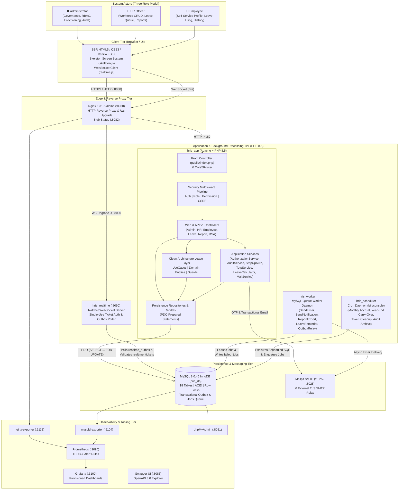
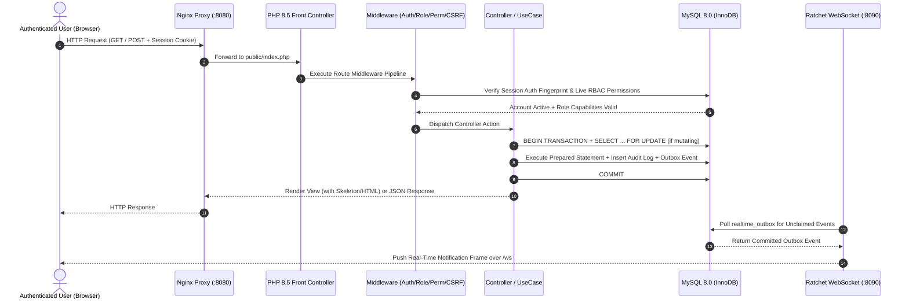

# NEXORA HR — Authoritative System Architecture & Component Specification

**Project:** NEXORA HR — Human Resource Information System  
**Tagline:** People. Processes. Progress.  
**Phase:** 16 — Final Technical Architecture Deliverable  
**Implementation Status:** Implemented and Verified  

---

## 1. Executive Architectural Overview

**NEXORA HR** is a modular, multi-container, four-tier enterprise Human Resource Information System (HRIS) and Leave Management Platform built on **PHP 8.5** and **MySQL 8.0 (InnoDB)**. It combines a custom lightweight MVC framework (`Core\*`) with a Clean Architecture Domain/Application/Infrastructure subsystem (`App\Domain\Leave\*`, `App\Application\Leave\*`, `App\Infrastructure\*`) for mission-critical leave workflows, backed by a **Transactional Outbox**, a **Ratchet WebSocket Server**, a **MySQL-backed Asynchronous Queue Worker**, a **Cron Scheduler**, and **Prometheus + Grafana** observability.

### Classification of System Components

| Component | Technology / Implementation | Status | Evidence Path |
| :--- | :--- | :--- | :--- |
| **Edge Reverse Proxy** | Nginx 1.31.6-alpine (`:8080`, `/ws` upgrade, `:8082/stub_status`) | **Implemented & Verified** | `docker/nginx/default.conf`, `docker-compose.yml` |
| **Web Application Runtime** | PHP 8.5 + Apache (`public/index.php`) | **Implemented & Verified** | `Dockerfile`, `public/index.php`, `core/Router.php` |
| **3-Role Dynamic RBAC** | `admin`, `hr`, `employee` (`AuthorizationService`, `PermissionRegistry`) | **Implemented & Verified** | `core/AuthorizationService.php`, `core/PermissionRegistry.php` |
| **MFA & Session Security** | Email OTP (HMAC-SHA256 peppered), RFC 6238 TOTP (`AES-256-GCM`), Live `auth_fingerprint` | **Implemented & Verified** | `app/models/EmailOtp.php`, `app/services/TotpService.php`, `core/Session.php` |
| **Clean Architecture Leave Engine** | Domain Value Objects, Use Cases, Pessimistic Locking (`SELECT ... FOR UPDATE`) | **Implemented & Verified** | `app/Domain/Leave/`, `app/Application/Leave/`, `app/Infrastructure/Persistence/Leave/` |
| **Tamper-Evident Audit Trail** | SHA-256 Hash-Chained Audit Log (`prev_hash` / `event_hash`) + Sensitive Key Redaction | **Implemented & Verified** | `core/AuditService.php`, `app/models/ActivityLog.php` |
| **Real-Time WebSocket Server** | Ratchet / ReactPHP (`:8090`) + Single-Use Ticket Handshake + Outbox Poller | **Implemented & Verified** | `bin/realtime-server.php`, `app/realtime/Server.php`, `app/realtime/PdoRealtimeStore.php` |
| **Asynchronous Queue Worker** | MySQL-backed `jobs` / `failed_jobs` daemon (`QueueWorker`, `QueueService`) | **Implemented & Verified** | `bin/queue-worker.php`, `app/Queue/QueueWorker.php`, `app/Queue/Handlers/` |
| **Cron Scheduler** | Dedicated container & CLI Kernel (`bin/console`) | **Implemented & Verified** | `docker/scheduler/Dockerfile`, `app/Console/Kernel.php`, `bin/console` |
| **Primary Database** | MySQL 8.0.46 InnoDB (18 tables, ACID transactions, foreign keys) | **Implemented & Verified** | `database/schema.sql`, `database/migrations/` |
| **Observability Stack** | Prometheus (`:9090`), Grafana (`:3100`), `nginx-exporter`, `mysqld-exporter` | **Implemented & Verified** | `docker/prometheus/`, `docker/grafana/`, `docker-compose.yml` |
| **API & OpenAPI Portal** | REST API v1 (`/api/v1/*`) + Swagger UI (`:8083` & `/docs`) | **Implemented & Verified** | `app/controllers/Api/`, `docs/api/openapi.yaml` |
| **DSA Academic Workbench** | Custom Data Structures, Searching/Sorting Algorithms & Execution Tracer | **Implemented & Verified** | `app/dsa/`, `app/controllers/DsaController.php`, `app/services/DsaTraceService.php` |
| **Skeleton Screen System** | Accessible SSR + CSR Skeleton Placeholders (`SkeletonRenderer`, `skeleton.js`) | **Implemented & Verified** | `core/SkeletonRenderer.php`, `public/assets/js/skeleton.js`, `public/assets/css/skeleton.css` |

---

## 2. Verified System Architecture Diagram

### 2.1 High-Level Container & Subsystem Architecture (Mermaid)

---

## 3. Architectural Layers & Component Responsibilities

### 3.1 Presentation & Client Layer (`app/views/`, `public/assets/`)
- **Server-Side Rendered Views (`app/views/`):** Organized by domain (`admin/`, `auth/`, `dashboard/`, `dsa/`, `employees/`, `errors/`, `layouts/`, `leaves/`, `notifications/`, `partials/`, `positions/`, `reports/`, `users/`). All output is escaped using the global `e()` helper (`htmlspecialchars(..., ENT_QUOTES, 'UTF-8')`).
- **Skeleton Screen Loading System (`core/SkeletonRenderer.php`, `public/assets/js/skeleton.js`, `public/assets/css/skeleton.css`):** Provides layout-matched shimmer placeholders with `aria-busy="true"`, `prefers-reduced-motion` support, dark-mode surface adaptation, and automatic lifecycle replacement (`Skeleton.withContainer()`).
- **Real-Time Client (`public/assets/js/realtime.js`):** Requests a single-use 30-second handshake ticket via `POST /realtime/ticket`, opens an authenticated WebSocket connection to `/ws`, updates notification badges/toasts live, and falls back gracefully to HTTP polling if the socket is unavailable.

### 3.2 Routing & Fail-Closed Middleware Pipeline (`public/index.php`, `core/`)
1. **Front Controller (`public/index.php`):** Bootstraps environment variables (`core/bootstrap.php`), initializes hardened sessions (`Core\Session::start()`), registers all web and REST API v1 routes on `Core\Router`, and dispatches the incoming HTTP request.
2. **`Core\AuthMiddleware`:** Enforces authentication and executes `Session::verifyAuthenticatedAccountState()` on every request. Recomputes the user's SHA-256 `auth_fingerprint` (`id|role|status|employment_status|password_hash`) against live MySQL state; immediately invalidates the session if the account was deactivated, terminated, role-changed, or had its password reset.
3. **`Core\RoleMiddleware`:** Enforces coarse-grained role boundaries (`['admin']`, `['hr']`, `['admin', 'hr']`, `['employee']`, or `['admin', 'hr', 'employee']`).
4. **`Core\PermissionMiddleware`:** Evaluates fine-grained capabilities via `Core\Permission::can()` and `Core\AuthorizationService::getInstance()->can()`, backed by the `roles`, `permissions`, and `role_permissions` tables with in-memory request caching.
5. **`Core\CsrfMiddleware`:** Validates synchronized `csrf_token` values on all state-mutating verbs (`POST`, `PUT`, `DELETE`, `PATCH`) using timing-safe `hash_equals()`.

### 3.3 Controllers Layer (`app/controllers/`, `app/controllers/Api/`)
- **Web Controllers:** `AuthController`, `AdminController`, `UserController`, `DashboardController`, `EmployeeController`, `DepartmentController`, `PositionController`, `LeaveController`, `ReportController`, `ActivityLogController`, `NotificationController`, `RealtimeController`, `DsaController`, `HomeController`.
- **REST API v1 Controllers (`App\Controllers\Api\*`):** `AuthController`, `ProfileController`, `EmployeeController`, `DepartmentController`, `PositionController`, `LeaveController`, `HealthController`, `DocsController`. Annotated with `OpenApi\Attributes` (`#[OA\Get]`, `#[OA\Post]`, etc.) to generate `docs/api/openapi.yaml`.

### 3.4 Clean Architecture Domain & Application Layer (`app/Domain/Leave/`, `app/Application/Leave/`)
The leave management subsystem implements Clean Architecture to isolate complex business rules from framework transport:
- **Domain Entities & Value Objects (`app/Domain/Leave/`):** `LeaveRequest`, `LeaveBalance`, `LeaveDateRange`, `LeaveStatus`, and domain events (`LeaveRequestSubmitted`, `LeaveRequestApproved`, `LeaveRequestRejected`, `LeaveRequestCancelled`).
- **Application Use Cases (`app/Application/Leave/UseCases/`):**
  - `FileLeaveRequestUseCase`: Validates working days (`LeaveCalculator`), checks balance sufficiency and date overlaps via `LeaveFilingGuard`, persists the pending request, and records a `LeaveRequestSubmitted` outbox event inside a single transaction.
  - `ApproveLeaveRequestUseCase`: Enforces reviewer authority and segregation of duties (cannot approve own request), locks the request and balance rows (`SELECT ... FOR UPDATE`), deducts `used_days` / `remaining_days`, updates status to `Approved`, and records a `LeaveRequestApproved` outbox event atomically.
  - `RejectLeaveRequestUseCase`: Locks the pending request, records the rejection reason and reviewer metadata, and emits `LeaveRequestRejected`.
  - `CancelLeaveRequestUseCase`: Allows employees to withdraw pending requests or HR/Admin to cancel approved requests (with mandatory reason and automatic balance restoration).

### 3.5 Persistence, Outbox, Queue & Scheduled Operations (`app/Infrastructure/`, `app/Queue/`, `app/Console/`)
- **Transactional Outbox (`realtime_outbox`):** Domain events are serialized into `realtime_outbox` within the same database transaction as the business state change. Both the Ratchet WebSocket server (`PdoRealtimeStore`) and `OutboxRelayHandler` consume committed events with row-level leases (`locked_at`, `locked_by`).
- **Database Queue (`jobs`, `failed_jobs`):** `QueueService::push()` enqueues background payloads (`send_email`, `send_notification`, `report_export`, `leave_reminder`, `outbox_relay`). `QueueWorker` polls `jobs` with atomic lease locking, exponential backoff (`attempts`, `available_at`), and dead-letter archival (`failed_jobs`).
- **CLI Console Kernel (`bin/console`, `app/Console/Kernel.php`):** Provides `leave:accrue-monthly`, `leave:carry-over`, `leave:remind-upcoming`, `auth:cleanup-tokens`, `audit:archive`, and `schedule:run`.

---

## 4. End-to-End Request & Data Flow

