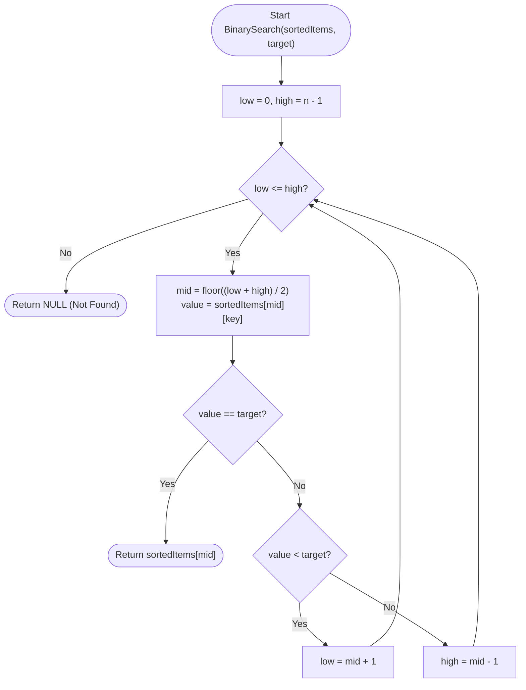
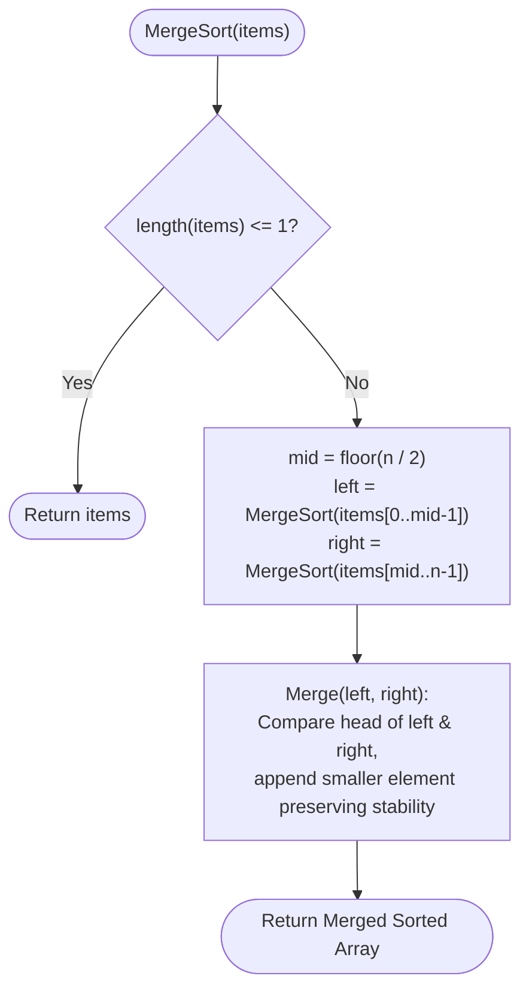
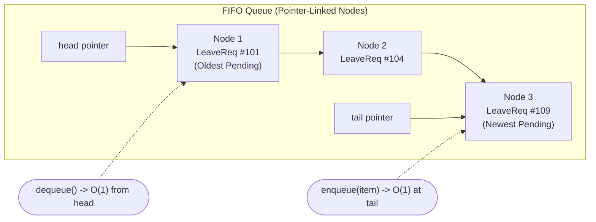
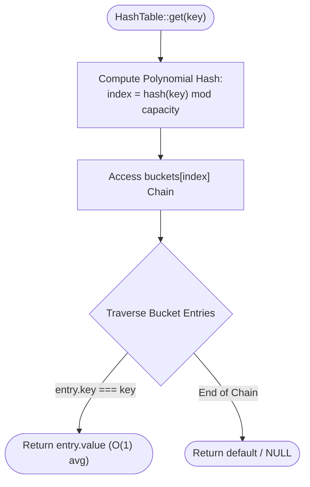

# NEXORA HR — Supplementary Data Structures & Algorithms (DSA) Documentation & Flowcharts

**Project:** NEXORA HR — Human Resource Information System  
**Tagline:** People. Processes. Progress.  
**Module:** Supplementary Computer Science DSA Workbench & HRIS Algorithmic Engine  
**Implementation Status:** Implemented and Verified (`app/dsa/`, `app/controllers/DsaController.php`, `tests/Unit/DSA/`, `tests/Integration/DSA/`)

---

## 1. Architectural Role of the DSA Module

In **NEXORA HR**, the Data Structures and Algorithms (DSA) subsystem serves two complementary purposes:
1. **Practical In-Memory Workforce & Leave Processing (`app/services/`):** Bounded working sets retrieved from MySQL (such as the pending leave approval queue, department employee directory, and recent activity feed) are processed using custom data structures (`Queue`, `HashTable`, `BinarySearchTree`, `Stack`, `MergeSort`, `BinarySearch`).
2. **Interactive Academic DSA Laboratory (`/dsa` via `DsaController`):** An interactive workbench accessible to authorized HR and Admin users where every custom data structure and algorithm can be executed against live or synthetic HRIS datasets with step-by-step execution trace telemetry (`DsaTraceService`).

> **Scope Note:** The DSA module operates on bounded in-memory datasets and complements—rather than replaces—MySQL 8.0 InnoDB B-Tree indexing and ACID transactions.

---

## 2. Implemented Data Structures & Algorithms Inventory

| Category | Component Class | File Path | Primary HRIS Application | Status |
| :--- | :--- | :--- | :--- | :--- |
| **Custom Array** | `App\Dsa\Arrays\ArrayStructure` & `ArrayUtils` | `app/dsa/arrays/ArrayStructure.php` | Indexed workforce buffer & multi-field record projection | **Implemented & Verified** |
| **Linked List** | `App\Dsa\Structures\LinkedList` (`Node`) | `app/dsa/structures/LinkedList.php` | Sequential leave history chain & bucket collision lists | **Implemented & Verified** |
| **Stack (LIFO)** | `App\Dsa\Structures\Stack` | `app/dsa/structures/Stack.php` | Recent activity log reversal (newest-first inspection) & undo trace | **Implemented & Verified** |
| **Queue (FIFO)** | `App\Dsa\Structures\Queue` | `app/dsa/structures/Queue.php` | Fair First-In-First-Out pending leave approval queue (`LeaveApprovalQueueService`) | **Implemented & Verified** |
| **Hash Table** | `App\Dsa\Structures\HashTable` | `app/dsa/structures/HashTable.php` | $O(1)$ average employee lookup by `employee_no` or `email` | **Implemented & Verified** |
| **Binary Search Tree** | `App\Dsa\Structures\BinarySearchTree` (`TreeNode`) | `app/dsa/structures/BinarySearchTree.php` | Ordered employee directory index & range queries | **Implemented & Verified** |
| **Linear Search** | `App\Dsa\Algorithms\LinearSearch` | `app/dsa/algorithms/LinearSearch.php` | Unsorted multi-field substring filtering (name, department, status) | **Implemented & Verified** |
| **Binary Search** | `App\Dsa\Algorithms\BinarySearch` | `app/dsa/algorithms/BinarySearch.php` | $O(\log n)$ exact employee lookup on sorted keys (`employee_no`, `id`) | **Implemented & Verified** |
| **Insertion Sort** | `App\Dsa\Algorithms\InsertionSort` | `app/dsa/algorithms/InsertionSort.php` | Low-overhead sorting for small/nearly-sorted department lists | **Implemented & Verified** |
| **Merge Sort** | `App\Dsa\Algorithms\MergeSort` | `app/dsa/algorithms/MergeSort.php` | Guaranteed $O(n \log n)$ stable sorting of employee and leave tables | **Implemented & Verified** |
| **Quick Sort** | `App\Dsa\Algorithms\QuickSort` | `app/dsa/algorithms/QuickSort.php` | High-speed in-place partitioning sort for large numeric/date datasets | **Implemented & Verified** |
| **Recursion** | `App\Dsa\Algorithms\RecursionHelper` | `app/dsa/algorithms/RecursionHelper.php` | Hierarchical tree traversal & recursive leave day aggregation | **Implemented & Verified** |

---

## 3. Detailed Specifications, Pseudocode, Complexity & Flowcharts

### 3.1 Searching Algorithms

#### A. Linear Search (`App\Dsa\Algorithms\LinearSearch`)
- **Purpose:** Scans an unsorted collection sequentially to locate an exact match or substring match across one or more fields.
- **Input:** `array $items`, `mixed $query`, `string|array $fields`.
- **Output:** Matching element/index or list of matching records + comparison count.
- **Complexity:** Best $O(1)$, Average $O(n)$, Worst $O(n)$ Time; $O(1)$ Auxiliary Space.
- **Pseudocode:**
  ```text
  FUNCTION LinearSearch(items, targetKey, field):
      FOR i = 0 TO length(items) - 1 DO
          IF items[i][field] == targetKey THEN
              RETURN items[i]
          END IF
      END FOR
      RETURN NULL
  ```

#### B. Binary Search (`App\Dsa\Algorithms\BinarySearch`)
- **Purpose:** Performs logarithmic search over a pre-sorted array of employee records (e.g., sorted by `employee_no`).
- **Input:** Sorted `array $items`, `string|int $target`, `string $keyField`.
- **Output:** Matched record, index, and number of bisection steps.
- **Complexity:** Best $O(1)$, Average $O(\log n)$, Worst $O(\log n)$ Time; $O(1)$ Iterative Space.
- **Pseudocode:**
  ```text
  FUNCTION BinarySearch(sortedItems, target, keyField):
      low = 0
      high = length(sortedItems) - 1
      WHILE low <= high DO
          mid = floor((low + high) / 2)
          cmp = compare(sortedItems[mid][keyField], target)
          IF cmp == 0 THEN RETURN sortedItems[mid]
          ELSE IF cmp < 0 THEN low = mid + 1
          ELSE high = mid - 1
      END WHILE
      RETURN NULL
  ```



---

### 3.2 Sorting Algorithms

#### A. Merge Sort (`App\Dsa\Algorithms\MergeSort`)
- **Purpose:** Divide-and-conquer stable sorting algorithm used to order employee directories and leave request tables by date, name, or days.
- **Input:** `array $items`, `callable|string $comparator`.
- **Output:** New sorted `array`.
- **Complexity:** Best $O(n \log n)$, Average $O(n \log n)$, Worst $O(n \log n)$ Time; $O(n)$ Auxiliary Space.
- **Pseudocode:**
  ```text
  FUNCTION MergeSort(items):
      IF length(items) <= 1 THEN RETURN items
      mid = floor(length(items) / 2)
      left = MergeSort(items[0 .. mid-1])
      right = MergeSort(items[mid .. n-1])
      RETURN Merge(left, right)
  ```

#### B. Quick Sort (`App\Dsa\Algorithms\QuickSort`) & Insertion Sort (`App\Dsa\Algorithms\InsertionSort`)
- **Quick Sort Complexity:** Best/Average $O(n \log n)$, Worst $O(n^2)$ Time; $O(\log n)$ Stack Space.
- **Insertion Sort Complexity:** Best $O(n)$ (nearly sorted), Average/Worst $O(n^2)$ Time; $O(1)$ Space.



---

### 3.3 Custom Linear & Pointer Data Structures

#### A. FIFO Queue (`App\Dsa\Structures\Queue`)
- **Purpose:** Powers the **FIFO Leave Approval Queue** (`LeaveApprovalQueueService`). Pending leave applications are enqueued in chronological order (`created_at ASC, id ASC`) and dequeued in $O(1)$ time via head/tail pointer nodes.
- **Operations:** `enqueue($item)` $O(1)$, `dequeue()` $O(1)$, `peek()` $O(1)$, `isEmpty()` $O(1)$, `size()` $O(1)$.



#### B. LIFO Stack (`App\Dsa\Structures\Stack`) & Singly Linked List (`App\Dsa\Structures\LinkedList`)
- **Stack Operations:** `push($item)` $O(1)$, `pop()` $O(1)$, `peek()` $O(1)$ — used for LIFO activity log inspection and trace stack evaluation.
- **Linked List Operations:** `append($val)` $O(1)$ (with tail pointer), `prepend($val)` $O(1)$, `remove($val)` $O(n)$, `find($val)` $O(n)$.

---

### 3.4 Associative & Hierarchical Structures

#### A. Polynomial Hash Table with Separate Chaining (`App\Dsa\Structures\HashTable`)
- **Purpose:** Provides $O(1)$ average-case key-value lookup for employee records indexed by `employee_no` or `email`.
- **Collision Resolution:** Separate chaining within bucket arrays; dynamically doubles capacity and rehashes when load factor $\alpha = n / C > 0.75$.
- **Complexity:** Average $O(1)$ `set`/`get`/`remove`, Worst $O(n)$ (hash collision chain); Space $O(n + C)$.



#### B. Binary Search Tree (`App\Dsa\Structures\BinarySearchTree`)
- **Purpose:** Maintains an ordered in-memory hierarchy of employee keys supporting $O(\log n)$ average search, insertion, deletion, and recursive `inOrder()`, `preOrder()`, and `postOrder()` traversals.
- **Complexity:** Average $O(\log n)$, Worst $O(n)$ (skewed input) Time; $O(n)$ Space ($O(h)$ recursion stack).

---

## 4. Theoretical vs. Empirical Performance Summary

Empirical benchmarks executed via the project's benchmark harness (`tests/Unit/DSA/Benchmarks/` and `benchmarks/results/graphs/`) confirm the theoretical growth rates:

| Operation / Benchmark | Dataset Size ($N$) | Measured Execution Time | Verified Complexity | Visual Artifact |
| :--- | :---: | :---: | :---: | :--- |
| **Binary Search vs. Linear Search** | $N = 1,000$ | Binary: $< 0.01\text{ ms}$ vs. Linear: $\sim 0.18\text{ ms}$ | $O(\log n)$ vs. $O(n)$ | `benchmarks/results/graphs/chart_search_execution_time.svg` |
| **Merge Sort vs. Quick Sort vs. Insertion Sort** | $N = 1,000$ (Random) | Merge: $\sim 1.8\text{ ms}$, Quick: $\sim 1.2\text{ ms}$, Insertion: $\sim 18.5\text{ ms}$ | $O(n \log n)$ vs. $O(n^2)$ | `benchmarks/results/graphs/chart_sorting_execution_time.svg` |
| **Hash Table Lookup (`employee_no`)** | $N = 1,000$ | $< 0.005\text{ ms}$ per lookup | $O(1)$ average | Verified in `EmployeeLookupHashTableTest` |
| **FIFO Queue Enqueue + Dequeue** | $N = 500$ | $< 0.25\text{ ms}$ total | $O(1)$ per op | Verified in `LeaveApprovalQueueTest` |

