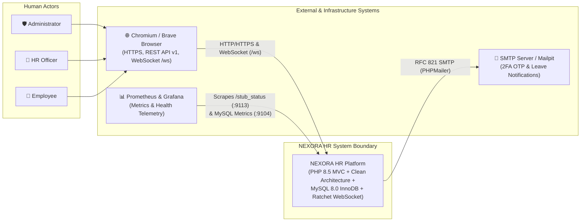
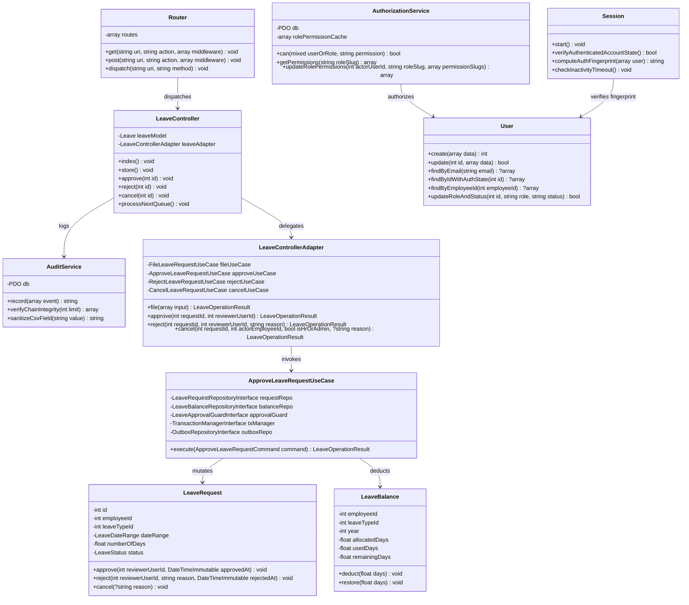
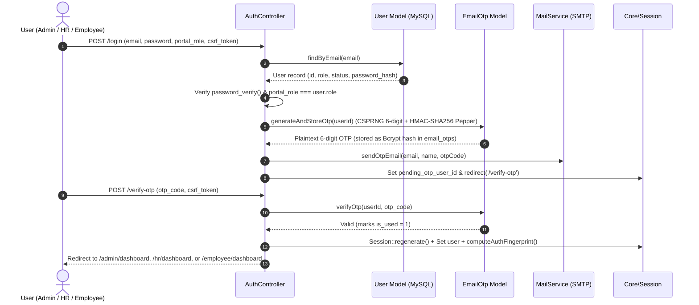
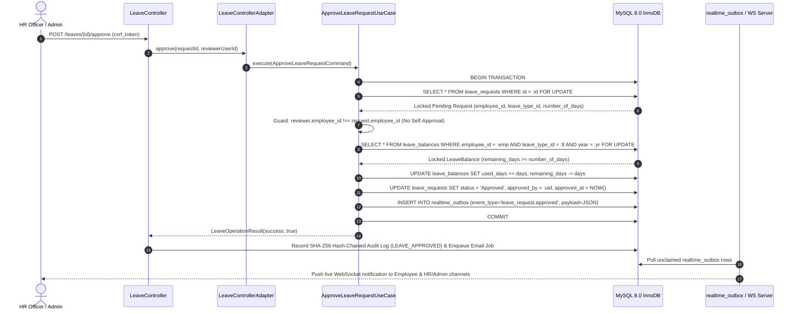
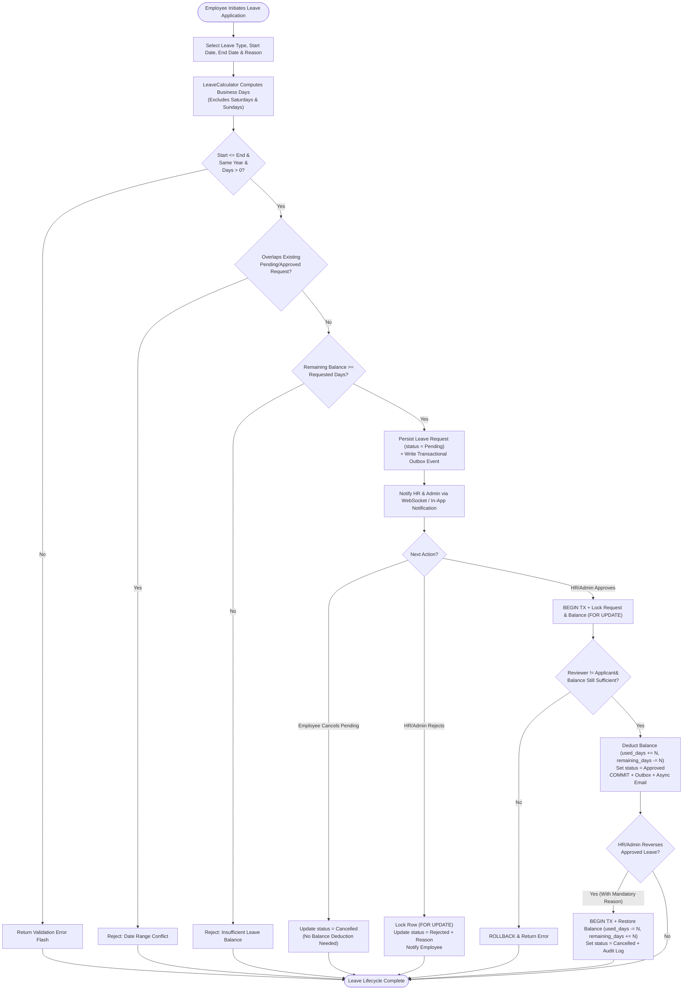
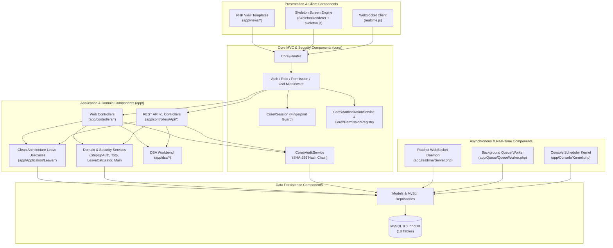
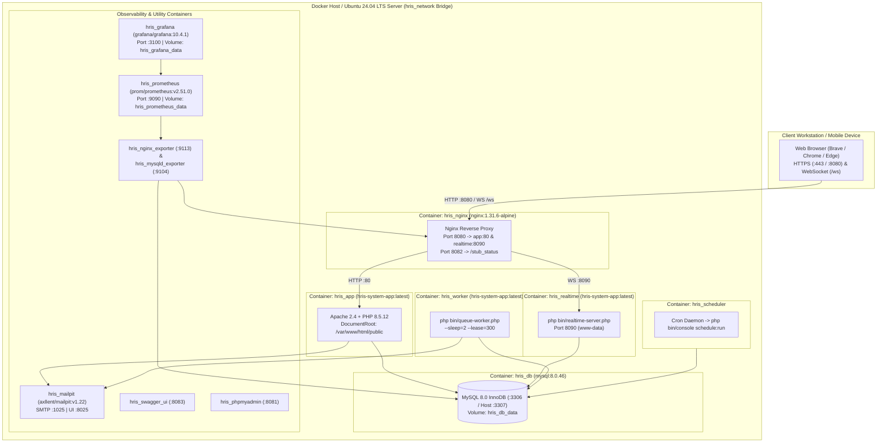

# NEXORA HR — Authoritative UML Diagrams Catalog

**Project:** NEXORA HR — Human Resource Information System  
**Tagline:** People. Processes. Progress.  
**Phase:** 16 — UML Specifications (Context, Use Case, Class, Sequence, Activity, Component, Deployment)  
**Implementation Status:** Implemented and Verified against Source Code  

---

## 1. System Context Diagram

Shows the boundary of **NEXORA HR** and its interactions with the three approved human actors (`Admin`, `HR`, `Employee`) and external/supporting infrastructure systems (`SMTP Mail Relay`, `Prometheus/Grafana Telemetry`).

---

## 2. UML Use Case Diagram (Three-Role RBAC Model)

Represents the exact capabilities enforced by `Core\PermissionRegistry`, `Core\AuthorizationService`, `Core\RoleMiddleware`, and `Core\PermissionMiddleware`.

```mermaid
flowchart LR
    Admin(["🛡️ Administrator\n(role = admin)"])
    HR(["💼 HR Officer\n(role = hr)"])
    Emp(["👤 Employee\n(role = employee)"])

    subgraph AuthBoundary["Authentication & Security"]
        UC_Login("Sign In via Portal + 2FA Email OTP / TOTP")
        UC_StepUp("Verify Step-Up Authentication for Sensitive Actions")
    end

    subgraph AdminBoundary["System Governance (Admin Only)"]
        UC_AdminDash("View Admin Governance Dashboard")
        UC_ManageUsers("Provision, Activate/Deactivate Users & Assign Roles")
        UC_ManageRBAC("Configure Dynamic Role-Permission Matrix")
        UC_ProvisionAdmin("Provision Additional Administrator Account")
        UC_SecEvents("Monitor Security Events & System Health")
        UC_SysSettings("Manage Auth, General & Notification Settings")
    end

    subgraph WorkforceBoundary["Workforce & Leave Operations (HR & Admin)"]
        UC_HRDash("View HR Operational Dashboard")
        UC_EmpCRUD("Create, View, Edit & Deactivate Employee Records")
        UC_DeptPos("Manage Departments & Job Positions")
        UC_LeaveReview("Approve / Reject Leave Requests (FIFO & Pessimistic Lock)")
        UC_LeaveBal("Manage Leave Types & Adjust Annual Balances")
        UC_Reports("Generate Analytics & Export Sanitized CSV Reports")
        UC_Audit("Inspect Tamper-Evident Hash-Chained Audit Trail")
        UC_DSA("Execute DSA Laboratory & Algorithm Visualizers")
    end

    subgraph SelfServiceBoundary["Employee Self-Service (Employee)"]
        UC_EmpDash("View Employee Self-Service Dashboard")
        UC_OwnProfile("View Personal Employment Profile")
        UC_FileLeave("Submit Leave Application (Working-Day Calculation)")
        UC_CancelOwn("Withdraw Own Pending Leave Request")
        UC_OwnHistory("View Own Leave Balances, History & Notifications")
    end

    Admin --> UC_Login
    Admin --> UC_StepUp
    Admin --> UC_AdminDash
    Admin --> UC_ManageUsers
    Admin --> UC_ManageRBAC
    Admin --> UC_ProvisionAdmin
    Admin --> UC_SecEvents
    Admin --> UC_SysSettings
    Admin --> UC_EmpCRUD
    Admin --> UC_DeptPos
    Admin --> UC_LeaveReview
    Admin --> UC_LeaveBal
    Admin --> UC_Reports
    Admin --> UC_Audit
    Admin --> UC_DSA

    HR --> UC_Login
    HR --> UC_StepUp
    HR --> UC_HRDash
    HR --> UC_EmpCRUD
    HR --> UC_DeptPos
    HR --> UC_LeaveReview
    HR --> UC_LeaveBal
    HR --> UC_Reports
    HR --> UC_Audit
    HR --> UC_DSA

    Emp --> UC_Login
    Emp --> UC_EmpDash
    Emp --> UC_OwnProfile
    Emp --> UC_FileLeave
    Emp --> UC_CancelOwn
    Emp --> UC_OwnHistory
```

---

## 3. UML Class Diagram (Core Framework, Domain Use Cases & Persistence)

Reflects the actual classes in `Core\*`, `App\Controllers\*`, `App\Application\Leave\*`, `App\Domain\Leave\*`, `App\Services\*`, and `App\Models\*`.

---

## 4. UML Sequence Diagrams

### 4.1 Portal Login, 2FA Email OTP & Session Fingerprint Initialization

### 4.2 Transaction-Safe Leave Approval with Pessimistic Locking & Outbox

---

## 5. UML Activity Diagram — Complete Leave Request Lifecycle

---

## 6. UML Component Diagram

---

## 7. UML Deployment Diagram

Reflects the verified multi-container Docker Compose topology (`docker-compose.yml`) and production Linux host deployment.

