# NEXORA HR — Authoritative System Workflows & Flowcharts

**Project:** NEXORA HR — Human Resource Information System  
**Tagline:** People. Processes. Progress.  
**Phase:** 16 — Reconciled End-to-End System Flowcharts  
**Implementation Status:** Implemented and Verified against Source Code  

---

## 1. Authentication & Authorization Workflow

Traces `AuthController::login()`, `AuthController::verifyOtp()`, `AuthController::verifyTotp()`, `Core\Session::verifyAuthenticatedAccountState()`, and `Core\PermissionMiddleware`.

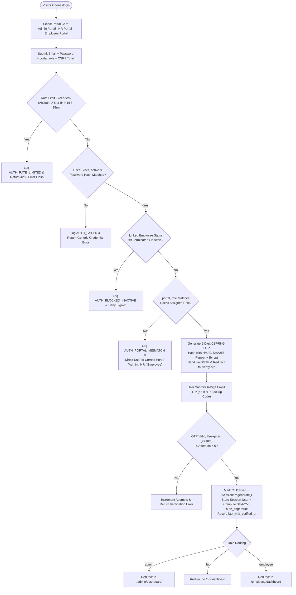

---

## 2. Administrator Governance Workflow

Traces `AdminController` and `UserController` operations exclusively accessible to `role = 'admin'`.

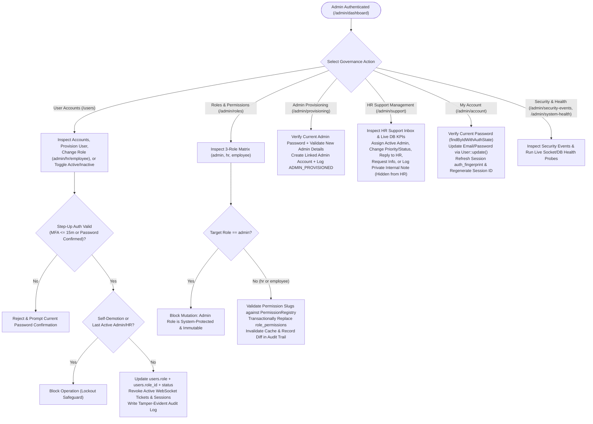

---

## 3. HR Officer Operational Workflow

Traces `DashboardController`, `EmployeeController`, `DepartmentController`, `PositionController`, `LeaveController`, `ReportController`, and `HrAdminSupportController`.

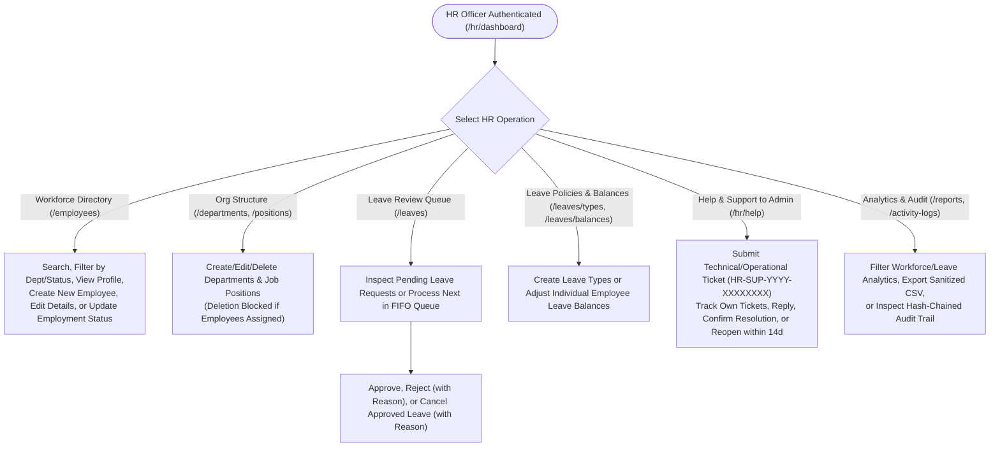

---

## 4. Employee Self-Service Workflow

Traces `DashboardController::index()`, `DashboardController::profile()`, `LeaveController::create()`, `LeaveController::store()`, `LeaveController::cancel()`, and `NotificationController`.

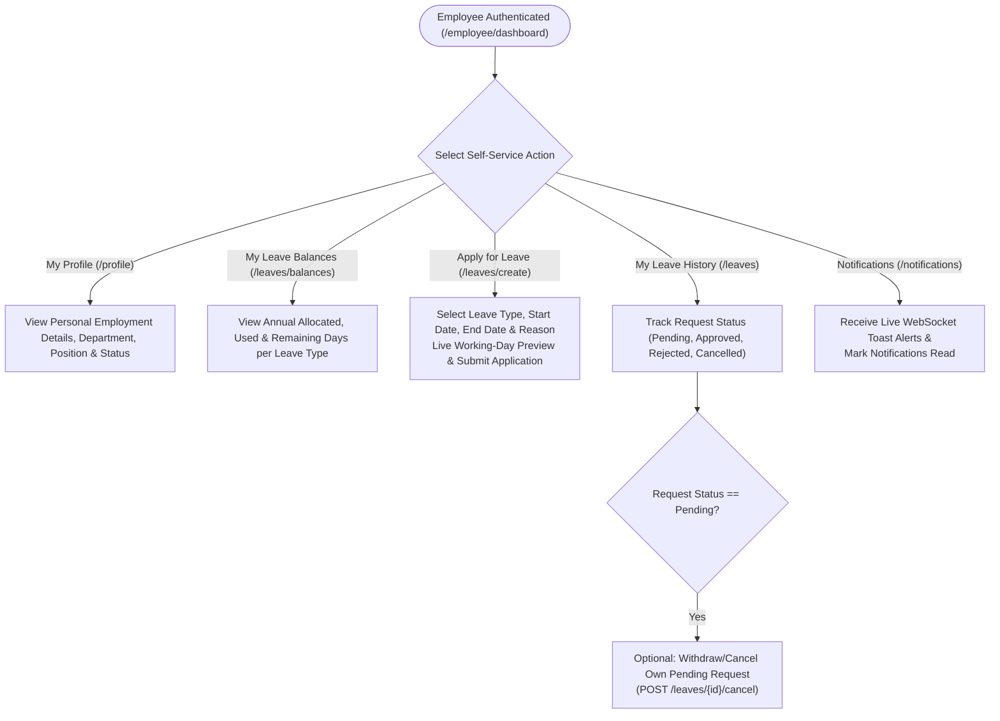

---

## 5. Employee Management & Auto-Provisioning Workflow

Traces `EmployeeController::store()`, `EmployeeController::update()`, and `EmployeeController::deactivate()`.

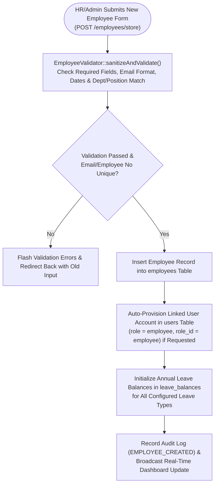

---

## 6. Leave Request Submission Workflow

Traces `LeaveController::store()` -> `LeaveControllerAdapter::file()` -> `FileLeaveRequestUseCase::execute()`.

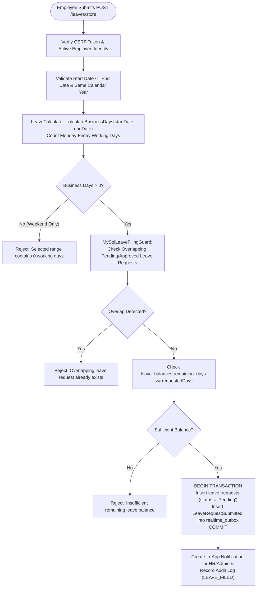

---

## 7. Leave Approval, Rejection & Cancellation Workflows

### 7.1 Leave Approval & Rejection (`ApproveLeaveRequestUseCase` / `RejectLeaveRequestUseCase`)

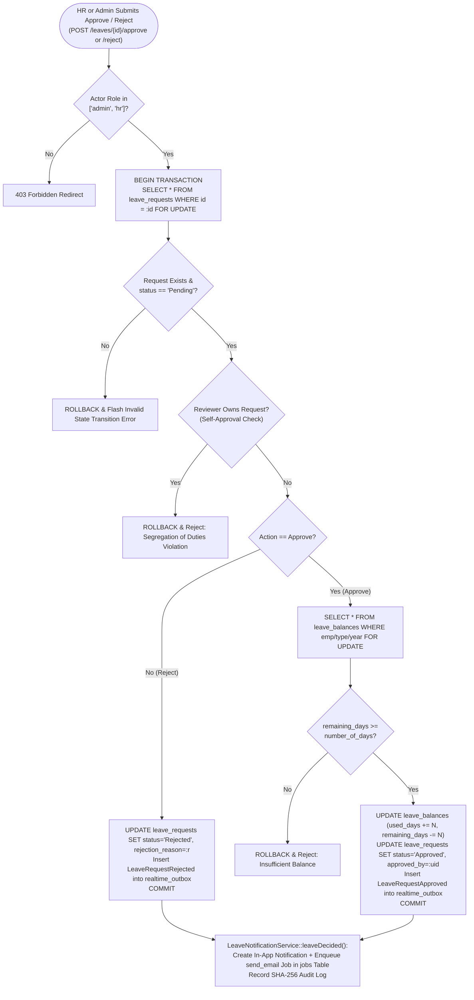

### 7.2 Leave Cancellation & Balance Refund (`CancelLeaveRequestUseCase`)

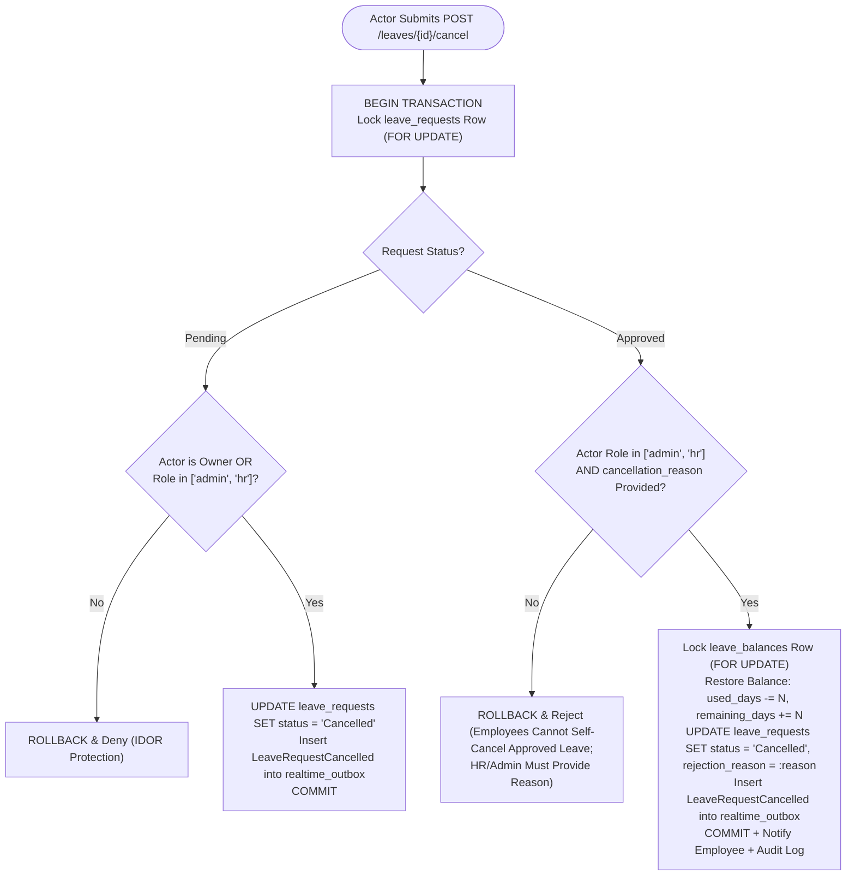

---

## 8. Notification, Transactional Outbox & Background Queue Workflow

Traces `realtime_outbox`, `app/realtime/Server.php`, `app/Queue/QueueService.php`, and `app/Queue/QueueWorker.php`.

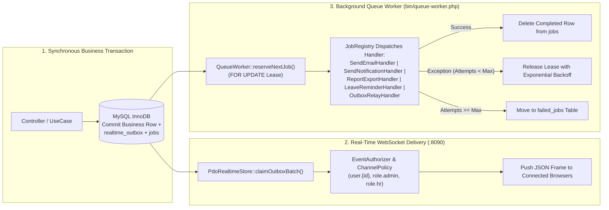

---

## 9. Tamper-Evident Audit Trail Workflow

Traces `Core\AuditService::record()` and `Core\AuditService::verifyChainIntegrity()`.

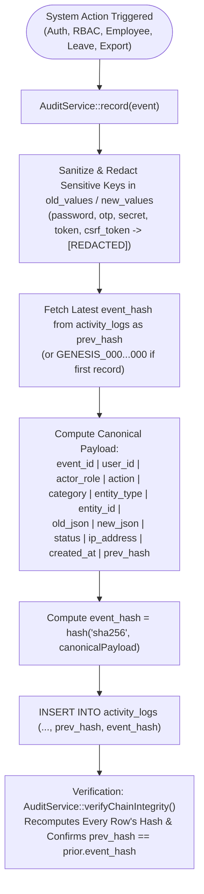

---

## 10. Deployment & CI/CD Pipeline Workflow

Traces `.github/workflows/ci.yml` and `docker-compose.yml`.

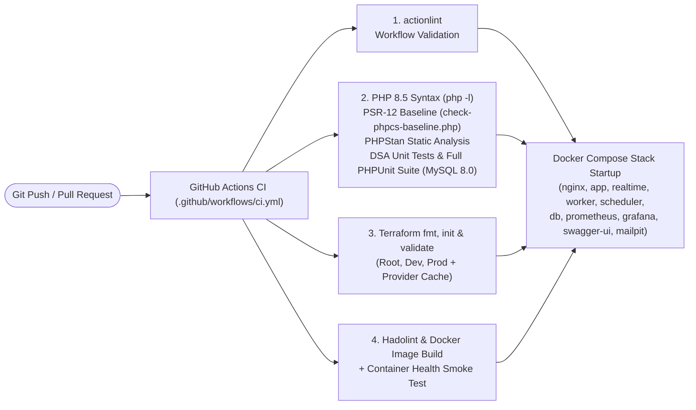

