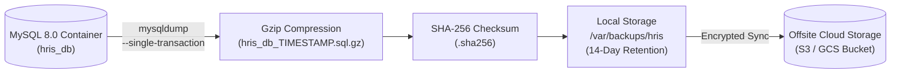

# HRIS-SYSTEM: Backup, Restore & Disaster Recovery Standard

**Document:** `docs/devops/backup-and-recovery.md`  
**Target System:** MySQL 8.0 InnoDB on Linux VPS  
**RPO (Recovery Point Objective):** <= 1 Hour  
**RTO (Recovery Time Objective):** <= 30 Minutes  
**Status:** Approved Standard  

---

## 1. Backup Strategy Overview

To protect employee and leave transaction records against accidental deletion, ransomware, corruption, or catastrophic hardware failure, the system implements automated daily logical dumps with transaction isolation and offsite replication.



---

## 2. Automated Scheduled Backup Procedure

The backup script `scripts/backup/backup-db.sh` executes a non-locking, transaction-consistent logical dump using `mysqldump --single-transaction --quick --routines --triggers`.

### Daily Cron Configuration

On the VPS host, install a cron entry under the `deployer` user (`crontab -e`):

```cron
# Run daily database backup at 02:00 AM UTC
0 2 * * * /var/www/hris/scripts/backup/backup-db.sh >> /var/log/hris-backup.log 2>&1
```

### Script Execution & Output Verification

Manually test the backup process:

```bash
chmod +x scripts/backup/backup-db.sh
./scripts/backup/backup-db.sh
```

Example output:
```
[2026-10-31 02:00:00Z] Starting HRIS database backup...
[2026-10-31 02:00:00Z] Streaming compressed dump to /var/backups/hris/hris_db_20261031_020000.sql.gz...
[2026-10-31 02:00:02Z] Backup completed successfully: /var/backups/hris/hris_db_20261031_020000.sql.gz (1.2M)
[2026-10-31 02:00:02Z] SHA-256 Checksum: e3b0c44298fc1c149afbf4c8996fb92427ae41e4649b934ca495991b7852b855
[2026-10-31 02:00:02Z] Pruning backups older than 14 days...
[2026-10-31 02:00:02Z] Backup routine finished successfully.
```

---

## 3. Disaster Recovery & Restoration Procedure

In the event of a catastrophic database failure, follow this exact recovery sequence:

### Step 1: Put Application into Maintenance Mode

To prevent concurrent writes while restoring:

```bash
# In Nginx or front controller:
touch /var/www/hris/public/maintenance.flag
```

### Step 2: Identify the Latest Valid Backup Snapshot

```bash
ls -lht /var/backups/hris/*.sql.gz | head -n 5
```

### Step 3: Execute Database Restoration Script

```bash
chmod +x scripts/restore/restore-db.sh
./scripts/restore/restore-db.sh /var/backups/hris/hris_db_20261031_020000.sql.gz
```

The script will:
1. Validate the SHA-256 checksum matching `hris_db_20261031_020000.sql.gz.sha256`.
2. Uncompress and stream the SQL statements into `hris_db`.
3. Query the information schema to verify that all **11 core database tables** exist and report row counts.

### Step 4: Run Application Health & Smoke Tests

Verify system endpoints and transaction consistency:

```bash
./scripts/deploy/smoke-test.sh https://hris.example.com
```

### Step 5: Disable Maintenance Mode

```bash
rm -f /var/www/hris/public/maintenance.flag
```

---

## 4. Offsite Backup Replication Guidelines

Local backups on `/var/backups/hris` protect against software defects or administrative errors. To protect against complete datacenter loss, sync backups daily to an offsite S3 or GCS bucket with server-side encryption:

```bash
# Example using AWS CLI or Rclone
aws s3 sync /var/backups/hris/ s3://hris-offsite-backups/database/ \
  --sse aws:kms \
  --delete
```

Configure bucket lifecycle policies:
- Retain daily backups for 30 days.
- Transition backups older than 30 days to Glacier / Coldline storage.
- Delete backups older than 365 days.

