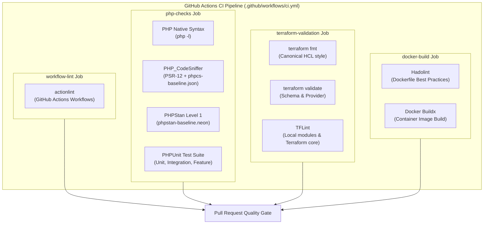

# CI Linting Automation & Code Quality Guide

## 1. Overview & Quality Gates

The HRIS-SYSTEM CI pipeline automates static analysis, coding standards enforcement, and configuration linting across all project layers. This ensures code health, style consistency, and container security without disrupting existing legacy application code.

### Quality Architecture



---

## 2. Tool Inventory and Configuration Files

| Tool | Version | Scope / Target | Configuration File | Baseline / State File |
| :--- | :--- | :--- | :--- | :--- |
| **PHP_CodeSniffer** | `4.0.4` | PSR-12 code style across `app/`, `core/`, `tests/` | [`phpcs.xml.dist`](../../../phpcs.xml.dist) | [`phpcs-baseline.json`](../../../phpcs-baseline.json) |
| **PHPStan** | `2.3.4` | Static analysis (Level 1) across `app/`, `core/` | [`phpstan.neon.dist`](../../../phpstan.neon.dist) | [`phpstan-baseline.neon`](../../../phpstan-baseline.neon) |
| **TFLint** | `v0.55.0` | Terraform HCL linting (`terraform/`, `dev/`) | [`.tflint.hcl`](../../../.tflint.hcl) | Ruleset: `terraform` (preset: `recommended`) |
| **Hadolint** | `v2.12.0` | Dockerfile security and syntax | [`.hadolint.yaml`](../../../.hadolint.yaml) | Failure threshold: `error` |
| **actionlint** | `latest` | Workflow definitions (`.github/workflows/*.yml`) | Built-in rules + shellcheck | Validates all YAML workflows |

---

## 3. Local Execution Guide

Developers can run all linting checks locally prior to committing code:

### PHP Coding Standards (PHPCS PSR-12)
```bash
# Run baseline check (fails only if new violations are introduced)
composer lint:phpcs-baseline

# View full report of all PSR-12 violations
composer lint:phpcs

# Automatically fix whitespace, line-ending, and formatting violations
composer lint:phpcbf

# Re-generate baseline after completing code cleanup
composer lint:phpcs-generate
```

### PHP Static Analysis (PHPStan)
```bash
# Run static analysis at Level 1 with baseline
composer lint:phpstan

# Re-generate baseline after resolving static analysis issues
composer lint:phpstan-baseline
```

### Terraform Linting (TFLint)
```bash
# Initialize plugins and run TFLint
tflint --init
tflint --chdir=terraform
tflint --chdir=terraform/environments/dev

# Alternatively, run via Docker:
docker run --rm -v "${PWD}:/data" -w /data ghcr.io/terraform-linters/tflint:latest --init
docker run --rm -v "${PWD}:/data" -w /data ghcr.io/terraform-linters/tflint:latest --chdir=terraform
docker run --rm -v "${PWD}:/data" -w /data ghcr.io/terraform-linters/tflint:latest --chdir=terraform/environments/dev
```

### Dockerfile Linting (Hadolint)
```bash
# Run Hadolint via Docker
docker run --rm -v "${PWD}:/workspace" -w /workspace hadolint/hadolint hadolint Dockerfile
```

### GitHub Actions Workflow Linting (actionlint)
```bash
# Run actionlint via Docker
docker run --rm -v "${PWD}:/repo" -w /repo rhysd/actionlint:latest
```

### Full Local Check (Convenience)
```bash
# Runs PHPCS baseline check followed by PHPStan analysis
composer lint
```

---

## 4. Baseline Management and Staged Rollout

To maintain engineering momentum while elevating code quality standards, the repository uses **documented baselines**:

1. **PHP_CodeSniffer (`phpcs-baseline.json`):**
   - Established baseline: 309 existing legacy style violations (chiefly line length warnings and header spacing) across 128 files.
   - Any modification or new file that introduces **new** style errors will immediately fail CI.
   - When developers refactor files or run `composer lint:phpcbf`, running `composer lint:phpcs-generate` lowers the allowed threshold permanently.

2. **PHPStan (`phpstan-baseline.neon`):**
   - Established baseline: 11 existing legacy type/call findings across 3 files (`LeaveController.php`, `InstrumentedAlgorithms.php`, `HandshakeGuard.php`).
   - All newly written PHP code must pass PHPStan Level 1 with zero errors.
   - When existing errors are remediated, run `composer lint:phpstan-baseline` to update the baseline.

