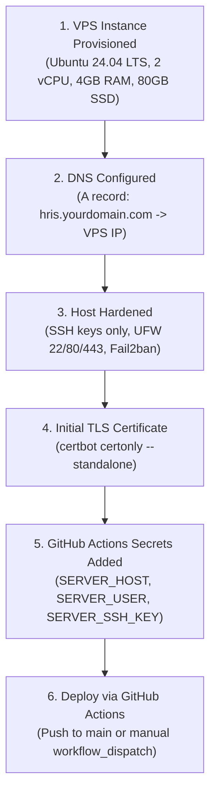

# HRIS-SYSTEM: Future Linux VPS Deployment Runbook

**Document:** `docs/devops/future-vps-deployment.md`  
**Target Architecture:** Single Ubuntu 24.04 LTS VPS with Docker Compose & Nginx  
**Status:** Pre-Deployment Reference  

---

## 1. Prerequisites Checklist

Before executing a production deployment, ensure the following prerequisites are met:



---

## 2. Server Sizing & Hosting Selection

| Resource | Minimum Specification | Recommended Providers |
| :--- | :--- | :--- |
| **Operating System** | Ubuntu 24.04 LTS (Noble Numbat) | Hetzner Cloud (CPX21 / CAX21) |
| **Compute** | 2 vCPUs (x86_64 or ARM64) | DigitalOcean (Regular / Premium Droplet) |
| **Memory** | 4 GB RAM (+ 2 GB swapfile) | Linode / Akamai Cloud |
| **Storage** | 80 GB NVMe / SSD | AWS Lightsail (4 GB tier) |
| **Bandwidth** | 1 TB/month transfer | Vultr (Cloud Compute) |

---

## 3. Host Hardening & Firewall (UFW)

Follow the complete step-by-step instructions in [`docs/devops/vps-provisioning.md`](file:///c:/xampp/htdocs/GitHub_Clone_File_Projects/HRIS-SYSTEM/docs/devops/vps-provisioning.md).

### Summary Firewall Policy:
```bash
# Allow ONLY administrative SSH and public web traffic
sudo ufw default deny incoming
sudo ufw default allow outgoing
sudo ufw allow 22/tcp comment 'SSH'
sudo ufw allow 80/tcp comment 'Nginx HTTP / ACME'
sudo ufw allow 443/tcp comment 'Nginx HTTPS'
sudo ufw enable
```

> [!CAUTION]
> Never open MySQL (3306), Ratchet (8090), Prometheus (9090), or Grafana (3100) on the host firewall. All internal traffic remains private inside the `hris_network` Docker bridge.

---

## 4. HTTPS Certificate Provisioning (Certbot)

Prior to starting the Docker stack, issue an initial certificate while port 80 is unbound:

```bash
sudo certbot certonly --standalone \
  --preferred-challenges http \
  -d hris.yourdomain.com \
  --email admin@yourdomain.com \
  --agree-tos \
  --no-eff-email
```

Certificates will be mounted into Nginx at:
`/etc/letsencrypt/live/hris.yourdomain.com/fullchain.pem`
`/etc/letsencrypt/live/hris.yourdomain.com/privkey.pem`

---

## 5. GitHub Actions Deployment Secrets

To enable automated CD via [`.github/workflows/cd.yml`](file:///c:/xampp/htdocs/GitHub_Clone_File_Projects/HRIS-SYSTEM/.github/workflows/cd.yml), configure these repository secrets:

1. **`SERVER_HOST`**: The public IPv4 address or hostname of your VPS (e.g., `203.0.113.10` or `vps.yourdomain.com`).
2. **`SERVER_USER`**: Dedicated deployment username (e.g., `deployer`).
3. **`SERVER_SSH_KEY`**: Private OpenSSH key corresponding to the public key in `/home/deployer/.ssh/authorized_keys`.
4. **`SERVER_PATH`**: Installation directory on the VPS (default: `/var/www/hris`).

---

## 6. Secure Monitoring Access (SSH Tunneling)

Because Prometheus and Grafana are bound to `127.0.0.1` (loopback) in [`docker-compose.prod.yml`](file:///c:/xampp/htdocs/GitHub_Clone_File_Projects/HRIS-SYSTEM/docker-compose.prod.yml), access them securely from your workstation via an encrypted SSH tunnel without exposing web interfaces to the internet:

```bash
# Forward remote Grafana (3100) and Prometheus (9090) to localhost
ssh -L 3100:127.0.0.1:3100 -L 9090:127.0.0.1:9090 deployer@your-vps-ip
```

Open your local browser to:
- **Grafana Dashboards:** `http://localhost:3100` (User: `hris_admin`, Password: set in `.env.production`)
- **Prometheus TSDB:** `http://localhost:9090`

---

## 7. Emergency Rollback Procedure

If a deployment fails smoke tests or introduces an operational regression:

### Step 1: Revert Containers to Previous Image Tag
```bash
cd /var/www/hris
# Redeploy using the previous known-good git SHA
docker compose -f docker-compose.prod.yml down
# Unpack previous release archive if needed:
tar -xzf dist/hris-system-release-PREVIOUS_SHA.tar.gz
docker compose -f docker-compose.prod.yml up -d --build
```

### Step 2: Restore Database if Migration Altered Schema
```bash
./scripts/restore/restore-db.sh /var/backups/hris/hris_db_PRE_DEPLOYMENT.sql.gz --force
```

### Step 3: Run Smoke Tests
```bash
./scripts/deploy/smoke-test.sh http://127.0.0.1:80
```

