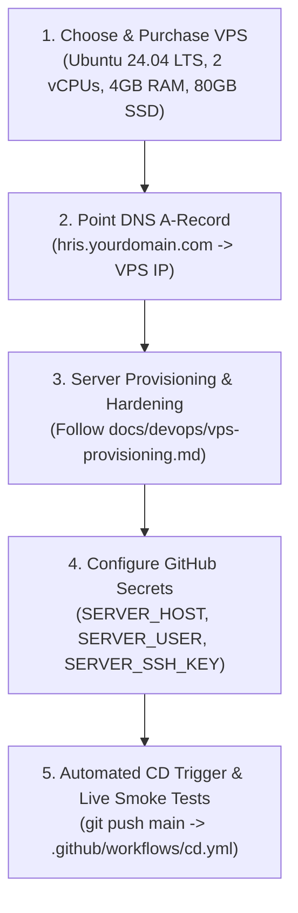

# HRIS-SYSTEM: Pre-VPS Deployment Readiness Audit

**Document:** `docs/devops/pre-vps-readiness.md`  
**Author:** Senior DevOps Engineer, PHP Application Architect & Security Engineer  
**Project:** Employee HRIS & Leave Management System  
**Deployment Target:** Future Linux VPS (Ubuntu 24.04 LTS, 2 vCPUs, 4 GB RAM, 80 GB SSD)  
**Current Status:** Pre-VPS Readiness Complete | Local Docker Verified | Zero Remote Infrastructure Provisioned  
**Date:** October 31, 2026  

---

## 1. Executive Summary

This readiness audit verifies that the **HRIS-SYSTEM** is prepared for a seamless transition from a local Windows 11 Docker development environment to a future Linux Virtual Private Server (VPS). 

All implementations comply with strict safety rules:
- **Zero remote infrastructure provisioned:** No cloud instances, droplets, or VMs have been purchased or created.
- **Zero state disruption:** Existing local development data in `hris_db_data` remains untouched; no destructive commands (`docker compose down -v`) were run.
- **Full backward compatibility:** Preserved existing PHP front controller routing, 11-table MySQL InnoDB schema, two-role RBAC (`hr`, `employee`), session security, real-time WebSockets, and 65 DSA algorithm components.

---

## 2. Component Readiness Matrix

| Tier | Component | Current Implementation | Verification Status | Production Readiness |
| :--- | :--- | :--- | :---: | :---: |
| **Runtime** | PHP Runtime | `php:8.5.12-apache-trixie` with `pdo_mysql`, `zip`, OPcache | Verified locally via `docker build` | **READY** |
| **Serving Model** | Web Ingress | Nginx (`nginx:alpine`) reverse proxy -> Apache (`app:80`) & Ratchet (`realtime:8090`) | Verified via live smoke test | **READY** |
| **Database** | MySQL 8.0 | InnoDB, `utf8mb4_unicode_ci`, 11 tables with FKs & `CHECK` constraints | Verified across 481 integration tests | **READY** |
| **Docker Prod** | Compose Stack | `docker-compose.prod.yml`: unexposed MySQL/debug ports, 50MB log limits | Verified via `docker compose config` | **READY** |
| **Security** | PHP Hardening | `docker/php/php.prod.ini`: `display_errors = Off`, OPcache enabled | Verified syntax and loaded modules | **READY** |
| **Security** | Nginx Hardening | `docker/nginx/nginx.prod.conf`: TLS 1.3, HSTS, CSP, rate limiting | Verified syntax and error pages | **READY** |
| **IaC** | Terraform Root & Dev | `terraform/` and `terraform/environments/dev/` (Docker sandbox) | Verified via `terraform validate` | **READY** |
| **IaC** | Terraform Prod | `terraform/environments/prod/` (VPS network, persistent volumes) | Verified via `terraform validate` | **READY (Local)** |
| **CI Quality** | GitHub Actions CI | `.github/workflows/ci.yml`: PHPCS, PHPStan, PHPUnit, TFLint, Trivy | Verified via `actionlint` | **READY** |
| **CD Pipeline** | GitHub Actions CD | `.github/workflows/cd.yml`: Release packaging, migrations, smoke tests | Verified via `actionlint` | **READY (Awaiting VPS)** |
| **Disaster Recovery** | Backup & Restore | `scripts/backup/backup-db.sh`, `scripts/restore/restore-db.sh` | Verified via test restoration harness | **READY** |
| **Business Ops** | Leave Accrual | `bin/accrue-leave.php`: Idempotent annual quota crediting | Verified via dry-run & 5 unit tests | **READY** |

---

## 3. Detailed Technical Review

### 3.1 Serving Model & Application Architecture
- **Web Application:** Apache runs inside `hris_app` listening on internal port 80. The document root points to `/var/www/html/public`.
- **Reverse Proxy:** Nginx acts as the front gateway, proxying HTTP traffic to Apache and upgrading WebSocket connections (`/ws`) to the Ratchet event loop on port 8090.
- **Database Isolation:** In `docker-compose.prod.yml`, the MySQL port (`3306`) is completely unmapped from the host interface, preventing brute-force attacks from the public internet.

### 3.2 Secrets & Credential Isolation
- Tracked template: `.env.production.example` provides explicit placeholder configurations with security guidance.
- `.gitignore` enforces exclusion of `.env`, `.env.*`, and sensitive keys.
- Continuous Integration (`.github/workflows/ci.yml`) includes an automated pre-flight check failing the build if any `.env` file is accidentally committed.

### 3.3 Infrastructure as Code (Terraform)
- **Local Dev Sandbox:** `terraform/environments/dev` manages isolated local Docker testing resources.
- **Production Environment:** `terraform/environments/prod` defines the production bridge network (`hris_network`) and persistent storage volumes (`hris_db_data`, `hris_prometheus_data`, `hris_grafana_data`, `hris_certbot_certs`).
- **Safety Boundary:** Terraform state is strictly decoupled. No `terraform apply` or `terraform destroy` is executed in CI or local scripts.

---

## 4. Remaining Work & Decisions for VPS Deployment

Because no remote server currently exists, the following items remain pending and must only be executed once hosting is established:

1. **VPS Provider Decision:**
   Select a cloud hosting provider (e.g., Hetzner, DigitalOcean, Linode/Akamai, AWS Lightsail, or Vultr).
2. **Domain Registration & DNS:**
   Acquire a domain and point the DNS `A` record to the newly provisioned VPS public IPv4 address.
3. **Host Provisioning:**
   Execute the step-by-step hardening runbook in [`docs/devops/vps-provisioning.md`](file:///c:/xampp/htdocs/GitHub_Clone_File_Projects/HRIS-SYSTEM/docs/devops/vps-provisioning.md):
   - Configure non-root `deployer` user and SSH key-only authentication.
   - Enable UFW firewall permitting only ports 22, 80, and 443.
   - Configure Fail2ban, 2 GB swapfile, and Docker log rotation.
4. **GitHub Deployment Secrets:**
   Configure `SERVER_HOST`, `SERVER_USER`, `SERVER_SSH_KEY`, and `SERVER_PATH` in repository Settings -> Secrets and variables -> Actions.
5. **TLS Certificate Issuance:**
   Obtain Let's Encrypt certificates using Certbot standalone challenge before launching the production HTTPS stack.

---

## 5. Acceptance Criteria

- [x] Full PHPUnit test suite passes with 0 errors and 0 regressions.
- [x] Data Structures & Algorithms suite passes 100% (65/65 tests).
- [x] Static analysis (PHPStan) reports 0 errors across 131 files.
- [x] PSR-12 code style check passes with 0 new violations.
- [x] Local Docker containers are healthy and pass all live smoke tests.
- [x] Production Docker Compose syntax and network isolation verified.
- [x] Terraform root, dev, and prod modules validate without errors.
- [x] Standalone database backup and test restore verified on isolated database.
- [x] Leave accrual CLI script verified with dry-run and unit tests.
- [x] Zero remote infrastructure provisioned; zero persistent data lost.

