# HRIS-SYSTEM: Production Readiness Audit & Implementation Plan

**Document:** `docs/devops/production-readiness-audit.md`  
**Author:** Senior DevOps, SRE, Security Engineer & PHP Application Architect  
**Project:** Employee HRIS & Leave Management System (`HRIS-SYSTEM`)  
**Deployment Target:** Linux VPS (Ubuntu LTS, Docker Compose, Nginx, MySQL 8.0, Prometheus, Grafana)  
**Date:** October 31, 2026  
**Status:** Approved for Implementation  

---

## 1. Executive Summary

This production-readiness audit examines the current architecture, container environment, CI/CD pipelines, security posture, and test coverage of the **HRIS-SYSTEM**. The objective is to incrementally harden, containerize, and prepare the system for a reliable, highly secure, and reproducible deployment on an Ubuntu LTS Linux VPS (2 vCPUs, 4 GB RAM, 80 GB SSD) without rewriting existing business logic, breaking database schemas, or risking data loss.

---

## 2. Current Architecture & Deployment Flow

```mermaid
flowchart TD
    Client["Browser / Mobile Client (HTTPS:443 / WSS)"] -->|Public Traffic| Nginx["Nginx Reverse Proxy (Container: hris_nginx)"]
    
    subgraph Isolated Bridge Network ["Docker Isolated Bridge Network (hris_network)"]
        Nginx -->|HTTP Reverse Proxy (app:80)| App["PHP 8.5 + Apache Front Controller (Container: hris_app)"]
        Nginx -->|WebSocket Upgrade (/ws -> realtime:8090)| Realtime["Ratchet WebSocket Server (Container: hris_realtime)"]
        
        App -->|Internal MySQL (Port 3306)| DB[("MySQL 8.0 InnoDB (Container: hris_db)")]
        Realtime -->|Read-only State Verification| DB
        
        App -->|Scrape /metrics| Prom["Prometheus Server (Container: hris_prometheus)"]
        NginxExp["Nginx Exporter (hris_nginx_exporter)"] -->|Scrape stub_status:8082| Nginx
        MySQLExp["MySQL Exporter (hris_mysqld_exporter)"] -->|Scrape metrics:9104| DB
        
        Prom -->|Scrape 9113| NginxExp
        Prom -->|Scrape 9104| MySQLExp
        Grafana["Grafana Dashboards (Container: hris_grafana)"] -->|PromQL Queries:9090| Prom
    end

    subgraph Persistent Storage ["Persistent Storage Volumes"]
        DB -->|Mount /var/lib/mysql| DBData[("Volume: hris_db_data")]
        Prom -->|Mount /prometheus| PromData[("Volume: hris_prometheus_data")]
        Grafana -->|Mount /var/lib/grafana| GrafData[("Volume: hris_grafana_data")]
    end
```

### 2.1 Actual Serving Model
- **Web / Application Server:** PHP 8.5 (`php:8.5.12-apache-trixie`) running Apache with `mod_rewrite` and `mod_headers` inside container `hris_app`. The document root is mapped to `/var/www/html/public`.
- **Front Reverse Proxy:** `nginx:alpine` (`hris_nginx`) acts as the single public entry point for incoming HTTP/HTTPS traffic. It proxies standard HTTP requests to Apache (`http://hris_backend` / `app:80`) and WebSocket requests (`/ws`) to `realtime:8090`.
- **WebSocket Daemon:** `cboden/ratchet` event loop running in `hris_realtime` on internal port 8090. Connection authorization uses single-use SHA-256 tickets generated during authenticated HTTP sessions.
- **Database:** MySQL 8.0 (`hris_db`) on internal port 3306 with persistent volume `hris_db_data`.
- **Observability:** Prometheus 2.51 (`hris_prometheus`) scraping Nginx stub status (via `nginx-prometheus-exporter`), MySQL performance metrics (via `mysqld-exporter`), and the application `/metrics` endpoint. Grafana 10.4 (`hris_grafana`) with provisioned dashboards.

---

## 3. Existing Components to Retain

| Component | Repository Path | Justification |
| :--- | :--- | :--- |
| **Domain-Driven Design (DDD) & ACL** | `app/Domain/Leave/`, `app/Application/Leave/`, `app/Infrastructure/Leave/` | Clean domain entities, value objects, transactional use cases with pessimistic locking, and Anti-Corruption Layer (ACL) controller adapters. |
| **Two-Role RBAC Model** | `core/RoleMiddleware.php`, `app/controllers/AuthController.php` | Strictly enforces access control between `hr` and `employee`. No demo or administrative backdoors exist. |
| **Database Schema & Migrations** | `database/schema.sql`, `database/migrations/`, `bin/migrate.php` | 11 core tables with foreign key constraints, `CHECK` validations, unique indexes, and automated CLI migration tracking. |
| **Data Structures & Algorithms (DSA)** | `app/dsa/`, `scratch/test_dsa_suite.php` | In-memory queues, stacks, linked lists, hash tables, sorting algorithms, and BST implementations. |
| **Automated Test Suite** | `tests/`, `phpunit.xml` | 476 PHPUnit tests (2,085 assertions) covering domain, application, controllers, auth, transactions, and security. |
| **Modular Terraform Architecture** | `terraform/` | Reusable child modules (`modules/network`, `modules/sandbox`) and isolated environment definitions (`environments/dev`). |

---

## 4. Missing or Incomplete Production Requirements

1. **Production Docker Compose Configuration (`docker-compose.prod.yml`):**
   - Development `docker-compose.yml` publishes internal services to the host (`3307:3306` for MySQL, `8081:80` for phpMyAdmin, `8083:8080` for Swagger UI, `9090:9090` for Prometheus, `3100:3000` for Grafana).
   - In production, database and debugging containers must **never** expose ports to the public host interface; phpMyAdmin and Swagger UI must be disabled or strictly internal.
2. **PHP Production Hardening:**
   - In `docker/php/php.ini`, `display_errors = On` and `display_startup_errors = On` must be switched to `Off` for production to prevent leaking sensitive variables, stack traces, or SQL queries.
   - OPcache is not enabled in the container, reducing PHP execution throughput.
3. **Automated Standalone Backup & Verification Scripts:**
   - Backups are currently documented in Markdown (`docs/deployment/backup-and-restore.md`), but executable, automated shell scripts (`scripts/backup/backup-db.sh` and `scripts/restore/restore-db.sh`) with gzip compression, checksums, and table integrity verification are missing.
4. **Automated Leave Accrual Service (Phase 9):**
   - The system lacks an automated, idempotent CLI batch command (`bin/accrue-leave.php`) to credit monthly/annual leave balances to active employees with transaction safety and audit logging.
5. **Nginx Hardening & Automated TLS (HTTPS):**
   - Nginx configuration needs SSL/TLS certificate directives, modern TLS ciphers (TLSv1.2, TLSv1.3), HSTS headers, strict Content Security Policy (CSP), request rate limiting, and Let's Encrypt / Certbot renewal hooks.
6. **CI/CD Pipeline Security Scanning:**
   - `.github/workflows/ci.yml` performs PHP linting, PHPStan, PHPUnit, and Terraform formatting, but lacks container vulnerability scanning (Trivy), Dockerfile best-practice enforcement in CI, and Terraform static security checks (TFLint / Checkov).
7. **Production Deployment Automation (`.github/workflows/cd.yml`):**
   - `.github/workflows/cd.yml` has a basic SSH deployment stub but lacks health checks, container rollback routines, and smoke test execution post-deployment.
8. **VPS Host Hardening Runbook:**
   - Requires an operational guide (`docs/devops/vps-provisioning.md`) detailing Ubuntu LTS host preparation, SSH key authentication, UFW firewall rules, Fail2ban configuration, and Docker daemon security.

---

## 5. Security & Operational Risk Matrix

| Risk ID | Vulnerability / Threat | Impact | Severity | Mitigation Strategy |
| :--- | :--- | :--- | :--- | :--- |
| **SEC-01** | Database port 3306/3307 exposed to public internet | Unauthorized brute-force attacks on MySQL | **CRITICAL** | Eliminate host port bindings in `docker-compose.prod.yml`; isolate MySQL strictly inside `hris_network`. |
| **SEC-02** | `display_errors = On` in production PHP runtime | Disclosure of database credentials, file paths, and SQL queries | **HIGH** | Set `display_errors = Off`, `log_errors = On`, and configure dedicated error logging in production `php.ini`. |
| **SEC-03** | Missing HTTPS / SSL termination | Man-in-the-middle (MitM) eavesdropping on credentials and session cookies | **HIGH** | Configure Nginx with Let's Encrypt TLS 1.3, HSTS (`max-age=31536000`), and enforce `SESSION_COOKIE_SECURE=true`. |
| **SEC-04** | Running container as root user | Potential container escape or privilege escalation | **MEDIUM** | Enforce non-root user `www-data:www-data` in Dockerfile and Docker Compose services. |
| **OPS-01** | No automated database backup / restore verification | Irreversible data loss in the event of hardware or software failure | **CRITICAL** | Deploy automated daily `mysqldump` script with gzip, SHA-256 checksums, and a verified test-restore harness. |
| **OPS-02** | Unbounded Docker container logs | Disk exhaustion leading to container crashes | **MEDIUM** | Configure Docker daemon `log-driver: json-file` with `max-size: 50m` and `max-file: 3`. |
| **OPS-03** | Leave accrual inconsistency | Employee leave disputes or double-crediting | **MEDIUM** | Build idempotent `bin/accrue-leave.php` with unique balance tracking and audit logging. |

---

## 6. Automated Tests & CI Baseline Status

- **PHPUnit Test Suite:**
  - Runtime: PHP 8.5.12
  - Status: **476 tests, 2,085 assertions, 0 failures, 0 errors, 3 skipped**
- **Data Structures & Algorithms (DSA) Suite:**
  - Script: `scratch/test_dsa_suite.php`
  - Status: **65 tests run, 65 passed (100% pass rate)**
- **Static Analysis (PHPStan):**
  - Command: `vendor/bin/phpstan analyse --memory-limit 512M`
  - Status: **131 files analyzed, 0 errors**
- **Code Style (PHP_CodeSniffer PSR-12):**
  - Command: `php bin/check-phpcs-baseline.php`
  - Status: **Passed (0 new violations beyond established baseline)**
- **Infrastructure as Code (Terraform):**
  - Formatting: `terraform fmt -check -recursive` (Passed)
  - Validation: Root module and dev environment (`terraform validate` Passed)

---

## 7. Terraform State & Resource Ownership

- **Current State:** `terraform/terraform.tfstate` manages local Docker sandbox resources via the `kreuzwerker/docker` provider:
  - Network: `module.network.docker_network.network` (`hris_tf_test_network`)
  - Image: `module.sandbox.docker_image.image` (`alpine:3.21.3`)
  - Container: `module.sandbox.docker_container.container` (`hris_tf_test_sandbox`)
- **State Protection Rule:** Existing local Docker test state is decoupled from production VPS provisioning. Production Terraform resources will be defined in a dedicated module/environment (`terraform/environments/prod`) and will not overwrite local state. No `terraform apply` or `destroy` will be executed against live infrastructure without manual approval.

---

## 8. Proposed Changes & Affected Files

```
HRIS-SYSTEM/
├── .github/workflows/
│   ├── ci.yml                          # Add Trivy, TFLint, Hadolint security scanning
│   └── cd.yml                          # Add automated release packaging, SSH deployment, smoke tests
├── bin/
│   └── accrue-leave.php                # [NEW] Idempotent leave accrual CLI command
├── docker/
│   ├── nginx/
│   │   ├── default.conf                # Retain development reverse proxy config
│   │   └── nginx.prod.conf             # [NEW] Hardened HTTPS Nginx configuration with TLS, headers, rate limits
│   ├── php/
│   │   ├── php.ini                     # Retain development PHP config
│   │   └── php.prod.ini                # [NEW] Production PHP config (display_errors=Off, opcache enabled)
│   └── prometheus/
│       └── alert_rules.yml             # [NEW] Production alerting rules (disk, memory, mysql, latency)
├── docker-compose.prod.yml             # [NEW] Production Compose stack (internal ports, healthchecks, logging limits)
├── docs/devops/
│   ├── production-readiness-audit.md   # [THIS FILE] Phase 0 comprehensive audit
│   ├── vps-provisioning.md             # [NEW] Phase 5 VPS setup and hardening runbook
│   ├── backup-and-recovery.md          # [NEW] Phase 7 Backup & restore operational procedures
│   └── leave-accrual-operations.md     # [NEW] Phase 9 Leave accrual design and scheduling guide
├── scripts/
│   ├── backup/
│   │   └── backup-db.sh                # [NEW] Automated MySQL dump script with retention and checksums
│   ├── restore/
│   │   └── restore-db.sh               # [NEW] Database restoration script with integrity checks
│   └── deploy/
│       └── smoke-test.sh               # [NEW] Post-deployment automated HTTP/WebSocket smoke tests
└── tests/
    └── Unit/
        └── LeaveAccrualTest.php        # [NEW] Automated unit test for leave accrual operations
```

---

## 9. Phased Implementation Roadmap

```mermaid
flowchart LR
    P0["Phase 0: Audit & Plan"] --> P1["Phase 1: Code & Security Gates"]
    P1 --> P2["Phase 2: Production Docker"]
    P2 --> P3["Phase 3: Nginx & HTTPS"]
    P3 --> P4["Phase 4: Terraform VPS"]
    P4 --> P5["Phase 5: VPS Host Hardening"]
    P5 --> P6["Phase 6: CI/CD Pipeline"]
    P6 --> P7["Phase 7: Backup & Recovery"]
    P7 --> P8["Phase 8: Monitoring & Alerting"]
    P8 --> P9["Phase 9: Leave Accrual Ops"]
    P9 --> P10["Phase 10: Final Verification"]
```



### Phase Details & Acceptance Criteria

| Phase | Deliverables | Acceptance Criteria |
| :--- | :--- | :--- |
| **Phase 0: Audit & Plan** | `docs/devops/production-readiness-audit.md` | Full repository audit completed; architecture, risks, and roadmap documented. |
| **Phase 1: Code & Security Gates** | Update `.github/workflows/ci.yml`, add Trivy & TFLint checks | CI executes PHPCS, PHPStan, PHPUnit, Hadolint, TFLint, and Trivy without errors. |
| **Phase 2: Production Docker** | `docker-compose.prod.yml`, `docker/php/php.prod.ini`, hardened Dockerfile | MySQL/debug ports unexposed to host; non-root user; OPcache active; error display off. |
| **Phase 3: Nginx & HTTPS** | `docker/nginx/nginx.prod.conf`, Let's Encrypt certbot documentation | TLSv1.2/1.3, strict security headers, rate limiting, and blocked sensitive file extensions. |
| **Phase 4: Terraform VPS** | `terraform/environments/prod/`, VPS IaC configuration | Validated Terraform definitions for production VPS without overwriting dev state. |
| **Phase 5: VPS Hardening** | `docs/devops/vps-provisioning.md` | Comprehensive guide for SSH keys, UFW firewall (22/80/443), Fail2ban, and Docker daemon limits. |
| **Phase 6: CI/CD Pipeline** | `.github/workflows/cd.yml`, `scripts/deploy/smoke-test.sh` | Automated release packaging, SSH deployment trigger, health checks, and rollback plan. |
| **Phase 7: Backup & Recovery** | `scripts/backup/backup-db.sh`, `scripts/restore/restore-db.sh`, `docs/devops/backup-and-recovery.md` | Non-locking single-transaction dumps, gzip compression, automated restore verification. |
| **Phase 8: Monitoring & Alerting** | `docker/prometheus/alert_rules.yml`, Grafana dashboard verification | Prometheus alerts for high CPU, memory, disk, and MySQL connection exhaustion. |
| **Phase 9: Leave Accrual Ops** | `bin/accrue-leave.php`, `tests/Unit/LeaveAccrualTest.php` | Idempotent annual/monthly leave crediting, transaction-safe, audit logged, and tested. |
| **Phase 10: Final Verification** | Full test run (`phpunit`), static analysis, linting, and acceptance report | All tests pass, static analysis clean, zero security regressions. |

---

## 10. Actions Requiring Explicit User Approval

The following operations interact with live external infrastructure or credentials and **require explicit user authorization** before execution:
1. Executing `terraform apply` or `terraform destroy` against real cloud or VPS infrastructure.
2. Configuring production server secrets (`SERVER_HOST`, `SERVER_USER`, `SERVER_SSH_KEY`) in GitHub Actions.
3. Provisioning or requesting live Let's Encrypt certificates over the public internet (requires a live registered domain and public DNS resolution).
4. Any operation that modifies or deletes live database volumes (`docker volume rm hris_db_data`).

All subsequent implementation steps in this roadmap are strictly local to the repository and maintain full backward compatibility with the existing application and test suite.

