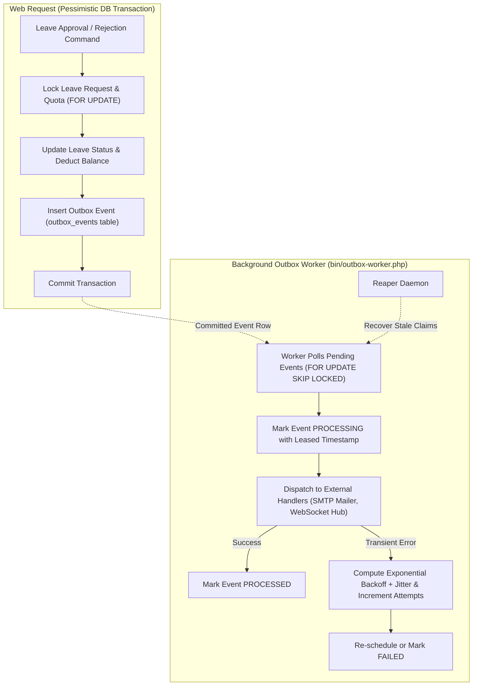

# HRIS-SYSTEM — Reliability, Security, and Production Readiness Audit

**Document Reference:** `docs/devops/reliability-readiness.md`  
**Current Baseline Date:** October 31, 2026  
**Auditor Roles:** Senior PHP Architect, DDD Engineer, Security Engineer, Site Reliability Engineer  
**Scope:** Complete repository assessment prior to implementing Transactional Outbox, TOTP 2FA, PITR, Log Aggregation, and VPS readiness.  
**Status:** AUDITED & BASELINE ESTABLISHED ✅

---

## 1. Baseline System Architecture

### 1.1 Domain Events & Event Dispatcher
- **Contracts:**
  - `App\Domain\Common\DomainEventInterface`: Base interface requiring `occurredAt(): DateTimeImmutable`.
  - `App\Domain\Common\EventDispatcherInterface`: Defines `dispatch(object $event): void` and `subscribe(string $eventClass, callable $handler): void`.
  - `App\Domain\Common\TransactionManagerInterface`: Defines `transactional(callable $operation): mixed`.
- **Implementations:**
  - `App\Infrastructure\Events\EventDispatcher`: In-memory synchronous event dispatcher iterating over subscribed callable handlers.
  - `App\Infrastructure\Events\EventBootstrap`: Configures standard handler bindings for `LeaveApprovedEvent` and `LeaveRejectedEvent`.
- **Domain Events:**
  - `App\Domain\Leave\Events\LeaveApprovedEvent`: Properties: `requestId`, `employeeId`, `approverUserId`, `occurredAt`.
  - `App\Domain\Leave\Events\LeaveRejectedEvent`: Properties: `requestId`, `employeeId`, `approverUserId`, `rejectionReason`, `occurredAt`.
- **Current Dispatch Gap:**
  - In `ApproveLeaveRequestUseCase` and `RejectLeaveRequestUseCase`, events are released from aggregate roots (`$request->releaseEvents()`) and dispatched synchronously *after* database commit.
  - **Risk:** If an external transport (SMTP or WebSocket) hangs or throws during in-memory dispatch, or if the PHP process crashes immediately post-commit, notifications are lost or user requests time out.
  - **Remediation Plan:** Transition to a **Transactional Outbox Pattern** where events are atomically persisted to an `outbox_events` table in the same MySQL transaction as the business operation, and delivered asynchronously by `bin/outbox-worker.php`.

---

### 1.2 Leave Domain & Transaction Boundaries
- **Use Cases:**
  - `App\Application\Leave\UseCases\ApproveLeaveRequestUseCase`: Locks leave request (`findByIdForUpdate`) and leave balance (`findByEmployeeAndTypeForUpdate`), validates state transitions, prevents self-approval, deducts quota, and saves entities.
  - `App\Application\Leave\UseCases\RejectLeaveRequestUseCase`: Locks leave request, validates transition, updates status to `Rejected`, records reason, and persists.
  - `App\Application\Leave\UseCases\FileLeaveRequestUseCase`: Computes working days, checks overlapping dates, verifies quota, and inserts request.
  - `App\Application\Leave\UseCases\CancelLeaveRequestUseCase`: Cancels pending request.
- **Transaction Manager:** `App\Infrastructure\Database\PdoTransactionManager` provides robust transaction encapsulation and rollback on `Throwable`.
- **Concurrency & Pessimistic Locking:** All mutations use `SELECT ... FOR UPDATE` ensuring serializable semantics on contested employee quota rows.

---

### 1.3 Authentication, Session Security & RBAC
- **Roles:** Strictly 2 roles: `HR` and `Employee`. No `Admin` role exists in the active domain model (legacy `/admin/*` routes redirect to `/hr/*`).
- **Password Security:** Passwords hashed with `PASSWORD_BCRYPT` (cost factor 12).
- **Two-Factor Authentication (Email OTP):**
  - Model: `App\Models\EmailOtp`.
  - Generates 6-digit numeric OTPs, hashes with `PASSWORD_DEFAULT`, expires after 5 minutes (300s).
  - Rate limiting & Lockout: 60-second resend cooldown; locks out after 5 consecutive failed attempts on a challenge or 10 failures within a 15-minute rolling window.
  - **Gap / Planned Upgrade:** Email OTP depends on SMTP availability. Phase 2 introduces RFC 6238-compliant **Time-based One-Time Passwords (TOTP)** with AES-256-GCM encrypted secret storage, single-use recovery codes, rate limiting, and replay prevention.
- **Session Hardening:**
  - `session.use_strict_mode = 1`, `session.use_only_cookies = 1`, `HttpOnly = true`, `SameSite = Lax`, conditional `Secure`.
  - 30-minute inactivity timeout. Background polling requests include `X-HRIS-Background: 1` to prevent unauthorized session extension.
  - Cryptographically secure 32-byte CSRF token validated with `hash_equals()`.

---

### 1.4 Docker Infrastructure & MySQL Configuration
- **Containers:**
  - `hris_nginx`: Nginx alpine reverse proxy (HTTP: 8080, production: 80/443).
  - `hris_app`: PHP 8.5.12 + Apache (internal port 80).
  - `hris_realtime`: Ratchet WebSocket server (internal port 8090).
  - `hris_db`: MySQL Community Server **8.0.46** (host port 3307, internal port 3306).
  - `hris_prometheus`: Prometheus v2.51.0 (port 9090).
  - `hris_grafana`: Grafana 10.4.1 (port 3100).
  - `hris_mysqld_exporter`: v0.15.1.
  - `hris_nginx_exporter`: v1.1.0.
  - `hris_swagger_ui`: v5.17.14.
  - `hris_phpmyadmin`: Latest.
- **MySQL 8.0 Storage & Binary Logging:**
  - Storage Engine: InnoDB with persistent volume `hris_db_data`.
  - Character set / collation: `utf8mb4` / `utf8mb4_unicode_ci`.
  - `log_bin`: **ON** (`/var/lib/mysql/binlog`).
  - `binlog_format`: **ROW**.
  - **Capability:** Natively supports `SELECT ... FOR UPDATE SKIP LOCKED` for lock-free parallel outbox workers and Point-In-Time Recovery via binary logs.

---

### 1.5 Backup & Disaster Recovery Baseline
- **Scripts:**
  - `scripts/backup/backup-db.sh`: Creates gzip-compressed mysqldump and computes SHA-256 checksums.
  - `scripts/restore/restore-db.sh`: Verifies SHA-256 checksums and restores into MySQL.
- **Gap:** Backups do not currently record exact binary log coordinates (`binlog file` and `position`) necessary for automated Point-In-Time Recovery (PITR).
- **Remediation Plan:** Enhance backup script with `--master-data=2` / `--source-data=2` coordinates and document the exact step-by-step PITR replay commands.

---

### 1.6 Observability & Metrics
- Prometheus scrapes `/metrics` on `hris_app`, `mysqld-exporter`, and `nginx-exporter`.
- Alerting rules in `docker/prometheus/alert_rules.yml`.
- Grafana dashboards in `docker/grafana/dashboards/`:
  - `database-overview.json`
  - `hris-overview.json`
  - `infrastructure-overview.json`
  - `mysql-deep-dive.json`
  - `stack-overview.json`
- **Gap:** Container logs are currently written to local Docker `json-file` driver. Centralized log aggregation will be evaluated in Phase 4.

---

### 1.7 CI/CD Quality Gates Baseline
- **Workflows:** `.github/workflows/ci.yml` and Jira integration workflow.
- **Active Gates:**
  1. Actionlint workflow linting.
  2. PHP syntax check (`php -l`), PHPCS PSR-12 baseline, PHPStan Level 2.
  3. PHPUnit test suite (481 tests passing with 2,108 assertions).
  4. Custom DSA suite (187 unit tests passing with 724 assertions).
  5. Terraform formatting (`fmt -check`), validation, and TFLint across root, dev, and prod modules.
  6. Hadolint Dockerfile linting and Trivy container vulnerability scanning (`@v0.36.0`).
  7. Composer audit (0 vulnerabilities).

---

## 2. Upgrade Architecture & Implementation Plan

---

## 3. Risk Assessment & Safety Safeguards

| Component | Risk Identified | Mitigation Strategy |
| :--- | :--- | :--- |
| **Transactional Outbox** | Worker contention on high load. | Use MySQL 8.0 `FOR UPDATE SKIP LOCKED` to allow horizontal worker scaling without row locks. |
| **Transactional Outbox** | Unbounded retries or poison pill event. | Enforce `max_attempts = 5`, exponential backoff with randomized jitter, and dead-letter/failed state. |
| **TOTP 2FA** | Secret theft via database dump. | Encrypt TOTP secrets at rest with AES-256-GCM using an application key stored in `.env` (`TOTP_ENCRYPTION_KEY`), separate from the DB. |
| **TOTP 2FA** | Account lockout if authenticator app is lost. | Generate 8 single-use cryptographically secure recovery codes; hashed with `password_hash` at rest. |
| **TOTP 2FA** | Backward compatibility. | Support Email OTP and TOTP side-by-side during transitional rollout. Users can configure either or both. |
| **PITR Backups** | Data corruption or accidental overwrite. | All PITR restore tests run strictly in disposable isolated databases (e.g. `hris_db_pitr_test`); production data is never touched. |
| **Log Aggregation** | Disk exhaustion from verbose logs. | Enforce Docker `max-size: 50m`, `max-file: 3` and evaluate Grafana Loki retention limits. |

---

## 4. Acceptance Criteria & Definition of Done

- [ ] **Phase 1 (Outbox):** Schema migration `outbox_events` created and applied. Business transactions atomically record outbox events. `bin/outbox-worker.php` claims, dispatches, retries, and handles dead-letter events safely. Zero transactional rollbacks on notification failures.
- [ ] **Phase 2 (TOTP):** RFC 6238 TOTP enrollment, confirmation, encrypted storage, replay protection, and single-use recovery codes implemented with unit and feature tests.
- [ ] **Phase 3 (PITR):** Consistent database backups capture binary log coordinates (`--source-data=2`). Safe PITR replay procedure verified against disposable test database.
- [ ] **Phase 4 (Log Aggregation):** Log aggregation architecture audited and documented without exposing sensitive credentials or unauthenticated endpoints.
- [ ] **Phase 5 (VPS Readiness):** VPS provisioning guide updated with concrete hardening, swap, fail2ban, and operational runbooks.
- [ ] **Phase 6 (CI & Regression):** All new tests integrated into GitHub Actions CI; all tests pass locally and in CI.

