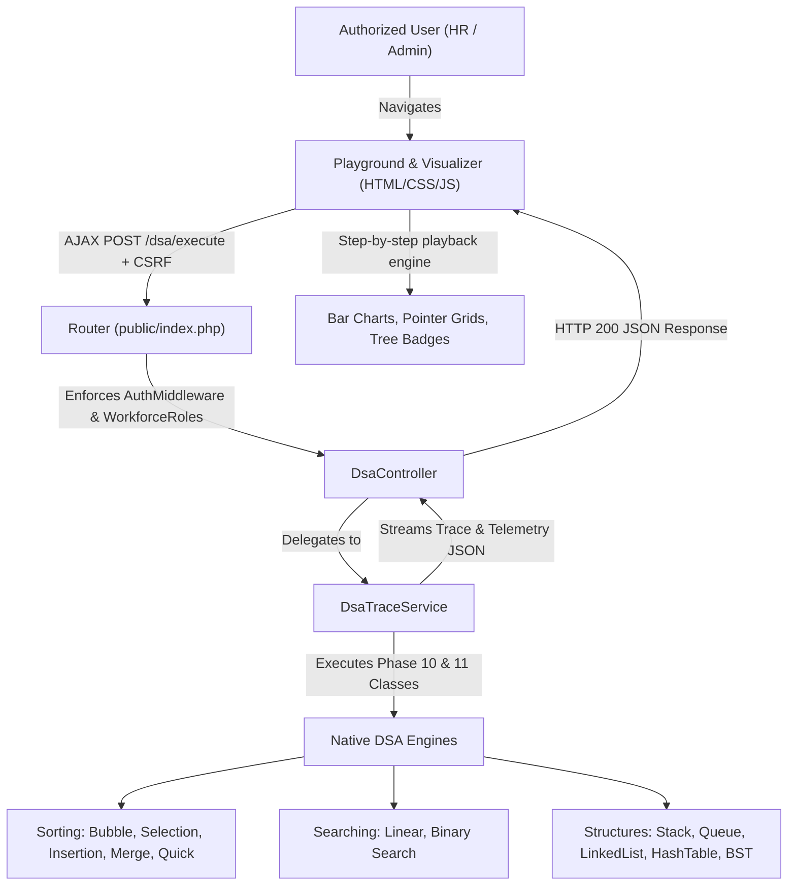

# Phase 12 — DSA Laboratory & Interactive Visualization Studio

## 1. Executive Summary & Architecture Overview

The **DSA Laboratory & Interactive Visualization Studio** delivers a demonstration-ready workbench integrated directly into the Employee HRIS & Leave Management System. Designed for stakeholders, engineers, and students, it visualizes native PHP data structures and algorithms in real time without synthetic client-side simulations.



---

## 2. Supported Topics & Capabilities

The studio supports all twelve (12) core algorithms and data structures implemented across Phases 10, 11, and 12:

| Category | Topic | Engine Class | Primary Operations / Observables |
| :--- | :--- | :--- | :--- |
| **Sorting** | Bubble Sort | `App\Dsa\Algorithms\BubbleSort` | Early-exit flag, pairwise adjacent comparisons, swaps |
| **Sorting** | Selection Sort | `App\Dsa\Algorithms\SelectionSort` | Minimum selection scans, sorted boundary partition swaps |
| **Sorting** | Insertion Sort | `App\Dsa\Algorithms\InsertionSort` | Key selection, backward shifts, sorted prefix insertion |
| **Sorting** | Merge Sort | `App\Dsa\Algorithms\MergeSort` | Divide-and-conquer, sub-array bounds, buffer merges |
| **Sorting** | Quick Sort | `App\Dsa\Algorithms\QuickSort` | Lomuto partitioning, pivot selection, recursion bounds |
| **Searching** | Linear Search | `App\Dsa\Algorithms\LinearSearch` | Sequential scan, match indices, comparison count |
| **Searching** | Binary Search | `App\Dsa\Algorithms\BinarySearch` | Interval halving, `low`/`mid`/`high` pointer tracks, pre-sorting invariant |
| **Structures** | Stack (LIFO) | `App\Dsa\Structures\Stack` | `push`, `pop`, `peek`, `clear`, top pointer tracking |
| **Structures** | Queue (FIFO) | `App\Dsa\Structures\Queue` | `enqueue`, `dequeue`, `peek`, `clear`, front/rear tracking |
| **Structures** | Linked List | `App\Dsa\Structures\LinkedList` | `append`, `prepend`, `remove`, `find`, node pointer linkage |
| **Structures** | Hash Table | `App\Dsa\Structures\HashTable` | `set`, `get`, `containsKey`, `remove`, bucket hashing |
| **Structures** | Binary Search Tree | `App\Dsa\Structures\BinarySearchTree` | `insert`, `search`, `delete`, In-Order, Pre-Order, Post-Order traversals |

---

## 3. Security, Authorization & Safeguards

1. **Role-Based Access Control (RBAC):**
   - Access to `/dsa`, `/dsa/visualizer`, and `POST /dsa/execute` is strictly restricted to authenticated HR and Administrator roles (`$workforceRoles` = `['hr', 'admin']`).
   - Self-service Employee users attempting to access these routes receive immediate HTTP 403 Forbidden redirection.
2. **CSRF Protection:**
   - Every execution request over `POST /dsa/execute` verifies the session's anti-forgery token via `CsrfMiddleware` (accepting `X-CSRF-Token` headers or `_csrf_token` body fields).
3. **Execution Guardrails:**
   - **Input Truncation:** Datasets are bounded to a maximum of 30 elements (`MAX_INPUT_SIZE = 30`) to protect server memory and browser rendering performance.
   - **Trace Cap:** Recorded traces are capped at 500 steps (`MAX_TRACE_STEPS = 500`) to prevent denial-of-service from infinite loops or excessively large states.
   - **Type Sanitization:** Inputs are coerced strictly to numeric types or sanitized strings.

---

## 4. API Specification

### Endpoint: `POST /dsa/execute`

**Headers:**
```http
Content-Type: application/json
Accept: application/json
X-CSRF-Token: <token>
```

**Payload Schema:**
```json
{
  "category": "sort",
  "topic": "quick",
  "input": [42, 17, 89, 5, 23, 64, 11, 78, 36, 50],
  "_csrf_token": "<token>"
}
```

**Response Schema (Sorting Example):**
```json
{
  "success": true,
  "algorithm": "quick",
  "original": [42, 17, 89, 5, 23, 64, 11, 78, 36, 50],
  "sorted": [5, 11, 17, 23, 36, 42, 50, 64, 78, 89],
  "steps": [
    { "type": "init", "state": [42, 17, ...], "message": "Initial array state loaded." },
    { "type": "partition_pivot", "pivot_index": 9, "pivot_value": 50, "state": [...], "message": "..." },
    { "type": "compare", "indices": [0, 9], "values": [42, 50], "state": [...], "message": "..." }
  ],
  "stats": {
    "comparisons": 25,
    "swaps": 11,
    "elapsed_ms": 0.124,
    "step_count": 38
  },
  "complexity": {
    "name": "Quick Sort",
    "best": "O(n log n)",
    "avg": "O(n log n)",
    "worst": "O(n²)",
    "space": "O(log n)",
    "notes": "Median-of-three pivot with recursion bounded to smaller partition. Non-stable."
  }
}
```

