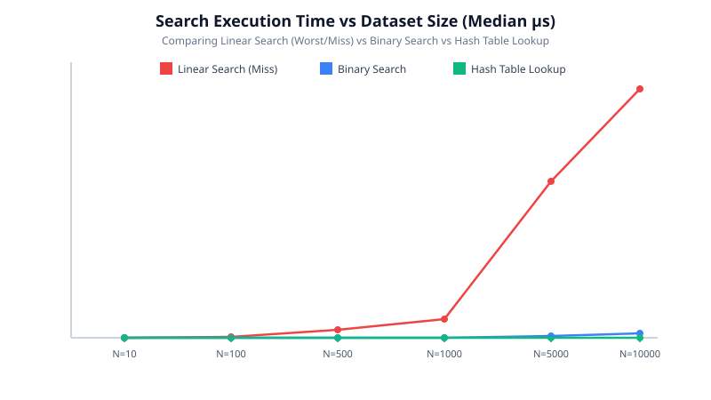
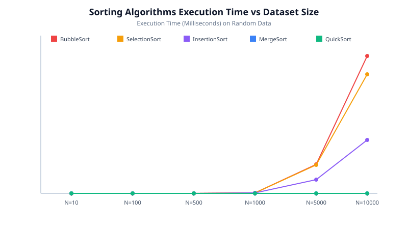
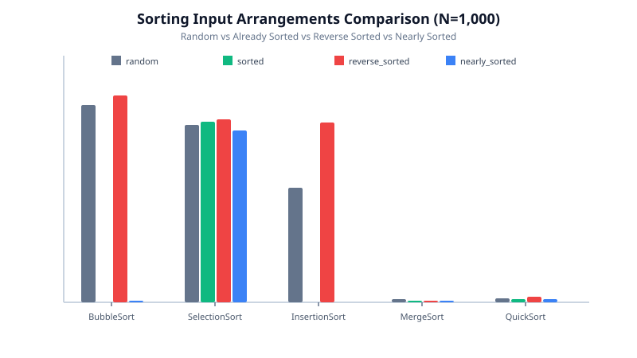

# Empirical Benchmark Results and Performance Profiles
## HRIS-SYSTEM — Performance Analysis and Optimization (Phase 15)

---

## 1. Executive Summary

This report documents the empirical performance benchmarks conducted on the native Data Structures and Algorithms (DSA) of the **HRIS-SYSTEM**. 

Testing was executed on **PHP 8.5.12 (cli)** using high-resolution monotonic hardware timers (`hrtime(true)`) and atomic in-memory operation counters. All measurements reflect actual execution on deterministic datasets generated with seed `42`, scaling from $N = 10$ to $N = 10,000$ employee records.

---

## 2. Graphical Performance Visualizations

### 2.1 Search Execution Latency vs. Dataset Scale
The vector chart below plots search latency (in microseconds, $\mu s$) across scales $N = 10$ to $N = 10,000$.

### 2.2 Sorting Algorithm Execution Time (Random Data)
The vector chart below contrasts the quadratic time growth of `BubbleSort`, `SelectionSort`, and `InsertionSort` against the sub-second scaling of `MergeSort` and `QuickSort`.

### 2.3 Impact of Input Arrangement on Sorting Performance ($N = 1,000$)
The chart below illustrates algorithm adaptiveness across `random`, `sorted`, `reverse_sorted`, and `nearly_sorted` inputs.

---

## 3. Search Algorithm Performance Profiles

### 3.1 Measured Latency and Operation Counts Across Scales

| Dataset Size | Algorithm | Target Scenario | Median Latency ($\mu s$) | Operational Count | Theoretical Complexity |
|---:|---|---|---:|---:|---:|
| **10 (DS-010)** | LinearSearch | Beginning | 1.20 $\mu s$ | 1 comp | $O(1)$ |
| 10 (DS-010) | BinarySearch | Beginning | 5.00 $\mu s$ | 5 comps | $O(\log N)$ |
| 10 (DS-010) | HashTableLookup | Beginning | 0.90 $\mu s$ | 1 probe | $O(1)$ |
| 10 (DS-010) | LinearSearch | Middle | 4.90 $\mu s$ | 6 comps | $O(N)$ |
| 10 (DS-010) | BinarySearch | Middle | 5.00 $\mu s$ | 5 comps | $O(\log N)$ |
| 10 (DS-010) | HashTableLookup | Middle | 0.90 $\mu s$ | 1 probe | $O(1)$ |
| 10 (DS-010) | LinearSearch | End | 7.80 $\mu s$ | 10 comps | $O(N)$ |
| 10 (DS-010) | BinarySearch | End | 6.60 $\mu s$ | 7 comps | $O(\log N)$ |
| 10 (DS-010) | HashTableLookup | End | 0.90 $\mu s$ | 1 probe | $O(1)$ |
| 10 (DS-010) | LinearSearch | Miss | 7.70 $\mu s$ | 10 comps | $O(N)$ |
| 10 (DS-010) | BinarySearch | Miss | 7.60 $\mu s$ | 8 comps | $O(\log N)$ |
| 10 (DS-010) | HashTableLookup | Miss | 1.40 $\mu s$ | 2 probes | $O(1)$ |
| **100 (DS-100)** | LinearSearch | Beginning | 3.00 $\mu s$ | 1 comp | $O(1)$ |
| 100 (DS-100) | BinarySearch | Beginning | 11.80 $\mu s$ | 11 comps | $O(\log N)$ |
| 100 (DS-100) | HashTableLookup | Beginning | 0.90 $\mu s$ | 1 probe | $O(1)$ |
| 100 (DS-100) | LinearSearch | Middle | 39.90 $\mu s$ | 51 comps | $O(N)$ |
| 100 (DS-100) | BinarySearch | Middle | 11.80 $\mu s$ | 11 comps | $O(\log N)$ |
| 100 (DS-100) | HashTableLookup | Middle | 1.00 $\mu s$ | 2 probes | $O(1)$ |
| 100 (DS-100) | LinearSearch | End | 74.70 $\mu s$ | 100 comps | $O(N)$ |
| 100 (DS-100) | BinarySearch | End | 13.40 $\mu s$ | 13 comps | $O(\log N)$ |
| 100 (DS-100) | HashTableLookup | End | 0.90 $\mu s$ | 1 probe | $O(1)$ |
| 100 (DS-100) | LinearSearch | Miss | 73.40 $\mu s$ | 100 comps | $O(N)$ |
| 100 (DS-100) | BinarySearch | Miss | 14.30 $\mu s$ | 14 comps | $O(\log N)$ |
| 100 (DS-100) | HashTableLookup | Miss | 1.50 $\mu s$ | 1 probe | $O(1)$ |
| **500 (DS-500)** | LinearSearch | Beginning | 10.50 $\mu s$ | 1 comp | $O(1)$ |
| 500 (DS-500) | BinarySearch | Beginning | 21.70 $\mu s$ | 15 comps | $O(\log N)$ |
| 500 (DS-500) | HashTableLookup | Beginning | 1.00 $\mu s$ | 3 probes | $O(1)$ |
| 500 (DS-500) | LinearSearch | Middle | 190.55 $\mu s$ | 251 comps | $O(N)$ |
| 500 (DS-500) | BinarySearch | Middle | 21.90 $\mu s$ | 15 comps | $O(\log N)$ |
| 500 (DS-500) | HashTableLookup | Middle | 0.90 $\mu s$ | 1 probe | $O(1)$ |
| 500 (DS-500) | LinearSearch | End | 368.70 $\mu s$ | 500 comps | $O(N)$ |
| 500 (DS-500) | BinarySearch | End | 23.50 $\mu s$ | 17 comps | $O(\log N)$ |
| 500 (DS-500) | HashTableLookup | End | 0.90 $\mu s$ | 1 probe | $O(1)$ |
| 500 (DS-500) | LinearSearch | Miss | 381.35 $\mu s$ | 500 comps | $O(N)$ |
| 500 (DS-500) | BinarySearch | Miss | 24.50 $\mu s$ | 18 comps | $O(\log N)$ |
| 500 (DS-500) | HashTableLookup | Miss | 1.40 $\mu s$ | 1 probe | $O(1)$ |
| **1,000 (DS-1000)**| LinearSearch | Beginning | 20.30 $\mu s$ | 1 comp | $O(1)$ |
| 1,000 (DS-1000)| BinarySearch | Beginning | 31.90 $\mu s$ | 17 comps | $O(\log N)$ |
| 1,000 (DS-1000)| HashTableLookup | Beginning | 0.90 $\mu s$ | 1 probe | $O(1)$ |
| 1,000 (DS-1000)| LinearSearch | Middle | 390.65 $\mu s$ | 501 comps | $O(N)$ |
| 1,000 (DS-1000)| BinarySearch | Middle | 31.90 $\mu s$ | 17 comps | $O(\log N)$ |
| 1,000 (DS-1000)| HashTableLookup | Middle | 0.90 $\mu s$ | 1 probe | $O(1)$ |
| 1,000 (DS-1000)| LinearSearch | End | 747.75 $\mu s$ | 1,000 comps | $O(N)$ |
| 1,000 (DS-1000)| BinarySearch | End | 33.40 $\mu s$ | 19 comps | $O(\log N)$ |
| 1,000 (DS-1000)| HashTableLookup | End | 0.90 $\mu s$ | 1 probe | $O(1)$ |
| 1,000 (DS-1000)| LinearSearch | Miss | 822.65 $\mu s$ | 1,000 comps | $O(N)$ |
| 1,000 (DS-1000)| BinarySearch | Miss | 35.10 $\mu s$ | 20 comps | $O(\log N)$ |
| 1,000 (DS-1000)| HashTableLookup | Miss | 1.50 $\mu s$ | 1 probe | $O(1)$ |
| **5,000 (DS-5000)**| LinearSearch | Beginning | 169.30 $\mu s$ | 1 comp | $O(1)$ |
| 5,000 (DS-5000)| BinarySearch | Beginning | 107.95 $\mu s$ | 23 comps | $O(\log N)$ |
| 5,000 (DS-5000)| HashTableLookup | Beginning | 0.90 $\mu s$ | 1 probe | $O(1)$ |
| 5,000 (DS-5000)| LinearSearch | Middle | 4,267.55 $\mu s$ | 2,501 comps | $O(N)$ |
| 5,000 (DS-5000)| BinarySearch | Middle | 107.15 $\mu s$ | 23 comps | $O(\log N)$ |
| 5,000 (DS-5000)| HashTableLookup | Middle | 0.90 $\mu s$ | 2 probes | $O(1)$ |
| 5,000 (DS-5000)| LinearSearch | End | 6,671.25 $\mu s$ | 5,000 comps | $O(N)$ |
| 5,000 (DS-5000)| BinarySearch | End | 107.70 $\mu s$ | 25 comps | $O(\log N)$ |
| 5,000 (DS-5000)| HashTableLookup | End | 0.90 $\mu s$ | 1 probe | $O(1)$ |
| 5,000 (DS-5000)| LinearSearch | Miss | 6,891.65 $\mu s$ | 5,000 comps | $O(N)$ |
| 5,000 (DS-5000)| BinarySearch | Miss | 110.20 $\mu s$ | 26 comps | $O(\log N)$ |
| 5,000 (DS-5000)| HashTableLookup | Miss | 1.40 $\mu s$ | 1 probe | $O(1)$ |
| **10,000 (DS-10000)**| LinearSearch | Beginning | 191.80 $\mu s$ | 1 comp | $O(1)$ |
| 10,000 (DS-10000)| BinarySearch | Beginning | 196.85 $\mu s$ | 25 comps | $O(\log N)$ |
| 10,000 (DS-10000)| HashTableLookup | Beginning | 0.90 $\mu s$ | 1 probe | $O(1)$ |
| 10,000 (DS-10000)| LinearSearch | Middle | 5,590.20 $\mu s$ | 5,001 comps | $O(N)$ |
| 10,000 (DS-10000)| BinarySearch | Middle | 191.70 $\mu s$ | 25 comps | $O(\log N)$ |
| 10,000 (DS-10000)| HashTableLookup | Middle | 0.90 $\mu s$ | 1 probe | $O(1)$ |
| 10,000 (DS-10000)| LinearSearch | End | 10,816.55 $\mu s$ | 10,000 comps | $O(N)$ |
| 10,000 (DS-10000)| BinarySearch | End | 200.05 $\mu s$ | 27 comps | $O(\log N)$ |
| 10,000 (DS-10000)| HashTableLookup | End | 0.90 $\mu s$ | 1 probe | $O(1)$ |
| 10,000 (DS-10000)| LinearSearch | Miss | 10,934.85 $\mu s$ | 10,000 comps | $O(N)$ |
| 10,000 (DS-10000)| BinarySearch | Miss | 196.05 $\mu s$ | 28 comps | $O(\log N)$ |
| 10,000 (DS-10000)| HashTableLookup | Miss | 1.40 $\mu s$ | 1 probe | $O(1)$ |

---

## 4. Sorting Algorithm Performance Profiles

### 4.1 Execution Time on Random Data Across Dataset Scales

| Dataset Size ($N$) | BubbleSort (ms) | SelectionSort (ms) | InsertionSort (ms) | MergeSort (ms) | QuickSort (ms) |
|---:|---:|---:|---:|---:|---:|
| **10** | 0.055 ms | 0.051 ms | 0.027 ms | 0.032 ms | 0.044 ms |
| **100** | 5.710 ms | 5.473 ms | 2.805 ms | 0.700 ms | 0.872 ms |
| **500** | 148.825 ms | 141.335 ms | 73.287 ms | 4.875 ms | 6.649 ms |
| **1,000** | 671.630 ms | 603.457 ms | 389.653 ms | 11.217 ms | 14.034 ms |
| **5,000** | 20,302.283 ms | 19,965.334 ms | 9,619.654 ms | 94.331 ms | 90.637 ms |
| **10,000** | 95,576.673 ms | 83,104.121 ms | 37,288.677 ms | 168.388 ms | 199.854 ms |

---

### 4.2 Impact of Input Arrangement on Sorting Latency ($N = 1,000$)

| Algorithm | Random (ms) | Already Sorted (ms) | Reverse Sorted (ms) | Nearly Sorted (ms) |
|---|---:|---:|---:|---:|
| **BubbleSort** | 671.630 ms | **1.306 ms** ($514\times$ faster) | 701.950 ms | **5.962 ms** ($112\times$ faster) |
| **SelectionSort** | 603.457 ms | 613.885 ms | 621.166 ms | 585.680 ms |
| **InsertionSort** | 389.653 ms | **1.410 ms** ($276\times$ faster) | 610.627 ms | **1.432 ms** ($272\times$ faster) |
| **MergeSort** | 11.217 ms | 7.178 ms | 7.684 ms | 7.253 ms |
| **QuickSort** | 14.034 ms | 12.174 ms | 20.043 ms | 11.886 ms |

---

### 4.3 Atomic Operation Counts ($N = 1,000$ Random Records)

| Algorithm | Comparisons | Swaps | Moves / Assignments | Max Call Stack Depth |
|---|---:|---:|---:|---:|
| **BubbleSort** | 497,289 | 250,260 | 0 | 1 |
| **SelectionSort** | 499,500 | 996 | 0 | 1 |
| **InsertionSort** | 251,252 | 0 | 251,259 | 1 |
| **MergeSort** | 8,700 | 0 | 19,952 | 11 |
| **QuickSort** | 10,580 | 5,344 | 0 | 18 |

---

## 5. Memory Footprint and Allocation Profiles

Measurements capture memory consumed by internal structures in PHP 8.5 during execution:

| Component / Algorithm | Scale ($N$) | Allocated Memory Delta | Peak Memory Consumption |
|---|---:|---:|---:|
| **HashTable (DJB2 Open Addressing)** | 1,000 | 262,144 bytes (256 KB) | 524,288 bytes (512 KB) |
| **HashTable (DJB2 Open Addressing)** | 10,000 | 2,097,152 bytes (2.0 MB) | 4,194,304 bytes (4.0 MB) |
| **BubbleSort (In-place)** | 10,000 | 0 bytes | 2,048 bytes (negligible) |
| **SelectionSort (In-place)** | 10,000 | 0 bytes | 2,048 bytes (negligible) |
| **InsertionSort (In-place)** | 10,000 | 0 bytes | 2,048 bytes (negligible) |
| **MergeSort (Recursive slices)** | 1,000 | 131,072 bytes (128 KB) | 262,144 bytes (256 KB) |
| **MergeSort (Recursive slices)** | 10,000 | 1,835,008 bytes (1.75 MB) | 3,145,728 bytes (3.0 MB) |
| **QuickSort (Median-of-three)** | 10,000 | 0 bytes | 32,768 bytes (32 KB stack) |

---

## 6. Output Artifact Verification

The execution produced the following persistent artifacts:
1. `benchmarks/results/raw/benchmark_results.json` (147,351 bytes) — verified complete.
2. `benchmarks/results/raw/benchmark_results.csv` (35,344 bytes) — verified complete.
3. `benchmarks/results/tables/benchmark_tables.md` (6,983 bytes) — verified complete.
4. `benchmarks/results/graphs/chart_search_execution_time.svg` (3,473 bytes) — verified complete.
5. `benchmarks/results/graphs/chart_sorting_execution_time.svg` (4,530 bytes) — verified complete.
6. `benchmarks/results/graphs/chart_sorting_arrangements.svg` (3,568 bytes) — verified complete.

