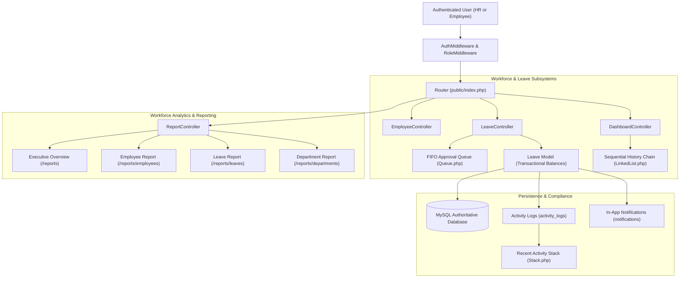

# Phase 13 — System Integration, Reports, Audit Logging & Notifications

## 1. System Architecture Overview

Phase 13 establishes the cohesive operational integration across all HRIS sub-systems: Authentication, Employee Workforce Directory, Leave Management, Transactional Balances, FIFO Approval Queues, Audit Activity Logging, Real-Time Notifications, and Organizational Reporting.

---

## 2. Integrated Workflows & Invariants

### A. Employee Leave Filing Workflow
1. User identity derived strictly from authenticated session (`Session::get('user')['employee_id']`).
2. Verification that the employee record exists and is in `'Active'` status (`employment_status = 'Active'`). Deactivated accounts cannot file leave requests.
3. Server-side validation of leave classification, date boundaries, and business working days (`LeaveCalculator`).
4. Overlapping leave detection against any non-cancelled and non-rejected filings.
5. Verification of available remaining quota and pending reservations.
6. Atomic insertion of request with status `'Pending'`.
7. Immediate activity log record (`LEAVE_REQUESTED`) and in-app notification dispatch for HR review.

### B. HR Leave Approval & FIFO Review Queue Workflow
1. Authoritative pending requests are enqueued into a deterministic FIFO queue (`LeaveApprovalQueueService`), ordered by `applied_at ASC, id ASC`.
2. HR can inspect the queue depth and next-in-line applicant directly in the Review Queue view (`/leaves`).
3. Quick-approval action (`POST /leaves/queue/next`) dequeues the head item and executes the atomic transaction:
   - Locks records via `FOR UPDATE`.
   - Verifies request is still `'Pending'`.
   - Re-checks employee active status, leave type active status, and remaining balance.
   - Atomically updates request to `'Approved'`, increments `used_days`, and decrements `remaining_days`.
   - Writes `activity_logs` entry (`LEAVE_APPROVED`).
   - Writes durable `notifications` record for the applicant employee.
   - Commits transaction.
   - Triggers post-commit external transport delivery (WebSocket/email) without double-deduction risks.

### C. HR Rejection Workflow
1. Rejection records the provided justification reason.
2. Status transitions to `'Rejected'`.
3. Balance remains completely untouched (no deduction).
4. Activity log (`LEAVE_REJECTED`) and notification records are committed atomically.

### D. Audit Activity Logging
1. Centralized logging via `ActivityLog` model.
2. Captures user ID, action type, description, entity type, entity ID, client IP address, and user agent.
3. Strict exclusion of credentials, plain passwords, session tokens, or OTP codes.
4. LIFO Stack integration (`RecentActivityStackService`) provides instant top-of-stack inspection on the `/activity-logs` dashboard.

### E. In-App Notifications
1. Stored in `notifications` table with recipient `user_id`, title, message, type, read status, and timestamps.
2. Ownership-scoped queries prevent IDOR (`WHERE user_id = :user_id`).
3. Mark-as-read updates enforce that users cannot mark other accounts' alerts.

---

## 3. Dedicated Reporting Endpoints

| Endpoint | Target Audience | Primary Functionality & Filters |
| :--- | :--- | :--- |
| **`GET /reports`** | HR / Admin | Executive overview KPI cards, department workforce distribution, and annual leave type utilization. |
| **`GET /reports/employees`** | HR / Admin | Full personnel directory audit with filters for department, position, active/inactive employment status, date-hired range, text search, and pagination. |
| **`GET /reports/leaves`** | HR / Admin | Absence utilization report with filters for request status (Approved, Pending, Rejected, Cancelled), leave classification, department, employee, schedule date range, and pagination. |
| **`GET /reports/departments`** | HR / Admin | Department directory with headcount breakdowns (active vs. inactive), assigned positions, total leave applications, and approved leave days taken. |

